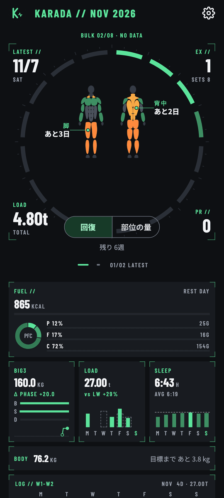
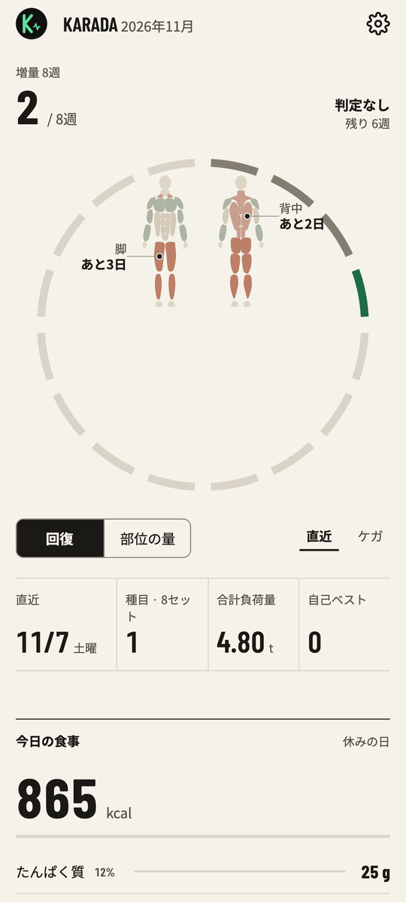
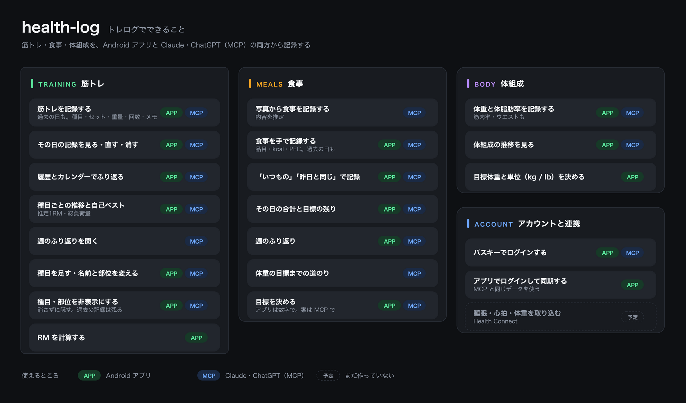
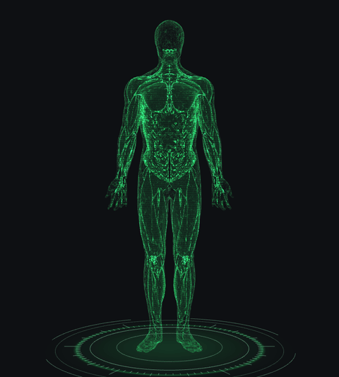
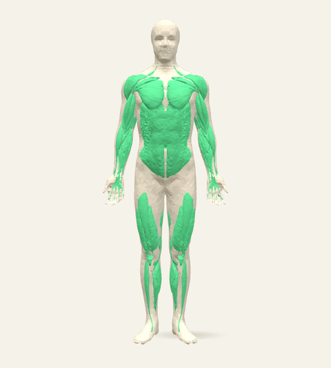
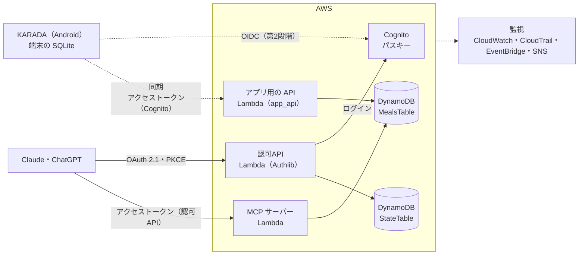
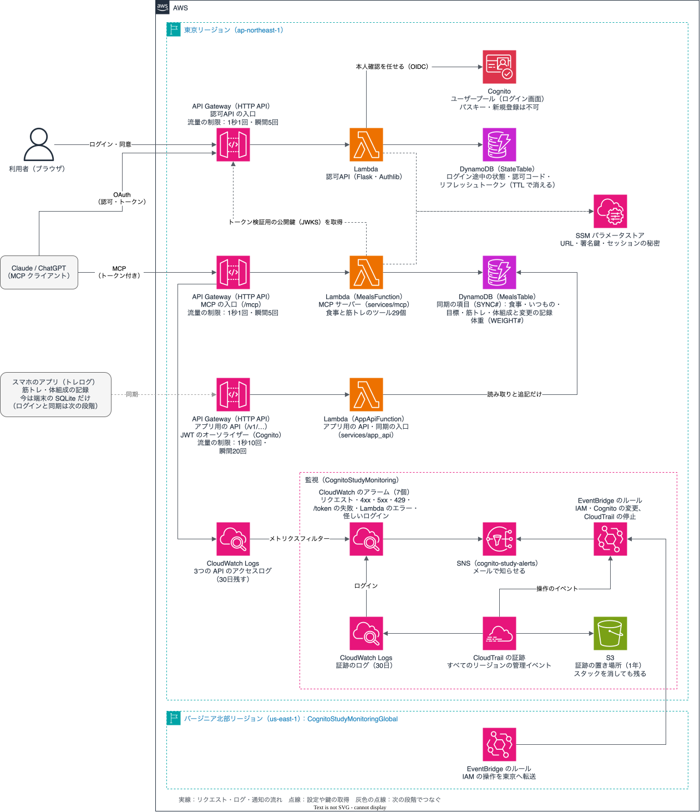

<p align="center">
  
  &nbsp;&nbsp;
  
</p>

<h1 align="center">KARADA</h1>

<p align="center">
  <b>筋トレ・食事・体組成を、1 つの「体」に集める。</b><br>
  Android のアプリと、Claude・ChatGPT（MCP）から、同じ記録を扱う。
</p>

<p align="center">
  <a href="https://github.com/ykitaza/health-log/actions/workflows/test.yml"></a>
  <a href="https://github.com/ykitaza/health-log/actions/workflows/eas-update.yml"></a>
</p>

<p align="center">
  <sub>左：HUD（暗い計器の見た目）／右：クラシック（紙の記録帳の見た目）。どちらも設定で切り替えられます。<br>
  画像は E2E の画面（web 版・サンプルのデータ）です。web 版の体は 2D で、Android では 3D になります。</sub>
</p>

---

## health-log とは

筋トレ・食事・体組成の記録を、Android のアプリ「KARADA」（旧名 hlog、トレログ）と、Claude・ChatGPT（MCP）の両方から扱うためのリポジトリです（旧名 meal-log-mcp）。
サーバーは AWS（API Gateway、Lambda、DynamoDB、Cognito のパスキー）にあり、アプリ用の API と、食事・筋トレ・レポートのツールを持つ MCP サーバーを動かします。
MCP の認可には、Authlib で書いた OAuth 2.1 の認可サーバー（認可API）を置いています。
アプリとサーバーの同期の仕組み、監視、CI/CD も同じリポジトリにあります。

## できること



図の APP はアプリ、MCP は Claude・ChatGPT から使えることです。

| 使うところ | できること |
|---|---|
| Android アプリ（KARADA） | 筋トレの記録（過去の日も。種目・セット・前回の記録）、総負荷量と推定1RM、履歴とグラフ、自己ベスト、種目の編集、ケガの記録と振り返り、フェーズ（増量・減量・維持・療養）、体組成の記録と推移、Health Connect からの取り込み（体重計・睡眠・心拍・歩数）、食事の記録（手で入力・いつもの・昨日と同じ）と目標の残り・週のふり返り、RM計算機、レポート（日・週・月のまとめ）を読む、CSV の書き出し。記録は先に端末に保存し、ログインするとサーバーと同期する（[画面ごとの説明](apps/mobile/README.md#できること)） |
| Claude・ChatGPT（MCP） | 食事の記録（写真から AI が推定）、目標と今日の残り、週のふり返り、筋トレと体組成の記録・推移・週のふり返り、睡眠・心拍・歩数のまとめ、ケガの記録と振り返り、フェーズ（増量・減量・維持・療養。アプリで宣言したもの）を読む、期間の材料をまとめて読む、まとめ（レポート）の保存（アプリのホームとレポートのタブで読める）。ツールは45個（[頼み方とツールの一覧](docs/mcp.md)） |

写真の解析や栄養の推定は Claude・ChatGPT の AI が行い、サーバーは記録と、決まった式での計算だけを受け持ちます。
アプリと MCP は同じデータを使います（アプリはパスキーでログインして同期）。アプリが Health Connect から取り込んだ体重計・睡眠・心拍（1日のまとめ）・歩数（1日の合計）も、同期で MCP から見えます。

## 2 つの見た目

設定の「表示」で切り替えられます（選ぶと、確かめてからアプリを開き直します）。記録も機能も同じで、変わるのは見た目だけです。

| HUD | クラシック |
|---|---|
| ほぼ黒の地にミント 1 色の、計器の盤。回復中は暖色、ケガは赤。ホームは英字の見出し（`LATEST //` など） | 生成りの紙に墨の、紙の記録帳。見出しは日本語で、四隅の数字は体の下の帳の 1 行に下りる |

## 3D の体

ホームの中心は、体の図です。回復の色（回復済み・回復中・ケガ）や、部位ごとの量を、体の上に直接重ねて見せます。Android では three.js と expo-gl で描く 3D の体で、ケガの画面、からだのタブ、筋トレの記録にも出ます。web 版と描けないときは 2D の図になります。

<table>
  <tr>
    <td align="center"><br><sub>HUD：ホログラム</sub></td>
    <td align="center"><br><sub>クラシック：つや消し</sub></td>
  </tr>
</table>

体の形は [BodyParts3D](https://dbarchive.biosciencedbc.jp/en/bodyparts3d/desc.html) をもとに、筋肉を 36 の部品にまとめ、頂点を減らして作っています（作り方と手を入れた点は [apps/mobile/assets/models/README.md](apps/mobile/assets/models/README.md)）。

## Claude・ChatGPT から使う（MCP）

MCP に対応したチャットに、カスタムコネクタとして登録して使います。写真や言葉で食事を伝えると、AI が品目と栄養を推定し、サーバーが記録と、決まった式での計算（目標、総負荷量、推定1RM など）を受け持ちます。保存したまとめ（レポート）は、アプリのホームとレポートのタブで読めます。

- つなぎ方、頼み方の例、ツールの一覧：[docs/mcp.md](docs/mcp.md)
- ログイン（OAuth 2.1・PKCE）からツール呼び出しまでの流れ：[docs/sequence.md](docs/sequence.md)

## アーキテクチャ



入口はどれも API Gateway の HTTP API です。細かい構成図は次のとおりです。左下の緑の線が、開発者の変更が AWS とスマホに届くまでの流れです（[サーバーの CD](docs/cd.md)、[アプリの配信](apps/mobile/docs/eas.md)）。



<details>
<summary>フォルダの役割</summary>

| フォルダ | 役割 |
|---|---|
| `apps/mobile/` | Android アプリ「KARADA」（Expo、expo-router、SQLite）（[README](apps/mobile/README.md)） |
| `services/authorization/` | 認可API（Flask・Authlib）。OAuth 2.1 の認可サーバー。Cognito でログインさせ、MCP サーバーだけに使えるアクセストークンを出す |
| `services/mcp/` | MCP サーバーの組み立て。食事・筋トレ・レポートのツールを1つのコネクタにまとめる |
| `services/meals/` | 食事記録（パッケージ `meals`。MCP のツール、目標の計算、同期の種類） |
| `services/training/` | 筋トレと体組成（MCP のツール、計算、同期の種類） |
| `services/reports/` | レポート（Claude・ChatGPT が書いたまとめ。MCP のツール、同期の種類） |
| `services/sync/` | 同期の共通の部品（変更の記録、今の状態への当てはめ） |
| `services/app_api/` | アプリ用の API の組み立て（同期と目標の案） |
| `services/composition/` | MCP とアプリ用の API で共有する組み立て |
| `cdk/` | AWS の構成（CDK）（[README](cdk/README.md)） |
| `docs/` | 構成図、シーケンス図、設計、同期、監視、CD の説明、アプリ用の API の仕様（`docs/api/app-api.yaml`） |
| `testdata/training/` | アプリとサーバーの計算が同じかを確かめるデータ |
| `tools/inspector/` | MCP Inspector で試すときの CIMD の文書 |
| `tools/body-model/` | 3D の体（`apps/mobile/assets/models/body.glb`）の手直しを作り直すスクリプト（[README](apps/mobile/assets/models/README.md)） |
| `.github/` | CI（テスト）、サーバーのデプロイ、アプリの配信（EAS）、Dependabot の設定 |

</details>

<details>
<summary>AWS のスタック</summary>

AWS のスタックは4つに分かれています。

| まとまり | リージョン | 中身 |
|---|---|---|
| 本体 | ap-northeast-1 | Cognito、認可API と MCP サーバー（食事と筋トレ）とアプリ用の API の API Gateway・Lambda・DynamoDB |
| 監視 | ap-northeast-1 | アラーム、CloudTrail、EventBridge、SNS。本体のあとに作られる |
| 監視（us-east-1） | us-east-1 | IAM の操作を東京に転送する EventBridge のルール |
| CI/CD | ap-northeast-1 | GitHub Actions から入るための OIDC の ID プロバイダーと、差分用・デプロイ用のロール。ワークフローからはデプロイせず、手でデプロイする（[サーバーの CD](docs/cd.md)） |

</details>

スタックの名前とデプロイの手順は [サーバーの CD](docs/cd.md) にあります。

## 開発

詳しくは [docs/development.md](docs/development.md) と [apps/mobile/README.md](apps/mobile/README.md) にあります。

```sh
# サーバーを PC で動かす（先に setup-local.sh で services/authorization/.env を作る）
(cd services/authorization && uv run flask --app main run --port 3000) &
(cd services/mcp && PYTHONPATH=../composition uv run python main.py) &   # http://localhost:8001/mcp

# テスト
for s in authorization meals sync training app_api mcp; do (cd services/$s && uv run pytest); done
(cd cdk && npm ci && npx tsc --noEmit && npm test)
(cd apps/mobile && npm ci && npx tsc --noEmit && npx jest)

# アプリ（Expo）を動かす（ブラウザで見るときは npx expo start --web）
(cd apps/mobile && npx expo start)
```

アプリの画面の E2E テスト（Playwright）は [apps/mobile/e2e/README.md](apps/mobile/e2e/README.md) にあります。

## デプロイ

- サーバー（AWS）：初めてのデプロイと GitHub Actions からのデプロイは [docs/cd.md](docs/cd.md)、AWS の構成のコマンドは [cdk/README.md](cdk/README.md)
- アプリ：EAS Update で JS の変更を Pixel に配信します（[apps/mobile/docs/eas.md](apps/mobile/docs/eas.md)）

<details>
<summary>文書の一覧</summary>

| 文書 | 中身 |
|---|---|
| [docs/mcp.md](docs/mcp.md) | Claude・ChatGPT へのつなぎ方、頼み方の例、MCP のツールの一覧、アプリと MCP の記録が重なったときの決まり |
| [docs/development.md](docs/development.md) | PC で動かす、テスト、フォルダごとの開発、図の書き出し |
| [docs/cd.md](docs/cd.md) | 初めてのデプロイ、GitHub Actions からのデプロイ、アプリの配信、片付け |
| [apps/mobile/README.md](apps/mobile/README.md) | アプリの画面、動かし方、テスト |
| [apps/mobile/docs/eas.md](apps/mobile/docs/eas.md) | Pixel への配信（EAS） |
| [cdk/README.md](cdk/README.md) | AWS の構成（CDK）のコマンド |
| [docs/design.md](docs/design.md) | 背景、制限、全体の設計、パスキー（作る・なくしたとき・消す）、アプリのログイン |
| [docs/meals-design.md](docs/meals-design.md) | 食事記録の設計 |
| [docs/sync-design.md](docs/sync-design.md) | アプリとサーバーの同期の設計、今あるデータの移行 |
| [docs/sequence.md](docs/sequence.md) | ログインからツールの呼び出し、アプリの同期の流れ（シーケンス図） |
| [docs/monitoring.md](docs/monitoring.md) | 監視、通知が来たときに見るもの、メールの購読の足し方 |
| [docs/api/app-api.yaml](docs/api/app-api.yaml) | アプリ用の API の仕様（OpenAPI） |

</details>

## クレジットとライセンス

3D の体のデータは BodyParts3D をもとにしています。

> BodyParts3D, © [The Database Center for Life Science](https://dbarchive.biosciencedbc.jp/en/bodyparts3d/desc.html) licensed under [CC Attribution 4.0 International](https://creativecommons.org/licenses/by/4.0/)

- 元のデータ：BodyParts3D 4.0（DOI：[10.18908/lsdba.nbdc00837-000](https://doi.org/10.18908/lsdba.nbdc00837-000)）
- 公式のライセンスのページ：<https://dbarchive.biosciencedbc.jp/en/bodyparts3d/lic.html>
- 筋肉の部品へのまとめ、頂点の削減、皮膚の手直しなどの改変をしています（[apps/mobile/assets/models/README.md](apps/mobile/assets/models/README.md)）。アプリでは、ケガの画面に出典とリンクを出しています

このリポジトリのコードのライセンスは、まだ決めていません（`LICENSE` ファイルはありません）。
