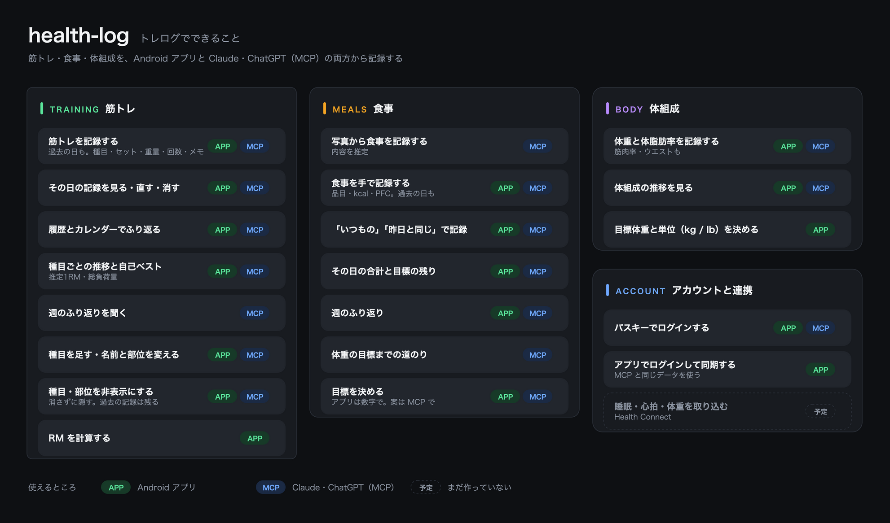
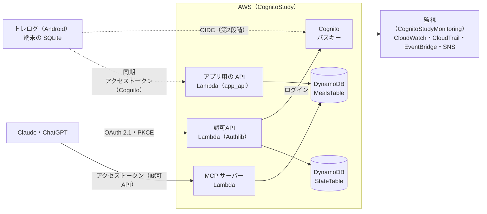
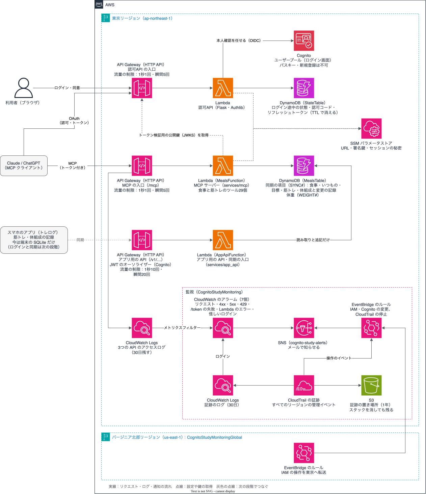

# health-log

筋トレ・食事・体組成の記録を、Android のアプリ「トレログ」と、Claude・ChatGPT（MCP）の両方から扱うためのリポジトリです（旧名 meal-log-mcp）。
サーバーは AWS（API Gateway、Lambda、DynamoDB、Cognito のパスキー）にあり、アプリ用の API と、食事と筋トレのツールを持つ MCP サーバーを動かします。
MCP の認可には、Authlib で書いた OAuth 2.1 の認可サーバー（認可API）を置いています。
アプリとサーバーの同期の仕組み、監視、CI/CD も同じリポジトリにあります。

## できること

図の APP はアプリ、MCP は Claude・ChatGPT から使えること、予定はまだ作っていないことです。

| 使うところ | できること |
|---|---|
| Android アプリ（トレログ） | 筋トレの記録（過去の日も。種目・セット・前回の記録）、総負荷量と推定1RM、履歴とグラフ、自己ベスト、種目の編集、体組成の記録と推移、食事の記録（手で入力・いつもの・昨日と同じ）と目標の残り・週のふり返り、RM計算機、CSV の書き出し。記録は先に端末に保存し、ログインするとサーバーと同期する（[画面ごとの説明](apps/mobile/README.md#できること)） |
| Claude・ChatGPT（MCP） | 食事の記録（写真から AI が推定）、目標と今日の残り、週のふり返り、筋トレと体組成の記録・推移・週のふり返り。ツールは30個（[頼み方とツールの一覧](docs/mcp.md)） |

写真の解析や栄養の推定は Claude・ChatGPT の AI が行い、サーバーは記録と、決まった式での計算だけを受け持ちます。
アプリと MCP は同じデータを使います（アプリはパスキーでログインして同期）。Health Connect からの取り込み（睡眠・心拍・体重計）は、これから入れる予定です。

## アーキテクチャ

入口はどれも API Gateway の HTTP API です。細かい構成図は次のとおりです。

| フォルダ | 役割 |
|---|---|
| `apps/mobile/` | Android アプリ「トレログ」（Expo、expo-router、SQLite）（[README](apps/mobile/README.md)） |
| `services/authorization/` | 認可API（Flask・Authlib）。OAuth 2.1 の認可サーバー。Cognito でログインさせ、MCP サーバーだけに使えるアクセストークンを出す |
| `services/mcp/` | MCP サーバーの組み立て。食事と筋トレのツールを1つのコネクタにまとめる |
| `services/meals/` | 食事記録（パッケージ `meals`。MCP のツール、目標の計算、同期の種類） |
| `services/training/` | 筋トレと体組成（MCP のツール、計算、同期の種類） |
| `services/sync/` | 同期の共通の部品（変更の記録、今の状態への当てはめ） |
| `services/app_api/` | アプリ用の API の組み立て（同期と目標の案） |
| `services/composition/` | MCP とアプリ用の API で共有する組み立て |
| `cdk/` | AWS の構成（CDK）（[README](cdk/README.md)） |
| `docs/` | 構成図、シーケンス図、設計、同期、監視、CD の説明、アプリ用の API の仕様（`docs/api/app-api.yaml`） |
| `testdata/training/` | アプリとサーバーの計算が同じかを確かめるデータ |
| `tools/inspector/` | MCP Inspector で試すときの CIMD の文書 |
| `.github/` | CI（テスト）、サーバーのデプロイ、アプリの配信（EAS）、Dependabot の設定 |

AWS のスタックは4つです。

| スタック | リージョン | 中身 |
|---|---|---|
| `CognitoStudy` | ap-northeast-1 | Cognito、認可API と MCP サーバー（食事と筋トレ）とアプリ用の API の API Gateway・Lambda・DynamoDB |
| `CognitoStudyMonitoring` | ap-northeast-1 | 監視（アラーム、CloudTrail、EventBridge、SNS）。`CognitoStudy` のあとに作られる |
| `CognitoStudyMonitoringGlobal` | us-east-1 | IAM の操作を東京に転送する EventBridge のルール |
| `CognitoStudyCiCd` | ap-northeast-1 | GitHub Actions から入るための OIDC の ID プロバイダーと、差分用・デプロイ用のロール。ワークフローからはデプロイせず、手でデプロイする（[サーバーの CD](docs/cd.md)） |

## 文書

| 文書 | 中身 |
|---|---|
| [docs/mcp.md](docs/mcp.md) | Claude・ChatGPT へのつなぎ方、頼み方の例、MCP のツールの一覧、アプリと MCP の記録が重なったときの決まり |
| [docs/development.md](docs/development.md) | PC で動かす、テスト、フォルダごとの開発、図の書き出し |
| [docs/cd.md](docs/cd.md) | 初めてのデプロイ、GitHub Actions からのデプロイ、アプリの配信、片付け |
| [apps/mobile/README.md](apps/mobile/README.md) | アプリの画面、動かし方、テスト |
| [apps/mobile/docs/eas.md](apps/mobile/docs/eas.md) | Pixel への配信（EAS） |
| [cdk/README.md](cdk/README.md) | AWS の構成（CDK）のコマンド |
| [docs/design.md](docs/design.md) | 背景、制限、全体の設計、パスキー（作る・なくしたとき・消す）、アプリのログイン |
| [docs/meals-design.md](docs/meals-design.md) | 食事記録の設計 |
| [docs/sync-design.md](docs/sync-design.md) | アプリとサーバーの同期の設計、今あるデータの移行 |
| [docs/sequence.md](docs/sequence.md) | ログインからツールの呼び出し、アプリの同期の流れ（シーケンス図） |
| [docs/monitoring.md](docs/monitoring.md) | 監視、通知が来たときに見るもの、メールの購読の足し方 |
| [docs/api/app-api.yaml](docs/api/app-api.yaml) | アプリ用の API の仕様（OpenAPI） |
