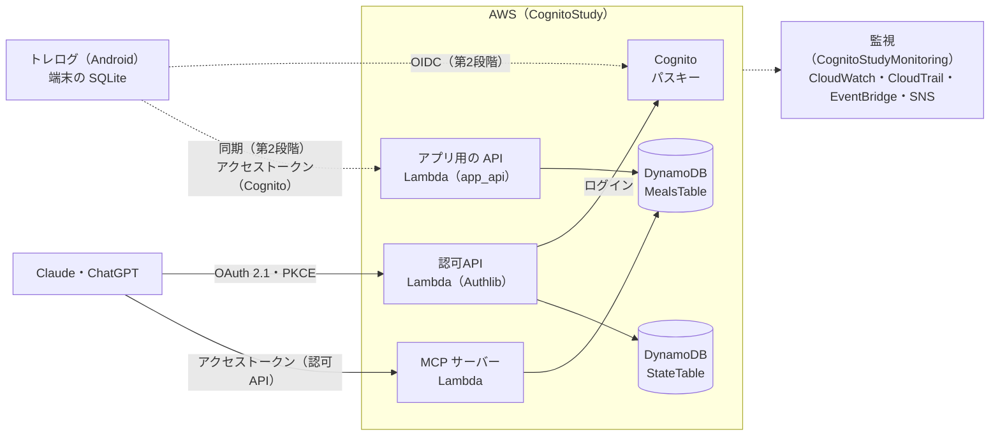

# health-log

筋トレ・食事・体組成の記録を、Android のアプリ「トレログ」と、Claude・ChatGPT（MCP）の両方から扱うためのリポジトリです（旧名 meal-log-mcp）。
サーバーは AWS（API Gateway、Lambda、DynamoDB、Cognito のパスキー）にあり、アプリ用の API と、食事と筋トレのツールを持つ MCP サーバーを動かします。
MCP の認可には、Authlib で書いた OAuth 2.1 の認可サーバー（認可API）を置いています。
アプリとサーバーの同期の仕組み、監視、CI/CD も同じリポジトリにあります。

## できること

### Android アプリ（トレログ）

今は第1段階で、記録は端末の SQLite にだけ保存します。通信がなくても使えますが、サーバーとはまだつながりません。アプリを消すと記録も消えるので、残したいときは設定から CSV で書き出します。
動かし方と配信は [apps/mobile/README.md](apps/mobile/README.md) にあります。

| 画面 | できること |
|---|---|
| ホーム | 合計負荷量（7日間・28日間・総合計）、今日の記録と推定1RM。「本日のトレーニングを追加」と RM計算機への入口 |
| トレーニング（その日の記録） | その日の種目の一覧（種目数・セット数・合計負荷量）。種目の追加、↑↓ での並べ替え、種目を押して記録を直す・消す |
| 種目を選ぶ | 検索、部位で絞る、部位ごとの一覧、種目ごとの前回の記録。種目の追加 |
| 記録の入力 | セットごとの重量・回数・完了。前回の記録の表示とコピー、上のセットのコピー、セットの追加、元に戻す |
| 履歴／分析 | 月のカレンダー（部位・種目で絞る）、種目ごとの総負荷量と推定1RM のグラフ、週ごとの総負荷量、種目ごとの自己ベスト（推定1RM） |
| 体組成 | 日ごとに体重・体脂肪率・筋肉率・ウエストを入れる。BMI などの計算（身長を設定したとき）、目標体重までの残り、1か月の体重の推移 |
| 体組成の推移 | 項目ごとの推移のグラフと記録の一覧 |
| RM計算機 | 重量と回数から推定1RM（重量 ×（1 ＋ 回数 ÷ 30））と、割合ごとの重量・回数の目安 |
| 種目と部位の管理 | 種目と部位の追加。使わなくなった種目は消さずに非表示にする（記録は残る） |
| 設定 | 重さの単位（kg・lb）、セット数の初期値、身長と目標体重、筋トレの記録の CSV の書き出し |
| 食事 | 準備中（タブだけあり、第2段階で使えるようにする） |

予定（第2段階。まだ入っていません）：

- Cognito にパスキーでログインし、サーバーと同期する。端末に先に保存し、つながったときに変更を送り合う（サーバーの側はデプロイ済み）
- 食事の記録と目標（MCP の食事記録と同じデータを使う）
- 体重計の記録の取り込み（Health Connect）

### Claude・ChatGPT（MCP）

MCP に対応したチャットに、カスタムコネクタとして登録して使います。写真の解析や栄養の推定は Claude・ChatGPT の AI が行い、サーバーは記録と、決まった式での計算（目標、週のまとめ、総負荷量、推定1RM など）だけを受け持ちます。サーバーはデータ（JSON）だけを返し、表やグラフはチャットの側が作ります。

#### 食事の頼み方

| 頼み方 | 起きること |
|---|---|
| 写真を貼って「昼ごはん」 | AI が料理と量を推定して表で見せ、了承を得てから記録する |
| 「朝はいつもの」「昨日の夜と同じ」 | 保存した組み合わせや前の食事を、確認なしで記録する |
| 「今日あと何を食べればいい？」 | 今日の合計と、目標までの残り（kcal・PFC）を返す |
| 「今週の食事をふり返って」 | 日ごとの kcal の推移と、PFC の割合を、表やグラフで見せる |
| 「目標を決めたい」 | 方針（増量・減量・維持）だけでも決められる。体重や身長を答えると、kcal と PFC の目標を計算する |
| 「体重 70kg」「目標まであとどれくらい？」 | 体重を記録し、最近のペースから目標体重までの週数を出す |
| 「さっきのご飯、量を半分に」 | 記録を直す（消すこともできる） |

写真は保存しません。保存するのは、AI が写真から読み取った説明文と栄養の推定値だけです。
その日に筋トレの記録があれば、食事の目標は自動で「筋トレの日」の目標になります（「今日は休みの日の目標にして」と言えば、そちらを優先します）。

#### 筋トレの頼み方

| 頼み方 | 起きること（ツール） |
|---|---|
| 「今日のベンチプレス 80kg 8回を3セット、懸垂10回」 | その日に記録し、総負荷量と自己ベストを超えたかを返す（`record_workout`） |
| 「今日のトレーニングを見せて」「11月の記録」 | 1日の記録（`get_workout`）、期間の一覧（`list_workouts`） |
| 「2セット目は6回だった」「スクワットは消して」「昨日の分だった」 | 直す・消す・日を移す（`update_workout`、`delete_workout`） |
| 「ベンチプレスの伸びは？」 | 日ごとの総負荷量と推定1RM の推移、自己ベスト（`exercise_history`） |
| 「今週の筋トレをふり返って」 | 週の回数、総負荷量、部位ごとの割合（偏り）、前回からの日数、先週との比べ（`weekly_training_review`） |
| 「種目の一覧」「ケトルベルスイングを脚に足して」 | 部位と種目（`list_exercises`、`add_exercise`） |
| 「体脂肪率 15%」「体組成の推移」 | 体組成の記録と推移（`record_body`、`body_progress`） |

- 計算（総負荷量、推定1RM、自己ベスト、体脂肪量など）はアプリと同じ式で、`testdata/training/*.json` で両方が同じ結果になることを確かめています
- 種目は名前で指します。「ベンチ」のように略すと、サーバーは推測で選ばず、候補（「ベンチプレス」など）を返します

#### ツールの一覧

1つのコネクタに、次の29個が並びます。

| 分類 | ツール | 説明 |
|---|---|---|
| 食事 | `record_meal` | 食事を1回分記録する（推定した内容を見せ、了承を得てから） |
| 食事 | `record_meals` | 複数の食事を一度に記録する（写真をまとめて貼られたとき） |
| 食事 | `copy_meal` | 記録済みの食事を別の日時に複製する（「昨日と同じ」） |
| 食事 | `save_template` | 記録済みの食事に名前を付けて「いつもの」として保存する |
| 食事 | `record_template` | 「いつもの」を名前で記録する |
| 食事 | `get_meal` | 食事を1件、品目ごとに返す |
| 食事 | `list_meals` | 期間（366日まで）の食事を返す。区分で絞れる |
| 食事 | `update_meal` | 食事を直す（量、品目の追加・削除、日時と区分） |
| 食事 | `delete_meal` | 食事を消す |
| 食事 | `today_status` | その日の合計・目標・残り |
| 食事 | `weekly_review` | 7日間のふり返り |
| 食事 | `record_weight` | 体重を記録する（体組成の手入力の記録として残す） |
| 食事 | `goal_progress` | 直近90日の体重の推移と、目標体重までの週数 |
| 食事 | `goal_questions` | 目標を決めるときに聞く項目と、今の目標を返す |
| 食事 | `suggest_goals` | 方針と体のデータから目標の案を計算する（保存はしない） |
| 食事 | `set_goals` | 目標を保存する |
| 食事 | `set_day_type` | その日を筋トレの日か休みの日にする |
| 筋トレ | `record_workout` | その日に種目とセット（重量・回数・メモ）を足す |
| 筋トレ | `get_workout` | その日の筋トレを、総負荷量・推定1RM・自己ベストを超えたかと一緒に返す |
| 筋トレ | `list_workouts` | 期間（366日まで）の筋トレをした日と、日ごとの種目・セット数・総負荷量 |
| 筋トレ | `update_workout` | セットの重量・回数・メモを変える、セットや種目を消す、日を移す |
| 筋トレ | `delete_workout` | その日の記録を、種目ごとか全部消す |
| 筋トレ | `exercise_history` | 種目ごとの総負荷量と推定1RM の推移、自己ベスト |
| 筋トレ | `weekly_training_review` | 週（日曜始まり）の筋トレのふり返り |
| 筋トレ | `list_exercises` | 部位と種目の一覧（アプリと同じもの） |
| 筋トレ | `add_exercise` | 種目を足す（アプリにも出る） |
| 筋トレ | `record_body` | 体組成（体重・体脂肪率・筋肉率・ウエスト）を記録する |
| 筋トレ | `body_progress` | 体組成の推移と、体脂肪量・除脂肪量、体重の週あたりの変化 |
| その他 | `logout` | ログアウトする（別のアカウントで入り直すとき、連携をやめるとき） |

食事のツールは `services/meals/meals/presentation/mcp_server.py`、筋トレのツールは `services/training/training/presentation/mcp_tools.py`、`logout` は `services/mcp/connector/tools.py` にあります。

#### つなぎ方

`cdk deploy` の出力 `MealsMcpServerUrl`（末尾が `/mcp`）を、Claude・ChatGPT にコネクタとして登録します。
登録すると認可API のログイン画面が開き、Cognito のパスキーでログインして、同意画面で許可します（OAuth 2.1、PKCE）。手順は下の [Claude・ChatGPT につなぐ](#claudechatgpt-につなぐ) にあります。

### アプリと MCP で同じデータを使う

アプリから送られた記録も MCP から書いた記録も、サーバーの同じ「変更の記録」を通り、同じ「今の状態」になります。同じ人かどうかは Cognito の `sub` で決まります。
アプリの同期は第2段階で入れるので、今はアプリで記録した分は MCP からは見えません。MCP の筋トレのツールは、応答に `last_app_sync_at`（アプリから最後に同期で受け付けた時刻）を付けています。

同じ記録を両方で変えたときは、項目ごとに次の順で強い方が残ります（[同期の設計](docs/sync-design.md#今の状態への当てはめ)）。

1. 手入力（アプリ・MCP）は、Health Connect などの取り込みより強い
2. 変えた時刻が新しい方（端末の時計が進んでいても、受け付けた時刻で切る）
3. 時刻が同じなら、あとに受け付けた方

違う項目を変えたときは両方が残ります。削除と変更がぶつかったときは削除が勝ちます。

## 構成

| フォルダ | 役割 |
|---|---|
| `apps/mobile/` | Android アプリ「トレログ」（Expo、expo-router、SQLite）（[README](apps/mobile/README.md)） |
| `services/authorization/` | 認可API（Flask・Authlib）。OAuth 2.1 の認可サーバー。Cognito でログインさせ、MCP サーバーだけに使えるアクセストークンを出す |
| `services/mcp/` | MCP サーバーの組み立て。食事と筋トレのツールを1つのコネクタにまとめる |
| `services/meals/` | 食事記録（パッケージ `meals`。MCP のツール、目標の計算、同期の種類） |
| `services/training/` | 筋トレと体組成（MCP のツール、計算、同期の種類） |
| `services/sync/` | 同期の共通の部品（変更の記録、今の状態への当てはめ） |
| `services/app_api/` | アプリ用の API の組み立て（同期と目標の案） |
| `services/composition/` | MCP とアプリ用の API で共有する組み立て |
| `cdk/` | AWS の構成（CDK）（[README](cdk/README.md)） |
| `docs/` | 構成図、シーケンス図、設計、同期、監視、CD の説明、アプリ用の API の仕様（`docs/api/app-api.yaml`） |
| `testdata/training/` | アプリとサーバーの計算が同じかを確かめるデータ |
| `tools/inspector/` | MCP Inspector で試すときの CIMD の文書 |
| `.github/` | CI（テスト）、サーバーのデプロイ、アプリの配信（EAS）、Dependabot の設定 |

AWS のスタックは4つです。

| スタック | リージョン | 中身 |
|---|---|---|
| `CognitoStudy` | ap-northeast-1 | Cognito、認可API と MCP サーバー（食事と筋トレ）とアプリ用の API の API Gateway・Lambda・DynamoDB |
| `CognitoStudyMonitoring` | ap-northeast-1 | 監視（アラーム、CloudTrail、EventBridge、SNS）。`CognitoStudy` のあとに作られる |
| `CognitoStudyMonitoringGlobal` | us-east-1 | IAM の操作を東京に転送する EventBridge のルール |
| `CognitoStudyCiCd` | ap-northeast-1 | GitHub Actions から入るための OIDC の ID プロバイダーと、差分用・デプロイ用のロール。ワークフローからはデプロイせず、手でデプロイする（[サーバーの CD](docs/cd.md)） |

## 全体の図



入口はどれも API Gateway の HTTP API です。細かい構成図は次のとおりです。


- 入口には、どれにも流量の制限を付けています（認可API と MCP は1秒1回・瞬間5回、スマホアプリ用の API は、アプリが使い始めるまで1秒2回・瞬間10回）
- 認可API が Cognito でログインさせ、同意を得てから、この MCP サーバーだけに使えるアクセストークンを出します。ログインはパスキーで、パスワードはパスキーを作るときだけ使います（[パスキー](docs/design.md#パスキー)）
- アプリは Cognito に直接 OIDC でつなぎ、アプリ用の API で変更の記録を送り合って同期します（[同期の設計](docs/sync-design.md)、[アプリ用の API](docs/api/app-api.yaml)、[アプリのログイン](docs/design.md#スマホアプリトレログのログイン)）
- 怪しいアクセスや異常（4xx・5xx・429 の急増、ルートや MFA なしのログイン、IAM・Cognito の変更など）を検知してメールで知らせます（[監視](docs/monitoring.md)）
- ログインからツールの呼び出しまでの流れと、アプリの同期の流れは [シーケンス図](docs/sequence.md)、設計の考え方は [全体の設計](docs/design.md) と [食事記録の設計](docs/meals-design.md) にあります

図の元は `docs/architecture.drawio` です。直したら、draw.io のデスクトップ版の CLI で SVG を書き出し直します（図を埋め込むので、SVG も draw.io で開けます）。

```sh
/Applications/draw.io.app/Contents/MacOS/draw.io -x -f svg --embed-diagram -o docs/architecture.drawio.svg docs/architecture.drawio
```

## 使い始め方

### デプロイする

AWS の認証情報は、環境変数（`AWS_PROFILE` など）で指定しておきます。
初めてのときは手でデプロイします。2回目からは GitHub Actions から行います（下の [デプロイ](#デプロイ)）。

us-east-1 にもスタックがあるので、初めてのときは、東京と us-east-1 の両方に CDK の bootstrap をします（1回だけ）。

```sh
cd cdk && npx cdk bootstrap aws://<アカウント ID>/ap-northeast-1 aws://<アカウント ID>/us-east-1
```

```sh
cd cdk && ./build-lambda.sh && npx cdk deploy --all
../services/authorization/setup-local.sh   # PC で認可API を動かすときの services/authorization/.env を書く（ユーザーは作らない）
```

初めてのときは、本人のユーザーを管理者の操作で作り、そのユーザーのパスキーを作って、パスワードを捨てます（[パスキーを作る手順](docs/design.md#パスキーを作る手順)）。
パスワードでログインできるテスト用のユーザーは作りません。
パスキーをなくしたときは、[パスキーをなくしたとき](docs/design.md#パスキーをなくしたとき)の手順で作り直します。

すでにデプロイしてあって、同期の仕組みを入れる前の記録があるときは、**デプロイの前に**移行のスクリプトを動かします（[今あるデータの移行](docs/sync-design.md#今あるデータの移行)）。

通知のメールは、デプロイのあとに SNS のトピックへ購読を足すと届きます（[監視](docs/monitoring.md#デプロイとメールの購読の足し方)）。

### Claude・ChatGPT につなぐ

`cdk deploy` の出力 `MealsMcpServerUrl`（末尾が `/mcp`）を登録します。

- Claude：「設定 → コネクタ → カスタムコネクタを追加」に URL を入れます。OAuth クライアントは「Claude の公開アイデンティティを使用」のままにします
- ChatGPT：開発者モードでアプリを作成し、URL を入れて認証方式に OAuth を選びます

登録するとログイン画面が開くので、上のユーザーで「パスキーでサインイン」を選んでログインし、同意画面で「許可する」を押します。
アクセストークンはこの MCP サーバー（食事と筋トレ）だけに使え、5分で切れます（切れたらリフレッシュトークンで更新します）。

**筋トレのツールを足す前につないだコネクタは、同意し直すまで筋トレのツールが使えません**（「許可がありません」と返ります。食事のツールはそのまま使えます）。
アクセストークンとリフレッシュトークンは、同意したときの scope（`meals:read`・`meals:write`）のままだからです。
コネクタの連携を解除して（または `logout` を頼んで）つなぎ直し、同意画面に筋トレの読み書きが出ていることを確かめて「許可する」を押します。URL は変わらないので、コネクタを登録し直す必要はありません。

### アプリを入れる

PC から Expo Go で動かす方法は [apps/mobile/README.md](apps/mobile/README.md)、Pixel に APK を入れる方法は [apps/mobile/docs/eas.md](apps/mobile/docs/eas.md) にあります。

## 開発・テスト

### PC で動かす

```sh
(cd services/authorization && uv run flask --app main run --port 3000) &
(cd services/mcp && PYTHONPATH=../composition uv run python main.py) &   # http://localhost:8001/mcp（記録はメモリーに置く。組み立ての共有は ../composition から読む）
```

先に `setup-local.sh` で `services/authorization/.env` を作っておきます（デプロイした Cognito を使います）。ログインには、本人のユーザーとパスキーを使います（ローカルの戻り先 `http://localhost:3000/cognito/callback` も Cognito に登録してあります）。
署名鍵とセッションの秘密は、初めて起動したときに `services/authorization/` に作られます（`.gitignore` 済み）。

スマホのアプリの動かし方は [apps/mobile/README.md](apps/mobile/README.md) にあります。

### テスト

```sh
for s in authorization meals sync training app_api mcp; do (cd services/$s && uv run pytest); done
(cd cdk && npm ci && npx tsc --noEmit && npm test)
(cd apps/mobile && npm ci && npx tsc --noEmit && npx jest)   # testdata/training/*.json で、アプリの計算がサーバーと同じかも確かめる
```

アプリの画面の E2E テストは [apps/mobile/e2e/README.md](apps/mobile/e2e/README.md) にあります。
PR と main への push では、GitHub Actions（`.github/workflows/test.yml`）が同じテストと E2E を動かします。

## デプロイ

- サーバー：GitHub Actions の deploy のワークフロー（`.github/workflows/deploy.yml`）から、`cdk diff` を見て承認をはさんでデプロイします。AWS には OIDC で入り、長期のアクセスキーは置きません（[サーバーの CD](docs/cd.md)）
- アプリ：EAS Build で APK を作り、JS の変更は EAS Update で配信します（Play ストアには出しません）。main の test が通ったあと、`apps/mobile/` が変わっていれば配信します（[EAS の手順](apps/mobile/docs/eas.md)）

## 片付け

`cdk destroy --all` で4つのスタックを消します。
次のものは、スタックを消しても残ります。

| 残るもの | 理由 | 消し方 |
|---|---|---|
| Cognito のユーザープール（`cognito-study`） | 削除の保護と RETAIN。ユーザーが消えると `sub` が変わり、記録がたどれなくなるため | コンソールで削除の保護を外してから消す |
| DynamoDB の `MealsTable`（記録）と `StateTable`（ログインの途中の状態、リフレッシュトークン） | 削除の保護と RETAIN。記録を守るため | コンソールで削除の保護を外してから消す |
| CloudTrail の証跡のバケット | RETAIN。証拠として残すため | 中身を消してから消す（[監視の片付け](docs/monitoring.md#片付け)） |
| Lambda のロググループ（`/aws/lambda/CognitoStudy-*`。90日で古いものから消える） | RETAIN（CDK の既定）。消したあとに調べられるように残す | 要らなければコンソールか `aws logs delete-log-group` で消す |
| SSM パラメータ（署名鍵とセッションの秘密） | 認可API が初回の起動で作り、スタックの外にあるため | 下のコマンド |

```sh
cd cdk && npx cdk destroy --all
# 認可APIが初回起動時に作った秘密の値（スタックとは別に残る）
aws ssm delete-parameters --names /cognito-study/authorization/signing-key /cognito-study/authorization/session-secret
```

## 背景

食生活を見直そうと思い、まずは記録から始めることにしました。
ただ、そのために食事記録のアプリを新しく入れるのは気が進まず、有料のものも多くあります。
普段から使っている Claude や ChatGPT なら、写真から料理と量を推定できます。
そこで、推定は AI に任せ、記録と集計だけをサーバーが受け持つ形にしました。サーバーは AI を呼ばないので、AI の利用料はかかりません。かかるのは Lambda・DynamoDB・API Gateway の従量課金だけです。
その後、筋トレと体組成をスマホでも記録したくなり、アプリ（トレログ）を足しました。

もう1つの目的は、MCP の認可（OAuth 2.1、CIMD、PKCE、リフレッシュトークン）を理解することです。
ログイン画面は Cognito に任せ、その前に認可API を置いています。
OAuth の中心（認可コード、PKCE、リフレッシュトークン、失効、JWT のアクセストークン）は保守されているライブラリ（Authlib）に任せ、
Authlib にない CIMD と RFC 8707（resource）、同意画面を自分で書いています。

## 制限

- 本人だけで使う前提です。ログイン画面からの新規登録はできません
- 栄養の値は AI の推定なので、だいたいの目安として使ってください
- `tools/inspector/` の CIMD の文書は localhost にあるので、Lambda の認可API からは取りに行けません（MCP Inspector で試せるのは PC で動かすときだけです）
