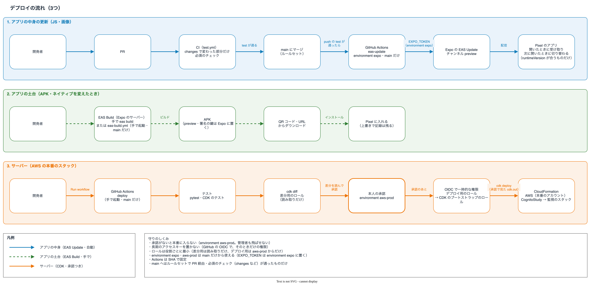

# サーバーの CD（GitHub Actions からのデプロイ）

サーバーのスタック（`CognitoStudy`、監視の `CognitoStudyMonitoring`・`CognitoStudyMonitoringGlobal`）を、GitHub Actions（`.github/workflows/deploy.yml`）からデプロイします。
初めてのときの手でのデプロイと、スタックの片付けもここに書きます。アプリの配信は [apps/mobile/docs/eas.md](../apps/mobile/docs/eas.md) にあります。

## 流れ



図の元は [architecture.drawio](architecture.drawio) のページ「デプロイの流れ」です。3つめの流れがこの文書の中身です。

手で起動する（Actions の画面で deploy を選び、main で Run workflow）→ テスト → `cdk diff` → environment `aws-prod` の承認 → `cdk deploy CognitoStudy` → `cdk deploy CognitoStudyMonitoring CognitoStudyMonitoringGlobal`

- 差分は、ジョブの Summary に出ます。承認する前に読みます
- 差分のジョブで合成したもの（`cdk.out`）を、承認のあとにそのままデプロイします。承認で見た差分と、デプロイするものが同じになります
- どちらのジョブも、AWS のアカウントが 969624666976 であることを確かめてから進みます
- 同時に2つは動きません（あとから起動したものは、前のものが終わるまで待ちます）

## AWS への入り方

長期のアクセスキーは置きません。GitHub の OIDC のトークンで、ロールを引き受けます。
ID プロバイダーとロールは、スタック `CognitoStudyCiCd`（`cdk/lib/cicd-stack.ts`）にあります。

| ロール | 使えるところ（トークンの `sub`） | できること |
|---|---|---|
| `health-log-github-diff` | `repo:ykitaza@104138874/health-log@1416443559:ref:refs/heads/main`（main のブランチのジョブで、environment なし） | 3つのスタックのテンプレートを読むことだけ（`cloudformation:DescribeStacks`・`GetTemplate`） |
| `health-log-github-deploy` | `repo:ykitaza@104138874/health-log@1416443559:environment:aws-prod`（承認のある environment のジョブ） | CDK のブートストラップの `deploy-role` と `file-publishing-role` を引き受けることだけ（東京と us-east-1） |

このリポジトリは、OIDC のトークンの sub に immutable subject（`repo:<owner>@<owner_id>/<name>@<repo_id>`）を使う設定です。リポジトリの名前を変えても ID の部分は変わりませんが、名前の部分は変わるので、名前を変えたら `cdk/bin/infra.ts` の `subjectPrefix` も直します。今の値は `gh api repos/ykitaza/health-log/actions/oidc/customization/sub` の `sub_claim_prefix` で確かめられます。

- どちらも `aud` は `sts.amazonaws.com` だけです。リポジトリは固定で、ワイルドカードは使いません
- `cdk diff --method template` は、ブートストラップの lookup ロールを引き受けようとします。lookup ロールは `ReadOnlyAccess`（DynamoDB の記録も読める）なので、差分用のロールには引き受けさせません。CDK は「Lookup role … was not assumed」と警告を出し、差分用のロールのままで続けます
- デプロイ用のロールから引き受ける `deploy-role` は、CloudFormation を通して何でも作れます（CDK のブートストラップの作り）。守りは environment の承認と、main だけから使えることです
- `CognitoStudyCiCd` 自身は、ワークフローからはデプロイしません。ロールの変更は手で行います

## 初めてのデプロイ

AWS の認証情報は、環境変数（`AWS_PROFILE` など）で指定しておきます。
初めてのときは手でデプロイします。2回目からは GitHub Actions から行います（上の「流れ」）。

us-east-1 にもスタックがあるので、初めてのときは、東京と us-east-1 の両方に CDK の bootstrap をします（1回だけ）。

```sh
cd cdk && npx cdk bootstrap aws://<アカウント ID>/ap-northeast-1 aws://<アカウント ID>/us-east-1
```

```sh
cd cdk && ./build-lambda.sh && npx cdk deploy --all
../services/authorization/setup-local.sh   # PC で認可API を動かすときの services/authorization/.env を書く（ユーザーは作らない）
```

初めてのときは、本人のユーザーを管理者の操作で作り、そのユーザーのパスキーを作って、パスワードを捨てます（[パスキーを作る手順](design.md#パスキーを作る手順)）。
パスワードでログインできるテスト用のユーザーは作りません。
パスキーをなくしたときは、[パスキーをなくしたとき](design.md#パスキーをなくしたとき)の手順で作り直します。

すでにデプロイしてあって、同期の仕組みを入れる前の記録があるときは、**デプロイの前に**移行のスクリプトを動かします（[今あるデータの移行](sync-design.md#今あるデータの移行)）。

通知のメールは、デプロイのあとに SNS のトピックへ購読を足すと届きます（[監視](monitoring.md#デプロイとメールの購読の足し方)）。

デプロイしたら、Claude・ChatGPT にコネクタを登録します（[MCP のつなぎ方](mcp.md#つなぎ方)）。

## 最初の準備（1回だけ）

### 1. CiCd のスタックを手でデプロイする

東京と us-east-1 の CDK の bootstrap が済んでいることが前提です（上の「[初めてのデプロイ](#初めてのデプロイ)」）。
GitHub の OIDC の ID プロバイダー（`token.actions.githubusercontent.com`）は、1つのアカウントに1つしか作れません。先にないことを確かめます。

```sh
aws iam list-open-id-connect-providers --profile yuki
cd cdk && AWS_PROFILE=yuki npx cdk diff CognitoStudyCiCd
AWS_PROFILE=yuki npx cdk deploy CognitoStudyCiCd
```

すでにあるときは、スタックで作らずに読み込む形に直してから進めます。

### 2. GitHub の environment `aws-prod` を作る

承認する人を自分にし、main のブランチからだけ使えるようにします。1人で使うので、自分の起動を自分で承認できるようにします（`prevent_self_review: false`）。管理者も承認を飛ばせないようにします。

```sh
export GH_TOKEN=$(gh auth token --user ykitaza)
gh api -X PUT repos/ykitaza/health-log/environments/aws-prod --input - <<EOF
{
  "wait_timer": 0,
  "prevent_self_review": false,
  "can_admins_bypass": false,
  "reviewers": [{ "type": "User", "id": $(gh api users/ykitaza --jq .id) }],
  "deployment_branch_policy": { "protected_branches": false, "custom_branch_policies": true }
}
EOF
gh api -X POST repos/ykitaza/health-log/environments/aws-prod/deployment-branch-policies -f name=main -f type=branch
```

environment に秘密の値は置きません（ロールの ARN は秘密ではないので、ワークフローに書いてあります）。

### 3. 動かしてみる

Actions の画面で deploy を main で起動します。diff のジョブの Summary で差分を見て、deploy のジョブの「Review deployments」で承認します。

## ロールを直すとき

`cdk/lib/cicd-stack.ts` を直し、PR でマージしてから、手でデプロイします。

```sh
cd cdk && AWS_PROFILE=yuki npx cdk diff CognitoStudyCiCd
AWS_PROFILE=yuki npx cdk deploy CognitoStudyCiCd
```

## アプリの配信

アプリは EAS Build で APK を作り、JS の変更は EAS Update で配信します（Play ストアには出しません）。main の test が通ったあと、`apps/mobile/` が変わっていれば配信します（[EAS の手順](../apps/mobile/docs/eas.md)）。

## 片付け

`cdk destroy --all` で4つのスタックを消します。
次のものは、スタックを消しても残ります。

| 残るもの | 理由 | 消し方 |
|---|---|---|
| Cognito のユーザープール（`cognito-study`） | 削除の保護と RETAIN。ユーザーが消えると `sub` が変わり、記録がたどれなくなるため | コンソールで削除の保護を外してから消す |
| DynamoDB の `MealsTable`（記録）と `StateTable`（ログインの途中の状態、リフレッシュトークン） | 削除の保護と RETAIN。記録を守るため | コンソールで削除の保護を外してから消す |
| CloudTrail の証跡のバケット | RETAIN。証拠として残すため | 中身を消してから消す（[監視の片付け](monitoring.md#片付け)） |
| Lambda のロググループ（`/aws/lambda/CognitoStudy-*`。90日で古いものから消える） | RETAIN（CDK の既定）。消したあとに調べられるように残す | 要らなければコンソールか `aws logs delete-log-group` で消す |
| SSM パラメータ（署名鍵とセッションの秘密） | 認可API が初回の起動で作り、スタックの外にあるため | 下のコマンド |

```sh
cd cdk && npx cdk destroy --all
# 認可APIが初回起動時に作った秘密の値（スタックとは別に残る）
aws ssm delete-parameters --names /cognito-study/authorization/signing-key /cognito-study/authorization/session-secret
```
