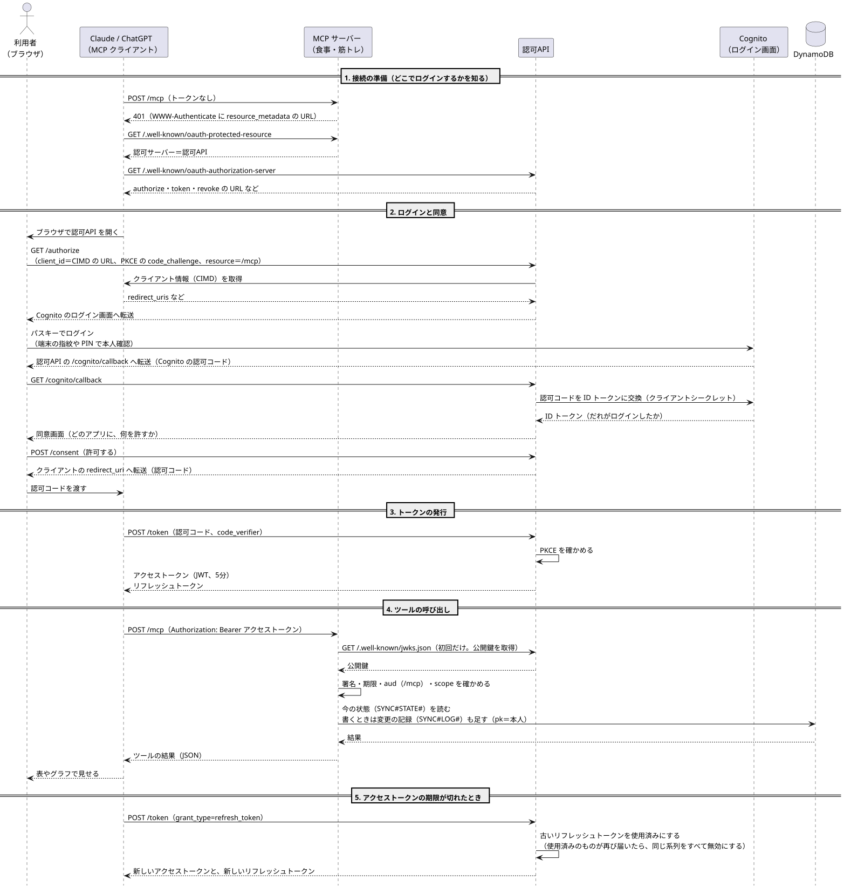
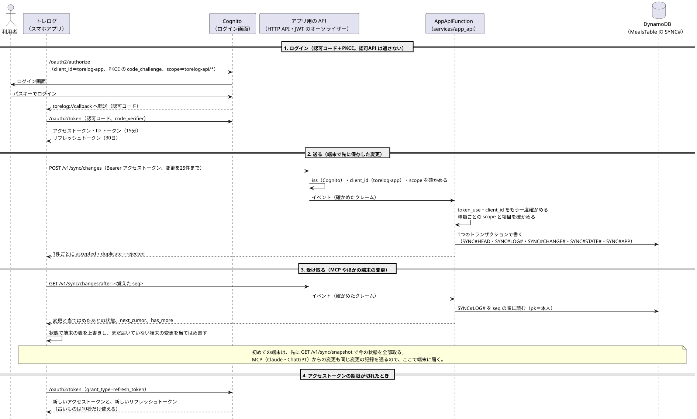

# シーケンス図

図の元は PlantUML（`sequence.puml`・`sequence-app.puml`）です。直したら、`plantuml -tsvg docs/sequence.puml docs/sequence-app.puml` で SVG を作り直します。

## MCP（Claude・ChatGPT）

Claude や ChatGPT が MCP サーバーにつながり、ツールを呼ぶまでの流れです。

1. **接続の準備**：クライアントは、MCP サーバーの 401 から「どの認可サーバーでログインするか」を知ります（RFC 9728、RFC 8414）
2. **ログインと同意**：本人確認は Cognito に任せ、どのアプリに何を許すかは認可API が同意画面で決めます。ログインはパスキーです（[パスキー](design.md#パスキー)）。クライアントは事前登録せず、client_id の URL から情報を取ります（CIMD）
3. **トークンの発行**：認可コードを渡したのと同じクライアントかを、PKCE で確かめます。認可コード・PKCE・トークンの発行は、認可API の中で Authlib が行います
4. **ツールの呼び出し**：MCP サーバーは、認可API の公開鍵でアクセストークンを確かめます。宛先（aud）が MCP サーバーでないトークンは受け付けません（RFC 8707）。食事のツールには `meals:read`・`meals:write` が要り（足りなければ 403）、筋トレのツールは `training:read`・`training:write` をツールごとに確かめます（[MCP サーバーの組み立て](design.md#mcp-サーバーの組み立て)）。記録は同期の仕組みの今の状態を読み、書くときは変更の記録を足します（[同期の設計](sync-design.md#mcp-からの書き込み)）
5. **期限切れ**：リフレッシュトークンは使うたびに新しくします。使用済みのものが再び届いたら、盗まれたとみなして同じ系列をすべて無効にします

## アプリの同期

スマホアプリ（トレログ）がログインし、サーバーと同期する流れです。サーバーの側はデプロイ済みで、アプリの側は次の段階で入れます。

1. **ログイン**：アプリは認可API を通さず、Cognito のアプリ用のクライアント（`torelog-app`、シークレットなし）に、認可コード＋PKCE でつなぎます（[スマホアプリのログイン](design.md#スマホアプリトレログのログイン)）
2. **送る**：API Gateway の JWT のオーソライザーが、issuer・クライアント・scope を確かめます。Lambda（`AppApiFunction`）は、クレームをもう一度確かめ、変更を1つのトランザクションで書きます。同じ `change_id` を送り直しても `duplicate` になります（[送信](sync-design.md#送信冪等)）
3. **受け取る**：カーソル（`seq`）より後の変更を、当てはめたあとの状態と一緒に受け取ります。MCP からの変更もここで届きます（[受け取り](sync-design.md#受け取りカーソル)）
4. **期限切れ**：アクセストークンは15分、リフレッシュトークンは30日で、使うたびに新しくなります
