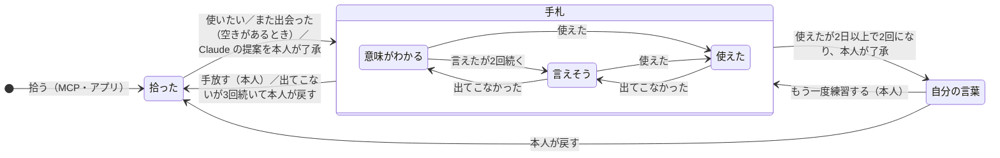
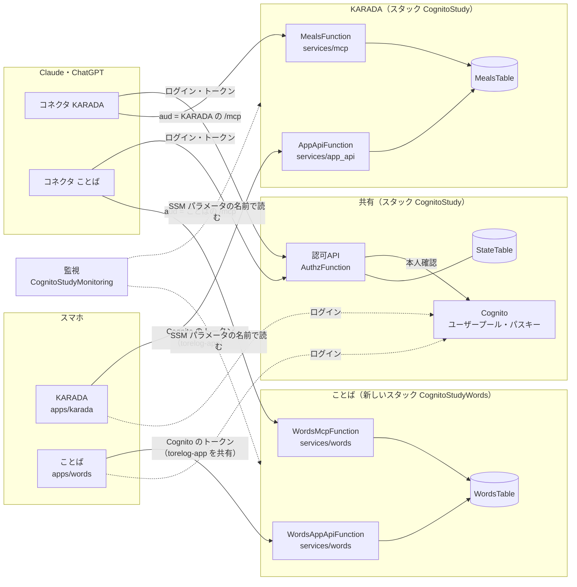

# ことば（言葉のアプリ）の設計メモ

本や会話で出会った日本語の表現を拾い、自分で「言える」ようにするための、新しいアプリ「ことば」（仮の名前。英語の作業名は words）の設計です。
KARADA と同じリポジトリに置き、ログイン・同期・CI/CD・監視は KARADA と共有します。MCP のサーバーとコネクタは KARADA と分けます。

まだ何も作っていません。この文書は、作り始める前に決めたことと、決めていないことをまとめたものです。
KARADA の全体の設計は [design.md](design.md)、同期は [sync-design.md](sync-design.md)、MCP は [mcp.md](mcp.md)、デプロイは [cd.md](cd.md) にあります。
KARADA のアプリのフォルダは `apps/karada` です（#279 で `apps/mobile` から名前を変えた）。

## 背景

本・Audible・Kindle・会話・動画や映画で「この言い方いいな」と思う表現に出会っても、書き留めないと忘れます。書き留めても、見返すだけでは話すときに出てきません。
目的は **話すときに使えること** です。日本語だけを扱います。

- 書き留めるのは、手が空いていない場面（運転中の Audible、読書中、会話のあと）が多いので、ふだん使っている Claude・ChatGPT のスマホのアプリに、声・ページの写真・Kindle のハイライトの共有で渡し、MCP で記録します。文字起こしと写真の読み取りは Claude・ChatGPT の AI がするので、アプリには音声認識も OCR も入れません（ネイティブのモジュールも足しません）。サーバーも AI を呼びません（KARADA と同じ方針）
- アプリには、文字で書き留める小さな入口だけを置きます
- 全部を覚えようとすると続かないので、覚える対象は「手札」の10個までに絞ります

## 決めたこと

- 日本語だけ。話すことを目的にする
- 書き留める主な入口は Claude・ChatGPT（MCP）。アプリは文字の入力だけ。アプリに音声認識・OCR は入れない
- 表現の置き場所は3つ：**拾った**（全部ここに入る。通知しない）、**手札**（言えるようになりたいもの。10個まで。通知はここだけ）、**自分の言葉**（使えるようになったもの）
- 手札に入る道は3つ：本人が「使いたい」を選ぶ、同じ表現にもう一度出会う（少し違う言い回しも含む）、Claude が振り返りで勧める
- 何度も出てこない、もう要らない、ときは拾ったに戻す。自動では何も消さない
- 手札の中の段階は **意味がわかる → 言えそう → 使えた**。間隔は「使えた」で大きく延ばし、思い出せたら少し延ばし、出てこなかったら縮める
- 振り返りは、場面だけを見せて「この場面で、あなたなら何て言う？」と聞き、答えを見せてから **言えた・惜しい・出てこなかった** を選ぶ。一度に3〜5個
- 並べる順は「忘れそうな度合い × 今の役立ち度（v1 は Claude が振り返りで決める）× ★」
- 通知は端末の中だけ（ローカル通知）。たまったときだけ、週2回まで、ふだんアプリを開く時刻に。その週に自分で振り返ったら送らない
- v1 の間隔の計算は単純なものにし、使ってみてから直す
- 同じリポジトリの `apps/words`（KARADA とは別の Expo のアプリ、別の EAS のプロジェクト）
- 共有するもの：認可API（ログインは1つ。ことばの MCP をトークンの宛先に足す）、Cognito、同期の仕組み（種類を足す）、CI/CD、監視
- **ログインの情報は KARADA と共通にする**（使うのは本人だけのため）。Cognito の資源は足さず、ことばのアプリは KARADA のアプリのクライアント（`torelog-app`）と scope（`torelog-api/…`）をそのまま使う（下の「ログインとトークンの宛先」）
- ことばの MCP サーバーは新しい Lambda（`services/words`）で、URL も Claude のコネクタも KARADA と別。作りは今の MCP の Lambda と同じで、サーバーの説明（instructions）は別に持つ
- AgentCore Gateway は今は使わない（下の「AgentCore Gateway を使わない理由」）
- データは **新しい DynamoDB のテーブル**（`WordsTable`）に置く（下の「データの置き場所」）
- v1 は、今の共有の資源を参照する `WordsStack` を足すだけにし、PlatformStack への組み替えは後に回す（下の「スタックの組み替え」）
- アプリの共有のコード（同期・ログイン・基本の UI）は、ことばが要るものだけを、少しずつ `packages/` に出す。KARADA の動きと見た目は変えない

## 使い方

| 場面 | 頼み方・操作 | 起きること |
|---|---|---|
| Audible を聞いていて | Claude のアプリに声で「今の『腑に落ちる』を拾って。〇〇の本、3章あたり」 | `capture_expression` で拾ったに入る（確認なし）。もう拾ってあれば「出会い」が1つ増え、手札に空きがあれば手札に入る |
| 紙の本を読んでいて | ページの写真を貼って「この傍線のところ」 | Claude が写真から表現と前後の文を読み取り、拾う。場面も一言で付ける |
| Kindle で | ハイライトを Claude に共有して「拾って」 | 何個かまとめて `capture_expressions`。本の題と位置（No.）も入る |
| 会話や動画のあとで | 「さっきの会議で部長が言ってた『〜に尽きる』、使いたい」 | 拾って、そのまま手札に入れる（使いたい） |
| 手が空いたとき | アプリの「書き留める」 | 表現・どこで（種類と題）・場面を書いて保存。同期で MCP にも見える |
| 通知が来たとき・気が向いたとき | アプリの「振り返り」 | 手札から3〜5個。場面を見て、自分ならどう言うか考え、答えを見て自己評価 |
| 実際に使えたとき | アプリの言葉の詳細で「使えた」、または Claude に「今日『腑に落ちる』が使えた」 | 段階が「使えた」になり、間隔が大きく延びる |
| 週末などに | Claude に「ことばの振り返りをして」 | `reflection_material` で材料を読み、手札の入れ替え、今の役立ち度、補う内容（意味・言い換え・例文）を提案し、了承を得て書く |
| 意味が気になったとき | 「『腑に落ちる』を補って」 | `enrich_expressions` で意味・ニュアンス・例文などを足す（本人の書いたものは変えない） |

## データ

### 種類

同期の対象の種類（`entity_type`）を3つ足します。どれも ID は UUID（アプリも MCP も v4）で、同期の決まり（作成・更新の時刻、論理削除 `deleted_at`、項目ごとの後勝ち）は KARADA と同じです（[sync-design.md](sync-design.md#対象)）。
scope の対象（`EntitySpec.area`）は `training` です。ログインの情報を KARADA と共通にし、新しい scope を作らないためです（レポート `report` が筋トレの scope を使っているのと同じ）。ことばの種類は `WordsTable` 用の別の `Registry` に登録するので、KARADA のアプリ用の API と同期の流れには入りません

| 種類 | 中身 | 親 | 書く人 |
|---|---|---|---|
| `expression` | 表現1つ。置き場所・段階・間隔・補った内容を持つ | なし | アプリと MCP |
| `encounter` | 出会い1回（どこで、いつ、どんな場面で）。最初に拾ったときと、また出会ったときに1件ずつ | `expression_id`（別に保存し、表現と一緒に消える。筋トレのセットと同じ `owner`） | アプリと MCP |
| `review` | 振り返りの結果1回（と「使えた」の報告）。追記だけ | `expression_id`（同上） | アプリと MCP。`app_ops` は `create`・`delete` だけ（後から直さない） |

通知の時刻を決めるための記録（アプリを開いた時刻）と通知を送った記録は、端末の中だけに置き、同期しません（ローカル通知は端末ごとのため）。

### 表現（`expression`）

| 項目 | 型・範囲 | 中身 | 書く人 |
|---|---|---|---|
| `text` | 文字。1〜200 | 表現そのもの（「腑に落ちる」） | 本人・Claude |
| `normalized_key` | 文字 | 同じ表現を探すための形（NFKC、カタカナをひらがなに、空白と句読点を除く）。サーバーとアプリで同じ決まりにし、`testdata/words/normalize.json` で両方を確かめる | 書く側が `text` から作る |
| `scene` | 文字。0〜300 | 振り返りで見せる場面（「上司の説明を聞いて、やっと納得したとき」）。最初の出会いの場面を写し、本人が直せる | 本人・Claude |
| `note` | 文字。0〜1000 | 本人のメモ | 本人だけ（Claude は本人が言ったことをそのまま入れる） |
| `star` | 真偽 | ★（優先したい） | 本人 |
| `place` | `collected`・`hand`・`own` | 置き場所（拾った・手札・自分の言葉） | 本人・Claude（下の「置き場所と段階」） |
| `stage` | `understood`・`sayable`・`used`・null | 手札の中の段階（意味がわかる・言えそう・使えた）。手札でないときは null | 計算で決まる |
| `moved_at` | 時刻 | 置き場所を最後に変えた時刻 | 書く側 |
| `hand_since` | 日付・null | 手札に入れた日 | 書く側 |
| `interval_days` | 整数。1〜60 | 今の間隔（日） | 計算 |
| `due_on` | 日付・null | 次に振り返る日（手札のときだけ） | 計算 |
| `last_reviewed_on` | 日付・null | 最後に振り返った日（「使えた」を含む） | 計算 |
| `success_streak`・`lapse_streak` | 整数 | 続けて言えた回数・続けて出てこなかった回数 | 計算 |
| `review_count`・`lapse_count`・`use_count` | 整数 | 振り返った回数・出てこなかった回数・使えた回数 | 計算 |
| `last_used_on` | 日付・null | 最後に使えた日 | 計算 |
| `meaning` | 文字。0〜300 | 意味 | Claude（補う） |
| `nuance` | 文字。0〜500 | ニュアンス・使いどころ・似た言葉との違い | Claude（補う） |
| `register` | `casual`・`neutral`・`formal`・null | くだけた・ふつう・改まった | Claude（補う） |
| `examples` | 文字の一覧。3件まで、各200 | 話し言葉の例文 | Claude（補う） |
| `similar` | 文字の一覧。5件まで、各100 | 言い換え・似た表現 | Claude（補う） |
| `usefulness` | 1〜3・null | 今の役立ち度（1 低い・2 ふつう・3 高い）。null は 2 として扱う | Claude（振り返り） |
| `usefulness_reason` | 文字。0〜200 | 役立ち度の理由（「来週の発表で使えそう」） | Claude（振り返り） |
| `usefulness_until` | 日付・null | 役立ち度の期限。過ぎたら 2 に戻して読む（既定は決めた日から14日） | Claude（振り返り） |
| `enriched_at` | 時刻・null | 最後に補った時刻 | Claude（補う） |
| `created_at`・`updated_at`・`deleted_at` | 時刻 | 同期の決まりどおり | 書く側 |

- 間隔の項目（`interval_days`・`due_on`・`last_reviewed_on`・連続の回数・回数・`stage`）は、1回の振り返りで一緒に変わるので、アプリは組（`syncSpec.ts` の `together`）で送ります（ケガの部位と左右と同じ）。項目ごとの後勝ちで、2つの端末の振り返りが混ざらないようにするためです
- 補った項目は Claude だけが書き、本人の項目（`text`・`scene`・`note`・`star`）とは分けます。補うことで本人の言葉が書き換わらないようにするためです
- 表現の上限は1人 5,000 件、出会いは表現1つに 50 件、振り返りの記録は表現1つに 500 件（書く側が確かめる。ケガと同じ）

### 出会い（`encounter`）

| 項目 | 型・範囲 | 中身 |
|---|---|---|
| `expression_id` | 参照 | どの表現か |
| `source_type` | `audible`・`kindle`・`book`・`conversation`・`video`・`other` | どこで出会ったか（Audible・Kindle・紙の本・会話・動画や映画・そのほか） |
| `title` | 文字。0〜200 | 本・番組・映画の題、会話の相手や場（「〇〇さんとの1on1」） |
| `locator` | 文字。0〜100 | 位置の手がかり（「3章」「p.142」「No.2310」「1:02:30」） |
| `met_on` | 日付・null | 出会った日（分かれば） |
| `time_hint` | 文字。0〜50 | 日付が曖昧なときの言葉（「先週」「通勤中」） |
| `scene` | 文字。0〜300 | その出会いの場面 |
| `surrounding_text` | 文字。0〜1000 | 前後の文（写真や Kindle のハイライトから Claude が読み取ったもの） |
| `wording` | 文字。0〜200 | その出会いでの言い回し（表現と少し違うとき。「腑に落ちた」） |
| `captured_via` | `mcp`・`app` | どこから書き留めたか |
| `note` | 文字。0〜500 | メモ |

写真・音声そのものは保存しません。保存するのは、Claude が読み取った文字だけです（KARADA の食事の写真と同じ）。

### 振り返りの記録（`review`）

| 項目 | 型・範囲 | 中身 |
|---|---|---|
| `expression_id` | 参照 | どの表現か |
| `kind` | `recall`・`use` | 振り返り（思い出す）か、実際に使えた報告か |
| `result` | `said`・`close`・`blank`・null | 言えた・惜しい・出てこなかった（`use` のときは null） |
| `reviewed_at` | 時刻 | した時刻 |
| `interval_before`・`interval_after` | 整数 | 前後の間隔（あとで計算を直すときの材料） |
| `session_id` | UUID・null | 1回の振り返り（3〜5個）のまとまり |
| `trigger` | `self`・`notification`・`chat`・null | 自分で始めたか、通知から開いたか、Claude との会話か。通知の「その週に自分で振り返ったら送らない」に使う |

### データの置き場所

**新しいテーブル（`WordsTable`）に置き、同期の仕組み（`services/sync`）はそのまま使う** ことを勧めます。今のテーブル（`MealsTable`）に種類を足す案と比べた理由は次のとおりです。

| 観点 | 今の `MealsTable` に種類を足す | 新しい `WordsTable` |
|---|---|---|
| 権限 | ことばの Lambda に `MealsTable` の読み取りを与えることになる。IAM で絞れるのは pk（`dynamodb:LeadingKeys`）までで、sk の前方一致では絞れないので、食事・筋トレ・ケガの記録まで読める | ことばの Lambda は `WordsTable` だけ。KARADA の Lambda もことばの記録に届かない |
| 変更の番号（`SYNC#HEAD`） | 利用者ごとに1本なので、KARADA とことばの書き込み（アプリ2つと MCP 2つ）が同じ先頭を楽観的ロックで取り合う。KARADA のアプリの受け取りとスナップショットも、ことばの項目を読んでから scope で捨てる（中身のないページが返ることもある） | 別々に番号が進む。KARADA の受け取りは今のまま |
| アプリの最後の同期の時刻（`SYNC#APP`） | 種類を見ずに書くので、ことばのアプリが同期すると、KARADA の MCP の `last_app_sync_at` が進み、「アプリで記録したのに見えない」の案内がずれる | 別々 |
| 戻すとき | ポイントインタイムリカバリはテーブルごとなので、ことばの不具合を戻すと、KARADA の記録も同じ時点に戻る | 別々に戻せる |
| 並びのキー（LSI） | LSI はテーブルを作るときにしか足せず、`by_day`（`day_key`）は食事が使っている | ことば用に作れる（下） |
| やめるとき | 項目を1つずつ消すことになる | スタックごと片付けられる（テーブルは RETAIN なので、消すのは手で） |
| 手間 | 種類を登録するだけ | テーブルと権限が1つずつ増える。`DynamoDBSyncStore(table_name, …)` はテーブル名を受け取るので、同期の部品のコードは変えない |

- キーは `MealsTable` と同じ形（pk `EATER#<sub>`、sk `SYNC#…`）にし、LSI も同じ名前 `by_day`・属性 `day_key` で作ります。`services/sync/sync/store.py` が名前を決め打ちしているので、変えずに使えるようにするためです。ことばでは、この並びのキーに表現の `normalized_key` を入れ（`EntitySpec.index_key`）、同じ表現を範囲の検索で探します（名前が中身と合わないので、あとで部品の側の名前を一般的なものに変えます）
- 設定は今のテーブルと同じ：オンデマンド、削除の保護、ポイントインタイムリカバリ、AWS マネージドキー、RETAIN
- 利用者は同じ Cognito の `sub` です。ことばと KARADA の記録をまたぐ処理はありません

## 置き場所と段階



- 手札は10個までです。書く側（アプリのリポジトリ、MCP のツール）が確かめ、いっぱいなら入れずに断ります（MCP は今の手札の一覧を返し、Claude がどれと入れ替えるかを聞く）
- 2つの端末から同時に入れると、同期のあとで11個になることがあります（項目ごとの後勝ちで、行をまたぐ決まりは守れないため。フェーズの「実施中は1つ」と同じ）。読む側は11個以上でもそのまま読み、アプリは「手札が11個あります。1つ戻してください」と出します。自動では戻しません
- また出会ったとき：手札に空きがあれば手札に入れ（意味がわかる、間隔1日）、Claude が一言伝えます。いっぱいなら拾ったのまま、出会いだけを足し、「手札がいっぱいなので入れていません」と返します
- 自分の言葉に移る条件（使えたが、違う日に2回）を満たしたら、アプリと Claude が「自分の言葉にしますか？」と勧めます。自動では移しません
- 出てこなかったが3回続いたら（`lapse_streak` 3）、振り返りの終わりに「拾ったに戻しますか？」と出します。自動では戻しません
- 自分の言葉と拾ったには、通知も振り返りもありません（間隔の項目はそのまま残し、手札に戻したときは間隔1日・意味がわかるから始めます）
- 消すのは本人が消したときだけです（論理削除。出会いと振り返りの記録も一緒に消す）

## 振り返りと間隔（v1）

日付の区切りは日本時間の午前4時です（夜中の振り返りは前の日に数える）。間隔は日数で持ち、同じ日に2回振り返っても、間隔を変えるのはその日の最初の1回だけです（記録は残す）。

### 手札に入れたとき

`interval_days` = 1、`due_on` = 明日、`stage` = 意味がわかる、連続の回数は0。

### 結果ごとの計算

| 結果 | 間隔 | 段階 | 回数 |
|---|---|---|---|
| 言えた | `min(ceil(間隔 × 1.5), 14)` | 言えたが2回続いたら、意味がわかる → 言えそう | `success_streak` +1、`lapse_streak` を0に |
| 惜しい | そのまま | そのまま | 連続の回数は変えない |
| 出てこなかった | `max(floor(間隔 ÷ 2), 1)` | 言えそう → 意味がわかる、使えた → 言えそう | `success_streak` を0に、`lapse_streak` +1、`lapse_count` +1 |
| 使えた（実際の会話で） | `min(max(間隔 × 3, 7), 60)` | 使えた | `use_count` +1、`lapse_streak` を0に |

`due_on` = 振り返った日 + 新しい間隔。思い出すだけの間隔は14日で止め、それより延びるのは「使えた」だけです（話せることが目的で、思い出せることは途中の段階のため）。

例：入れた日 → 1日後 言えた（2日）→ 言えた（3日。言えそう）→ 言えた（5日）→ 言えた（8日）→ 言えた（12日）→ 言えた（14日で止まる）。
途中の3日のところで実際に使えたら 9日、次に使えたら 27日、その次は 60日。

### 一度に見せるもの

1. 手札のうち、今日が `due_on` 以降のものを「期限のもの」とする
2. 忘れそうな度合い `risk` = 最後に振り返ってからの日数 ÷ 間隔（まだ振り返っていなければ、手札に入れてからの日数）。3で止める
3. 優先度 = `risk` × 今の役立ち度（1〜3。null と期限切れは2）× ★（あれば 1.5、なければ 1）
4. 期限のものを優先度の高い順に5つまで出す。3つに満たなければ、今日まだ振り返っていない、`risk` が 0.5 以上のものを優先度の順に足して3つにする。手札が3つより少なければ全部
5. 1つずつ「場面」だけを見せ、「この場面で、あなたなら何て言う？」→ 本人が頭の中か声で言う → 「答えを見る」で表現・意味・例文を出す → 言えた・惜しい・出てこなかった

v1 は、この式と数字だけで動かします。`review` に前後の間隔と結果を残しておき、数か月使ってから、言えた割合を見て係数を直します（後の検討）。

## 通知

ローカル通知だけです（`expo-notifications` で端末の中で予約する。サーバーからのプッシュは使わない）。

| 決まり | 値 |
|---|---|
| 送るとき | 予約した時刻に、期限の手札が3つ以上あるとき（期限は `due_on` で先に分かるので、3つ以上になる日を計算して予約する） |
| 回数 | 週（月曜〜日曜、日本時間）に2回まで。2回の間は48時間以上あける |
| 時刻 | ふだんアプリを開く時刻：直近14日のアプリを前面にした時刻の中央値を15分単位に丸め、7:00〜22:00 におさめる。記録が5回より少なければ 20:00 |
| 送らないとき | その週に自分で振り返った（`trigger` が `self` の振り返りを終えた）とき、手札が空のとき、通知を許可していないとき |
| 文 | 「手札の言葉が3つ、言えるか確かめごろです」。続けた日数や、さぼったことは書かない |
| 予約し直すとき | アプリを前面にしたとき・裏に回したとき、同期のあと、振り返りのあと。予約は常に1つだけにする |

- 通知の許可は、初めて手札に入れたときに聞きます（Android 13 からは `POST_NOTIFICATIONS` が要る）。正確な時刻のアラーム（`SCHEDULE_EXACT_ALARM`）は使わず、数分ずれてもよいことにします
- MCP で手札に入れた分は、アプリを開いて同期するまで予約に入りません（ローカル通知だけにした代わりの制限）

## MCP

### つなぎ方

ことばの MCP サーバーは、KARADA と別の URL（`cdk deploy` の出力 `WordsMcpServerUrl`、末尾が `/mcp`）で、別のカスタムコネクタとして登録します。ログインは同じ認可API・同じパスキーで、同意画面で「ことば」の読み書きを許します。
コネクタが別なので、チャットやプロジェクトごとに KARADA とことばを別々にオン・オフできます。

### ツール

scope は `words:read`・`words:write` です。接続のところで両方を必須にします（KARADA のような、後から足した scope の事情がないため）。

| ツール | 入力 | 出力 | 確認 |
|---|---|---|---|
| `capture_expression`（拾う） | `text`、`source_type`、`title`・`locator`・`met_on`・`time_hint`・`scene`・`surrounding_text`・`wording`・`note`（任意）、`star`、`want_to_use`（使いたい）、`same_as`（同じ表現の ID） | `expression`（ID・置き場所・段階）、`outcome`（`created`・`reencountered`・`promoted`）、`candidates`（似た表現。下）、`hand`（今の数と上限） | なし |
| `capture_expressions`（まとめて拾う） | 上の入力の一覧（30件まで。Kindle のハイライト、写真のページ） | 1件ごとの結果 | なし。拾ったあとに一覧で見せる |
| `enrich_expressions`（補う） | `items`（20件まで）：`id`、`meaning`・`nuance`・`register`・`examples`・`similar`・`usefulness`・`usefulness_reason`・`usefulness_until`（どれも任意） | 1件ごとの結果 | なし。補う項目だけを変え、本人の項目（表現・場面・メモ・★）は変えない |
| `list_expressions` | `place`、`source_type`、`query`（表現・場面・題の部分一致）、`starred`、`limit`（50まで） | 表現の一覧（短い形）と全部の数 | 読むだけ |
| `get_expression` | `id` か `text` | 表現の全部、出会いの一覧、最近の振り返り10件 | 読むだけ |
| `move_expression` | `id`、`to`（`collected`・`hand`・`own`）、`reason` | 移したあとの表現、`hand` | 本人が頼んだときはなし。Claude から勧めるときは、了承を得てから呼ぶ。手札がいっぱいなら `hand_full` と今の手札を返す |
| `record_use`（使えた） | `id`、`used_on`、`scene`・`note`（任意） | 段階・新しい間隔、自分の言葉に移す条件を満たしたか | なし |
| `update_expression` | `id`、`text`・`scene`・`note`・`star`、出会いの項目（`encounter_id` と直す項目） | 直したあとの表現 | 本人が言ったとおりに直すときはなし |
| `delete_expression` | `id` | 消した表現 | **必ず確認する**（出会いと振り返りも一緒に消えるため） |
| `reflection_material`（振り返りの材料） | `days`（7〜90。既定14） | 手札（段階・間隔・期限・連続の回数・役立ち度）、期間に拾ったもの、また出会ったもの、振り返りの結果の数、手札に勧められるもの（出会いが2回以上か★のある拾ったもの）、戻すのを勧めるもの（`lapse_streak` 3以上、手札に45日以上いて意味がわかるのまま）、自分の言葉に勧められるもの | 読むだけ |
| `logout` | なし | 連携を解除する | KARADA と同じ（コネクタの部品を共有する） |

- **同じ表現の見つけ方**：`normalized_key` が同じなら同じ表現として、出会いを足します。同じでなくても、似たもの（`normalized_key` の2文字ずつの組の重なり（Jaccard）が 0.5 以上、または片方がもう片方を含む）があれば、新しく作らずに `candidates` を付けて断り、Claude に選ばせます（`same_as` に ID を入れて呼び直すか、`same_as: "new"` で別の表現として作る）。KARADA の種目の名前と同じく、サーバーは推測で選びません。活用の違い（「腑に落ちる」と「腑に落ちた」）は、Claude が同じと判断して `same_as` を使います
- 時刻は日本時間、日付は `YYYY-MM-DD` で返します。結果に `last_app_sync_at`（ことばのアプリから最後に同期で受け付けた時刻）を付けます（KARADA と同じ理由）

### サーバーの説明（instructions）の案

```
日本語の表現を集めて、話すときに使えるようにするサーバー（ことば）。
表現の置き場所は3つ：拾った（集めたもの全部）、手札（言えるようになりたいもの。10個まで）、自分の言葉（使えるようになったもの）。

# 拾う
利用者が表現を拾ってと言ったら、確認せずに capture_expression で記録する（いくつもあるときは capture_expressions）。
声・写真・Kindle のハイライトから、表現そのもの、出会った場所（source_type と題・位置）、場面、前後の文を読み取って入れる。
言っていない場所や場面を推測で埋めない（空のまま記録し、あとで update_expression で足せる）。写真から読み取った前後の文は surrounding_text に入れる。
「使いたい」「言えるようになりたい」と言われたら want_to_use を付ける。
結果に candidates があれば、同じ表現（活用や言い回しの違いだけ）なら same_as にその ID を入れて呼び直す。迷うときは利用者に聞く。
記録したら一言で伝える。また出会った表現で手札に入ったときは、そのことも伝える。

# 補う
意味やニュアンスを聞かれたら、enrich_expressions で補う。利用者の書いた表現・場面・メモは変えない。
例文は話し言葉で、利用者の場面に近いものにする。

# 振り返り
「ことばの振り返りをして」と頼まれたら、先に reflection_material を読む。
手札の入れ替え（入れる・拾ったに戻す・自分の言葉にする）は提案だけをし、了承を得てから move_expression を呼ぶ。手札は10個まで。
今の役立ち度（usefulness 1〜3）は、利用者の近い予定や話題から決め、理由を一言付けて enrich_expressions で書く。
覚えられていないことや、振り返りをしていないことを責めない。続けた日数を数えない。

# 使えた
「〇〇が使えた」と言われたら、確認せずに record_use で記録し、新しい間隔を一言で伝える。
自分の言葉にする条件を満たしたと返ってきたら、移すかどうかを聞く。

# 消す
delete_expression は、消すものを見せて了承を得てから呼ぶ。手札から外したいだけなら、消さずに拾ったに戻す。

結果の last_app_sync_at は、スマホのアプリ（ことば）から最後に同期で受け付けた時刻（日本時間）。
アプリで書いた分は同期するまで見えない。見当たらないと言われたら、アプリを開いて同期してもらうよう伝える。
```

### AgentCore Gateway を使わない理由

KARADA とことばの MCP を、Amazon Bedrock AgentCore Gateway で1つの入口にまとめる案を考え、今は使わないことにしました。あとで見直します。

- コネクタが別なら、チャットやプロジェクトごとにオン・オフできる（食事の話にことばのツールが出ない）
- サーバーの説明（instructions）を、それぞれのサーバーの中に閉じられる。1つにまとめると、KARADA の長い説明とことばの説明が、どの会話にも入る
- 片方の不具合や停止が、もう片方に広がらない
- ツールの名前の付け方（Gateway が前に付ける名前）と、Claude.ai のカスタムコネクタ（OAuth、CIMD、RFC 8707）とつながるかを確かめていない

## アプリ（`apps/words`）

KARADA とは別の Expo のアプリで、EAS のプロジェクトも別です（APK・EAS Update のチャンネル・`runtimeVersion` の fingerprint も別）。端末の SQLite に先に保存し、ログインしたら同期します（KARADA と同じ）。
画面の試作は Figma の「ことば（試作）」のページに描いています（描いている途中）。画面の名前はそのページのフレームと合わせます。

| 画面 | 中身 |
|---|---|
| 書き留める | 表現、どこで（種類のチップ：Audible・Kindle・本・会話・動画・そのほか）、題、場面、「使いたい」。保存すると拾ったに入る（使いたいなら手札）。入力中に同じ・似た表現があれば下に出し、「また出会った」として足せる |
| 拾った | 一覧（新しい順）。種類・★・自分の言葉で絞る、探す。出会いの数を出す。横にすべらせて「手札に入れる」。自分の言葉もここで絞って見る（v1 はタブを増やさない） |
| 手札 | 10個の枠。段階（意味がわかる・言えそう・使えた）と期限の印。空いた枠は「拾ったから選ぶ」。上に「振り返りを始める」（期限の数） |
| 振り返り | 1枚ずつ、場面 →「この場面で、あなたなら何て言う？」→「答えを見る」→ 言えた・惜しい・出てこなかった。終わりに結果と、勧め（自分の言葉にする・拾ったに戻す） |
| 言葉の詳細 | 表現・場面・メモ・★、補った内容（Claude が書いたことが分かるように分ける）、出会いの一覧（どこで・いつ・前後の文）、段階と次の期限、「使えた」「手札に入れる・戻す」「消す」（確認つき） |
| 設定 | ログイン（KARADA と同じアカウント）、同期の状態、通知の許可と時刻の目安 |

- 色や文字の大きさは KARADA の基本（ダークモード、余白 8px 刻み、押せるもの 48px 以上）にそろえ、アクセントの色だけを変えます（Figma で決める）
- 音声認識・OCR・カメラは入れません。足すネイティブのモジュールは `expo-notifications` と、KARADA と同じログイン・保存のもの（`expo-auth-session`・`expo-secure-store`・`expo-sqlite`）だけです

## 全体の構成



### コードの置き場所

| 場所 | 中身 |
|---|---|
| `services/words/` | ことばのコンテキスト（パッケージ `words`。`domain`：表現・置き場所・間隔の計算・同じ表現の判定、`application`、`infrastructure`：同期への登録 `sync_entities.py` とリポジトリ、`presentation`：MCP のツール `mcp_tools.py`）と、2つの組み立て（`mcp_main.py`：MCP の Lambda、`app_api.py`：アプリ用の同期の Lambda） |
| `services/sync/` | 変えない（scope の前置き `torelog-api/` も、ことばで同じものを使うのでそのまま） |
| `services/mcp/connector/` | アクセストークンの検証・`logout`・アイコン・診断のログを、ことばからも使えるパッケージ（例：`services/mcp_connector/`）に出す。KARADA の MCP は import の先が変わるだけ |
| `services/authorization/` | リソースサーバーにことばの MCP を足す。同意画面の説明とブランドを宛先ごとにする（下の「ログインとトークンの宛先」） |
| `apps/words/` | アプリ |
| `packages/` | アプリの共有のコード（下の「アプリの共有のコード」） |
| `testdata/words/` | 間隔の計算・同じ表現の判定・優先度の、入力と期待する結果（pytest と jest の両方で確かめる。KARADA の `testdata/training/` と同じ） |
| `cdk/lib/words-stack.ts` | `WordsStack` |

依存の向きは KARADA と同じ（組み立て → コンテキスト → 同期）です。ことばと KARADA のコンテキストは互いを import しません。

### AWS に足すもの

| もの | 中身 |
|---|---|
| Lambda `WordsMcpFunction` | MCP サーバー（Lambda Web Adapter、Python 3.12、arm64、512MB、15秒。`MealsFunction` と同じ作り）。権限は `WordsTable` の `GetItem`・`BatchGetItem`・`Query`・`PutItem`（`index/*` を含む）と、自分の URL の SSM パラメータの読み取りだけ |
| Lambda `WordsAppApiFunction` | アプリ用の同期（API Gateway のイベントを直接受ける。`AppApiFunction` と同じ作り）。権限は同上 |
| HTTP API `WordsMcpApi`・`WordsAppApi` | 入口。流量の制限（MCP は1秒1回・瞬間5回、アプリ用は1秒2回・瞬間10回）とアクセスログ（30日）。アプリ用は JWT のオーソライザー（issuer は Cognito、audience は KARADA と同じ `torelog-app` のクライアント）とルートごとの scope（`torelog-api/training.read`・`training.write`） |
| DynamoDB `WordsTable` | 上の「データの置き場所」 |
| SSM パラメータ | `/cognito-study/words/url`（認可API が読む MCP の URL）、`/cognito-study/words/app/api-url`（アプリが使う同期の API の URL。issuer・クライアント ID・ドメインは KARADA の `/cognito-study/app/*` をそのまま使う）、`/cognito-study-monitoring/Words*/…`（監視が読む名前） |
| Lambda のロググループ | 90日（今と同じ） |

**Lambda は1つではなく2つにすることを勧めます。** MCP は Starlette を Lambda Web Adapter で動かし、同期の入口（`SyncHttpApi`）は API Gateway のイベントからオーソライザーが確かめたクレームを読むので、作りが違います。1つにまとめると、同期の入口で Cognito のトークンを自分で確かめ直す処理が要ります。KARADA と同じ分け方にすれば、テスト・監視・ビルドの手順をそのまま写せます（決めていないことに入れています）。

足さないもの（v1）：S3、Bedrock、プッシュ通知のサービス（SNS のモバイルプッシュ、FCM の鍵）。新しいアラームも作りません。今のアラームは関数・テーブル・API をまとめて数える作りなので、ことばの分をその中に足します（下の「監視」）。

あとで足すかもしれないもの：

| もの | 何のために | 足すときに考えること |
|---|---|---|
| S3 | 音声やページの写真を残し、あとで聞き直す・見直す | 本人のデータが増える。暗号化・期限・削除の保護、Claude から渡す方法（今は渡せない。[meals-design.md](meals-design.md#決めたこと)） |
| Bedrock | 拾ったときに意味・例文を自動で補う、役立ち度を自動で決める | 「サーバーは AI を呼ばない」方針を変えることになる。費用の上限 |
| サーバーからのプッシュ | MCP で手札に入れた直後の通知、端末をまたぐ通知の回数の管理 | FCM の鍵の管理、通知の回数の決まりをサーバーに持つ |

### 監視

- `WordsStack` は、今の `InfraStack` と同じく、関数名・テーブル名・アクセスログのロググループ名を SSM パラメータに置き、その名前を `functionNameParams`・`tableNameParams`・`accessLogGroupParams` で出します。`cdk/bin/infra.ts` で KARADA の分と合わせて `MonitoringStack` に渡します（スタックをまたぐ Export は作らない）
- 足すのはメトリクスフィルター（アクセスログ2つ分と、ことばのアプリ用の API の `bulk_delete`）と、まとめのアラームの式の中のメトリクス（関数2つ、テーブル1つ）です。アラームの料金はメトリクスの数で数えるので、月 $0.30 ほど増えます（[monitoring.md](monitoring.md#費用の見込み)）。アラームのしきい値の説明文（「認可API・MCP・アプリ用の API」など）も直します
- 監視の `OWN_STACK_NAMES`（`cdk/lib/monitoring-stack.ts`）に新しいスタックの名前を足します。足さないと、デプロイのたびに「自分のスタック以外への CloudFormation の変更」の通知が来ます
- `DATA_DESTRUCTION_PATTERN` はテーブル名を見ないので、`WordsTable` の削除・保護を外す操作もそのまま通知されます

### CI/CD

- `CognitoStudyCiCd` の `targetStacks` に新しいスタックを足し、手でデプロイします（差分用のロールが読めるスタックが増える。[cd.md](cd.md#ロールを直すとき)）
- `.github/workflows/deploy.yml` の差分とデプロイに新しいスタックを足します（順番は `CognitoStudy` → `CognitoStudyWords` → 監視）
- `cdk/build-lambda.sh` に `words` を足します（`sync` と `words` と共有のコネクタの部品を載せる）
- `.github/workflows/test.yml` の変更の絞り込みに `services/words/**`・`apps/words/**`・`packages/**`・`testdata/words/**` を足し、`packages/**` が変わったら KARADA のテストも流します
- `eas-build.yml`・`eas-update.yml` は、`apps/words` 用を別に作ります（environment `expo` の `EXPO_TOKEN` は共有）

## ログインとトークンの宛先

使うのは本人だけなので、ログインの情報は KARADA と共通にします。Cognito に資源は足しません。

| 誰が | どこへ | トークン |
|---|---|---|
| Claude・ChatGPT のコネクタ（ことば） | ことばの MCP | 認可API が出す JWT。`aud` = ことばの MCP の URL（`…/mcp`）、scope `words:read`・`words:write`（下の「MCP の宛先」） |
| ことばのアプリ | ことばのアプリ用の API | KARADA のアプリと同じ Cognito のアクセストークン（クライアント `torelog-app`、scope `torelog-api/training.read`・`training.write`） |

### ことばのアプリが KARADA から使うもの

| もの | 値 | 置き場所 |
|---|---|---|
| クライアント ID | `torelog-app`（シークレットなし、認可コード＋PKCE、`ALLOW_USER_AUTH`） | SSM `/cognito-study/app/client-id`、`cdk deploy` の出力 `AppClientId` |
| scope | `torelog-api/training.read`・`torelog-api/training.write`（KARADA と同じ resource server。ことばは食事の scope を求めない） | `cdk/lib/infra-stack.ts` の `AppApiResourceServer` |
| issuer・ドメイン | Cognito の issuer と、マネージドログインのドメイン（`oidc-study-<アカウント>`） | SSM `/cognito-study/app/issuer`・`/cognito-study/app/cognito-domain` |
| パスキー | 同じユーザー・同じパスキー（RP ID は上のドメイン） | 作り直しは要らない |
| ログイン画面 | `torelog-app` のブランディング（KARADA の見た目のまま） | `AppBranding` |
| トークンの期限 | アクセストークン15分、リフレッシュトークン30日（使うたびに新しくする） | 同じクライアントの設定 |

- **今のクライアントで1つだけ変えること**：戻り先に、ことばのアプリのスキーム（仮に `kotoba://callback`・`kotoba-dev://callback`、ログアウトは `kotoba://signout`・`kotoba-dev://signout`）を足します。`torelog://` を2つのアプリで使うと、Android がどちらで開くかを聞き、横取りの対策（ログインのあとに `/logout` で Cookie を消す）も効かなくなるためです。`callbackUrls`・`logoutUrls` の変更は、クライアントを作り直さない変更（`AWS::Cognito::UserPoolClient` の置き換えのない更新）で、`CognitoStudy` の中の変更です
- ことばのアプリ用の API のオーソライザーは、issuer と audience（`torelog-app` のクライアント ID）を KARADA と同じ SSM パラメータから読みます。KARADA のアプリのトークンでもことばの API を呼べますが、どちらも本人のデータなので問題にしません
- `SyncHttpApi` は今のまま（scope の前置き `torelog-api/`、`app_client_id` に `torelog-app`）で使えます
- ログインの操作は、ことばのアプリで1回します。KARADA のアプリは、トークンに換えたあとにマネージドログインの Cookie を消している（[design.md](design.md#スマホアプリkaradaのログイン)）ので、ことばのアプリでもパスキーでもう一度入ります。トークンはアプリごとに別に持ち、片方でログアウトしても、もう片方は切れません

### MCP の宛先（認可API）

認可API は共有のままです。ことばのコネクタのトークンの宛先（`aud`）をどうするかは、次の2つを比べ、**(a) を勧めます**。

| 案 | 中身 | よい点 | 気になる点 |
|---|---|---|---|
| (a) 宛先をコネクタごとに分ける | 認可API のリソースサーバーを2つにする（KARADA の `/mcp` と、ことばの `/mcp`）。ことばの MCP は、`aud` がことばの URL のトークンだけを受け付ける。`resource` を送らないクライアントは KARADA 宛てにする | MCP の仕様（RFC 8707・RFC 9728）のとおりで、Claude・ChatGPT がそのままつなげる。scope も宛先ごとに分かれ、同意画面に「ことば」の読み書きだけが出る | 認可API のコードを少し直す（下）。`resource` がないときの既定を足す |
| (b) ことばの MCP も今の宛先を受け付ける | ことばの MCP が、`aud` が KARADA の URL のトークンを受け付ける | 宛先は1つのまま | Claude・ChatGPT は、つなぐ MCP の URL（ことばの `/mcp`）を `resource` に入れて送り、RFC 9728 の文書の `resource` がその URL と同じかを確かめる。ことばの URL を受け付けて KARADA の `aud` を出す読み替えを認可API に足すことになり、結局コードを直す。KARADA の食事・筋トレの scope がことばのコネクタにも付き、ことばのトークンで KARADA の MCP も呼べる |

使うのは本人だけなので、どちらでも危うさは小さいです。ただ (b) は、仕様から外れる読み替えが要り、手間も減らないので、(a) にします。

認可API で変えること（`services/authorization/`）：

- リソースサーバーを2つにします（`main.py` の `resource_servers` に、ことばの MCP の URL と scope `words:read`・`words:write` を足す）。URL は SSM パラメータ `/cognito-study/words/url` から読みます。`AuthzFunction` の `ssm:GetParameter` の許可にこの名前を足すのは、`CognitoStudy` の変更（足すだけ）です
- `resource` を送らないクライアントは KARADA 宛てにします（`ResourceIndicators.find` に既定のリソースサーバーを持たせる）。今はリソースサーバーが1つなのでそこ宛てにしていて、2つにしたときに `invalid_target` で断ると、今のコネクタがつなぎ直せなくなるためです。テストで確かめます
- ことばの URL のパラメータがまだないとき（デプロイの順番による）は、ことばを足さずに起動します（起動で失敗しない）
- 同意画面（`presentation/pages.py`）の scope の説明に `words:*` を足し、宛先がことばのときは見出しを「ことば」にします
- リフレッシュトークンの系列は宛先ごとなので、ことばのコネクタを解除しても KARADA のコネクタは切れません

## 同期

- サーバー：`services/sync` の部品をそのまま使い、`WordsTable` を渡した `SyncEngine` と、ことばの種類だけを登録した `Registry` で動かします。変更の記録・当てはめ・冪等・カーソル・送信の上限（25件・64KB）・大量の削除の通知は KARADA と同じです
- アプリ用の API のルートは KARADA と同じ形（`POST /v1/sync/changes`、`GET /v1/sync/changes`、`GET /v1/sync/snapshot`）を、ことばの HTTP API に置きます。OpenAPI は `docs/api/words-app-api.yaml` に分けて書きます
- MCP からの書き込みは、KARADA と同じく変更の記録を通します（`origin` は `mcp`）。1回のトランザクションは30件までなので、`capture_expressions` の30件は、出会いと合わせて分けて書きます
- アプリ：端末の表ごとのトリガーで outbox に積み、起動・前面・保存のあとに同期します（KARADA の `lib/sync/` と同じ。共有のパッケージに出す。下）
- 種類ごとの決まり：
  - `expression`：間隔の項目は組で送る。`place` が `hand` の数は書く側が確かめる
  - `encounter`・`review`：表現と一緒に消える（`owner`）。`review` は追記だけ（`app_ops` は `create`・`delete`）
  - 補う項目（`meaning` など）はアプリから書けない（`app_fields` で本人の項目と間隔の項目だけにする）

## アプリの共有のコード

ことばが要るものだけを、少しずつ `packages/` に出します。

| 順番 | パッケージ | 中身（今の場所） |
|---|---|---|
| 1 | `packages/sync-client` | 同期の流れ・いつ動かすか・状態（`apps/karada/lib/sync/`）、outbox のトリガーを作る部分と種類の対応の型（`db/syncSpec.ts` の型と作る関数。KARADA の種類の中身は KARADA に残す） |
| 2 | `packages/auth` | ログインとトークンの保存（`lib/auth/`、`hooks/auth.tsx` の中身）。クライアント ID は共通、スキーム・scope を引数にする |
| 3 | `packages/ui` | 色・余白・文字の基本の値（`theme/`）と、ボタン・カードなどの基本の部品。アクセントの色は引数 |

KARADA の動きと見た目を変えないことは、出すたびに次で確かめます。

- テスト：KARADA の jest と E2E（Playwright）がそのまま通る
- 見た目：E2E のスクリーンショットを、出す前と後で比べ、違いがないこと
- ネイティブ：`npx @expo/fingerprint` の値が出す前と同じこと。同じなら、今の APK に EAS Update で配れます。違ったら（npm の workspaces にしたことで、ネイティブのモジュールの解決が変わったときなど）、その PR では出すのをやめ、原因を直すか、APK を作り直す日を決めます
- 1つの PR では1つのパッケージだけを出し、KARADA の import の先を変えるだけにします（中身を直すのは別の PR）

## スタックの組み替え

### 目指す形と、今の形

長い目では、共有のもの（Cognito、認可API、監視）を PlatformStack に、製品ごとのものを KaradaStack・WordsStack に分けます。
今の本番は `CognitoStudy`（Cognito・認可API・KARADA の MCP とアプリ用の API・テーブル2つ）と監視・CiCd のスタックで、本人のデータを持っています。

### v1 で勧めること

**v1 は、今のスタックを組み替えず、`WordsStack` を足すだけにします。** 今の資源への変更は、認可API の環境と許可に名前を足すことと、`torelog-app` のクライアントの戻り先にことばのスキームを足すことだけです（どれも置き換えのない更新）。Cognito に資源は足さないので、データを失うおそれがありません。

- `WordsStack`（CloudFormation のスタックの名前は `CognitoStudyWords`。監視と CiCd が名前を並べて扱っているので、今の名前の並びに合わせる）は、共有の資源を SSM パラメータの名前で参照します（Cognito の issuer、`torelog-app` のクライアント ID、認可API の URL。どれも今ある `/cognito-study/app/*`・`/cognito-study/authorization/url`）。スタックをまたぐ Export は作りません（今の監視のスタックと同じ。Export があると、元のスタックの値を変えられなくなる）
- 認可API がことばの MCP の URL を読むのも SSM パラメータの名前だけなので、2つのスタックの間に CloudFormation の依存はできません
- デプロイの順番：
  1. 共有のコネクタの部品を出す PR（KARADA の MCP の中身は変わらない。`MealsFunction` のコードのハッシュだけが変わる）
  2. 認可API を直す PR（`resource` がないときは KARADA 宛て、ことばの URL がなくても起動）と、`CognitoStudy` の変更（`AuthzFunction` の許可、`torelog-app` の戻り先）の PR。デプロイして、KARADA のコネクタのつなぎ直しと更新、KARADA のアプリのログインができることを確かめる。認可API のログで、`resource` のない `/authorize` があったかも見る
  3. `services/words` と `WordsStack`、監視・CiCd・ワークフローの変更。CiCd を手でデプロイしてから、`CognitoStudyWords`、監視の順にデプロイする
  4. `packages/` を出す PR を1つずつ、そのあと `apps/words`

### のちの組み替えの計画

組み替えは、ことばが動き出して、分ける理由がはっきりしてから行います。次の順に進め、どの段階でも止められるようにします。

**段階1：コードだけ分ける（CloudFormation は変えない）**
`InfraStack` の中身を、共有の部品（`PlatformResources`）と KARADA の部品（`KaradaResources`）の Construct に分けます。Construct の入れ子を変えると論理 ID（パスから作る）が変わり、CloudFormation が作り直すので、今の論理 ID を `overrideLogicalId` で固定します。
スタックの名前は `CognitoStudy` のまま（CDK の ID を `Platform` などに変えても、`stackName: 'CognitoStudy'` を付ければ同じスタック）です。
合格の条件は **`cdk diff` が空であること** です。jest に、データを持つ資源の論理 ID の一覧を確かめるテストを足し、変わったら落ちるようにします。

**段階2：動かせるものを動かす（必要なときだけ）**

| 資源 | 扱い | 理由 |
|---|---|---|
| ユーザープール（`UserPool`） | **動かさない**。`CognitoStudy` に置いたまま | 作り直すと `sub` が変わり、すべての記録（pk `EATER#<sub>`）がたどれなくなる。パスキーも作り直し |
| ドメイン（`Domain`、`oidc-study-<アカウント>`） | **動かさない** | パスキーの RP ID がこのドメイン。作り直すと、消してから作るまでログインできない |
| `MealsTable`・`StateTable` | **動かさない**（動かすならスタックの refactor か `cdk import` だけ） | 本人の記録と、コネクタのリフレッシュトークンの系列 |
| HTTP API（`AuthzApi`・`MealsApi`・`AppApi`）とそのステージ | 動かさない（動かすなら refactor だけ） | 作り直すと URL が変わる。認可API の URL はトークンの `iss`・Cognito の戻り先、MCP の URL は Claude・ChatGPT に登録した URL、アプリ用の API の URL はアプリの設定 |
| Cognito のクライアント（`authz-api`・`torelog-app`）とリソースサーバー | 動かさない | クライアント ID がアプリと SSM に入っている。作り直すと、アプリの作り直しとコネクタのつなぎ直し |
| Lambda・IAM の許可・ブランディング | 動かせる（refactor か、作り直しでもよい） | 状態を持たない。関数名は変わるが、監視は SSM パラメータで名前を読むので追いつく |
| SSM パラメータ（`StringParameter`） | 動かせるが、同じ名前は2つのスタックで同時に持てないので、外すデプロイと足すデプロイの間に、パラメータのない時間ができる | Lambda は起動のときに読むので、その時間は短くし、Lambda が動いていない時刻に行う |
| 認可API が作った SSM パラメータ（署名鍵・セッションの秘密） | スタックの外にあるので関係ない | |

動かし方は次の順に選びます。

1. CloudFormation のスタックの refactor（`aws cloudformation create-stack-refactor`、CDK では `cdk refactor`）：作り直さずに、資源をスタックの間で動かす。`TableV2` は `AWS::DynamoDB::GlobalTable`、ユーザープールは `AWS::Cognito::UserPool` で、どちらも refactor できるか、試す前に資料と検証用のスタックで確かめます
2. `cdk import`：元のスタックで RETAIN（すでに付いている）のまま定義を外し（資源はどのスタックにも属さずに残る）、新しいスタックに取り込む。外してから取り込むまでの間は、元のスタックを消したり、もう一度デプロイし直したりしない
3. 動かさない：KARADA の資源は `CognitoStudy` に置いたままにし、`CognitoStudy` を「共有と KARADA」のスタックとして扱う。これでも、ことばは困りません

### 守り

- 組み替えのデプロイの前に、変更セット（`cdk deploy --method=prepare-change-set`）を作り、データを持つ資源に `Replacement: True` や `Remove` がないことを読んで確かめます。ワークフローの差分の Summary でも同じものを見ます
- `CognitoStudy` に CloudFormation のスタックポリシーを付け、ユーザープール・ドメイン・テーブル2つ・HTTP API 3つへの `Update:Replace`・`Update:Delete` を断るようにします（組み替えの前に付ける。外すのは手で、理由を書いてから）
- 前の日に、テーブル2つのオンデマンドバックアップ（`aws dynamodb create-backup`）を取ります。ポイントインタイムリカバリ（35日）もあります
- ユーザープールの ID、クライアント ID、ドメイン、API の ID と URL、ユーザーの `sub`（`aws cognito-idp list-users`）を控えます
- 組み替え前の `cdk.out`（テンプレート）を残します

### 戻し方

| 段階 | 戻し方 |
|---|---|
| ことばの追加（v1） | `cdk destroy CognitoStudyWords`（`WordsTable` は RETAIN で残る）。認可API の変更は PR を戻してデプロイ（ことばのトークンが使えなくなるだけ） |
| 段階1（コードだけ） | `cdk diff` が空でなければデプロイしない。デプロイしたあとで気づいたら、コミットを戻してデプロイする |
| 段階2（refactor） | 失敗したら CloudFormation が戻す。終わったあとに戻すときは、逆向きの refactor |
| 段階2（`cdk import`） | 取り込みに失敗しても、資源は RETAIN でどのスタックにも属さずに残る。残しておいた元のテンプレートで、元のスタックに取り込み直す |
| データ | テーブルはポイントインタイムリカバリかバックアップから、別の名前のテーブルに戻して写し戻す（[design.md](design.md#外から届く道を絞る)） |

### 避けるべきデータの消え方

- **ユーザープールの作り直し**：論理 ID が変わる、作り直しになる項目（`signInAliases`・`standardAttributes` など）を変える。新しいプールでは `sub` が変わり、記録が「消えたように」見える（テーブルには残るが、だれのものかたどれない）。パスキーも全部作り直し
- **テーブルの作り直し**：論理 ID が変わると、CloudFormation は新しい空のテーブルを作り、古いテーブルは RETAIN で残ります（削除の保護があるので消えない）。Lambda は新しい空のテーブルを読み書きし始め、アプリと MCP の記録が分かれます。気づかずに古いテーブルを片付けると、本当に消えます
- **ドメインの作り直し**：パスキーでログインできなくなる
- **`StateTable` の作り直し**：リフレッシュトークンの系列が消え、すべてのコネクタがつなぎ直しになる（記録は消えない）
- **バックアップを取らずに、保護を外す操作**：削除の保護・ポイントインタイムリカバリを外す操作は、監視が通知します（`DATA_DESTRUCTION_PATTERN`）。通知が来たら、自分の操作か確かめます

## v1 の範囲と、あとで

| | v1 | あとで |
|---|---|---|
| 書き留める | MCP（声・写真・Kindle を Claude・ChatGPT が文字にする）、アプリの文字入力 | 音声・写真を残す（S3）、共有メニュー（Android の共有で Kindle のハイライトを直接受ける） |
| 置き場所 | 拾った・手札（10個）・自分の言葉 | 手札の数を変えられるようにする |
| また出会った | 同じ形は自動、似た形は候補を返して Claude が選ぶ | よみ（読み仮名）を持って比べる |
| 補う | Claude が `enrich_expressions` で | Bedrock で自動に補う |
| 役立ち度 | Claude が振り返りで決める（期限14日） | 予定（カレンダー）や会話の話題から決める |
| 振り返り | アプリで、場面 → 言う → 答え → 自己評価 | チャットの中での振り返り（Claude が場面を出す） |
| 間隔 | 上の単純な式 | 記録をもとに係数を直す。FSRS などを検討 |
| 通知 | ローカル通知、週2回まで | サーバーからのプッシュ |
| AWS | `WordsStack`（Lambda 2つ、HTTP API 2つ、テーブル1つ） | PlatformStack・KaradaStack への組み替え、AgentCore Gateway の見直し |
| アプリの共有 | `packages/` に同期・ログイン・基本の UI | KARADA とことばのアプリを1つにまとめるかは考えない |

## 決めていないこと

- ことばの Lambda を2つ（MCP と同期）にするか、1つにまとめるか（上の「AWS に足すもの」。勧めは2つ）
- スタックの名前（`CognitoStudyWords` を勧める。`Words` などにするなら、監視の `OWN_STACK_NAMES`・CiCd・ロググループの名前の前置きを合わせて直す）
- 同じ認可API に、2つのカスタムコネクタ（client_id は同じ claude.ai の CIMD）がつながったとき、Claude.ai がトークンを宛先ごとに分けて持つか（検証のコネクタで確かめる）
- アプリの名前・アイコン・Android のパッケージ名・カスタムスキーム（仮に `kotoba://`。決めたら `torelog-app` の戻り先に足す）・EAS のプロジェクト名
- 似た表現の判定のしきい値（2文字の組の重なり 0.5）と、よみを持つか
- 自分の言葉に移す条件（使えたを2回、違う日に）と、自動で移すか勧めるだけか（勧めは「勧めるだけ」）
- 役立ち度の期限（14日）と、★の重み（1.5）
- ふだんアプリを開く時刻の求め方（直近14日の中央値）で、通知が使いやすい時刻になるか
- Kindle のハイライトを Claude に共有したときの文の形（題・位置がどこまで取れるか）
- 表現の上限（1人 5,000 件）で足りるか
- 共有のコネクタの部品をどこに置くか（`services/mcp_connector/` を仮に置く）
- `services/sync/sync/store.py` の LSI の名前（`by_day`・`day_key`）を、一般的な名前に変えるか
- `packages/` を npm の workspaces にするか、パスの依存にするか（KARADA の fingerprint が変わらない方を選ぶ）
- スタックの refactor が `AWS::DynamoDB::GlobalTable` と `AWS::Cognito::UserPool` に使えるか（組み替えの段階2の前に確かめる）
