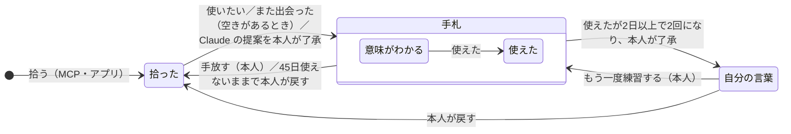
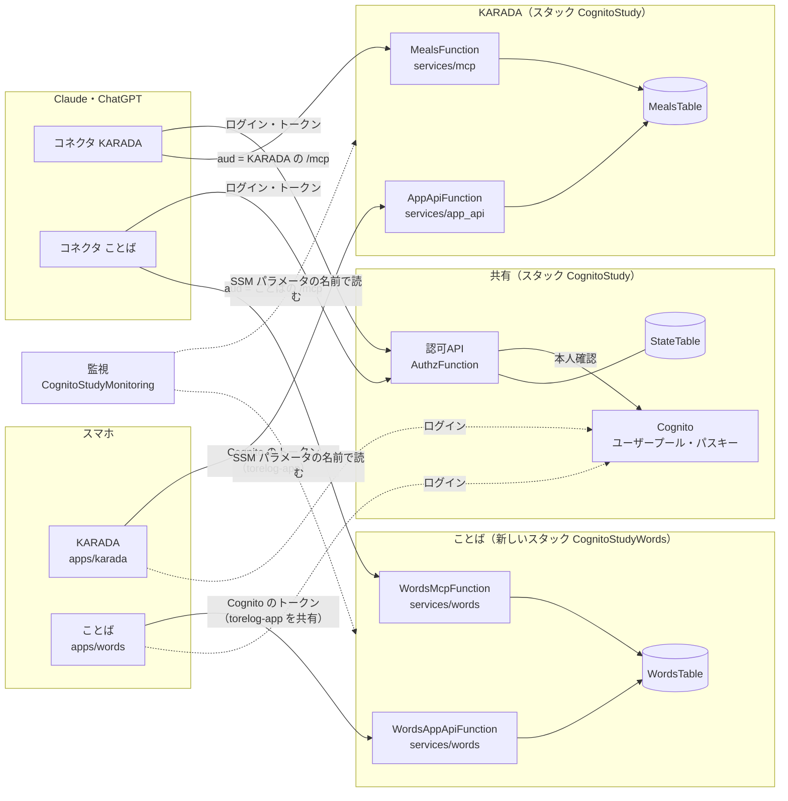

# ことば（言葉のアプリ）の設計メモ

本や会話で出会った日本語の表現を拾い、自分で「言える」ようにするための、新しいアプリ「ことば」（仮の名前。英語の作業名は words）の設計です。
KARADA と同じリポジトリに置き、ログイン・同期・CI/CD・監視は KARADA と共有します。MCP のサーバーとコネクタは KARADA と分けます。

まだ何も作っていません。この文書は、作り始める前に決めたことと、決めていないことをまとめたものです。
KARADA の全体の設計は [design.md](design.md)、同期は [sync-design.md](sync-design.md)、MCP は [mcp.md](mcp.md)、デプロイは [cd.md](cd.md) にあります。
KARADA のアプリのフォルダは `apps/karada` です（#279 で `apps/mobile` から名前を変えた）。

## 背景

本・Audible・Kindle・会話・動画や映画で「この言い方いいな」と思う表現に出会っても、書き留めないと忘れます。書き留めても、見返すだけでは話すときに出てきません。
目的は **話すときに使えること** です。日本語だけを扱います。
覚えるのは、自分で試す（自己採点の振り返り）のではなく、車の中などで **聞く** ことで行います（2026-11 に振り返りをやめて「聞く」に変えた）。

- 書き留めるのは、手が空いていない場面（運転中の Audible、読書中、会話のあと）が多いので、ふだん使っている Claude・ChatGPT のスマホのアプリに、声・ページの写真・Kindle のハイライトの共有で渡し、MCP で記録します。文字起こしと写真の読み取りは Claude・ChatGPT の AI がするので、アプリには音声認識も OCR も入れません（ネイティブのモジュールも足しません）。サーバーも AI を呼びません（KARADA と同じ方針）
- アプリには、文字で書き留める小さな入口だけを置きます
- 全部を覚えようとすると続かないので、覚える対象は「手札」の10個までに絞ります

## 決めたこと

- 日本語だけ。話すことを目的にする
- 書き留める主な入口は Claude・ChatGPT（MCP）。アプリは文字の入力だけ。アプリに音声認識・OCR は入れない
- 表現の置き場所は3つ：**拾った**（全部ここに入る。通知しない）、**手札**（言えるようになりたいもの。10個まで。通知はここだけ）、**自分の言葉**（使えるようになったもの）
- 手札に入る道は3つ：本人が「使いたい」を選ぶ、同じ表現にもう一度出会う（少し違う言い回しも含む）、Claude が手札の見直しで勧める
- 何度も出てこない、もう要らない、ときは拾ったに戻す。自動では何も消さない
- 手札の中の段階は **意味がわかる → 使えた**。間隔は「使えた」で大きく延ばし、聞いたら少し延ばす（14日まで）
- **自己採点の振り返りは作らない**。代わりに **聞く**：アプリが表現を1つずつ続けて読み上げる（表現 → 読み → 短い説明（意味とニュアンス）→ 使い方 → 例文1〜2個）。車の中で流すことを考えた作り（下の「聞く」）
- 聞く順は、手札（期限のものを先に、「忘れそうな度合い × 今の役立ち度 × ★」の順）→ ★のもの → 最近拾ったもの
- 読み上げは、既定は **端末の読み上げ（Android の TTS。無料）**。設定の「自然な声」（既定はオフ）をオンにしたときだけ、サーバーが Amazon Polly（日本語の neural の声）で読む。音声はどこにも溜めない（下の「読み上げ（TTS）」）。Polly は決まった台本を読むだけなので、「サーバーは AI を呼ばない」方針の例外にはしない
- 例文は、本人が拾うときに言ったものと、Claude が補うときに書く自然な話し言葉の2〜3個。だれが書いたか・本人が確かめたかを残す（下の「例文」）
- 続ける気持ちのために、活動の記録（拾った数・使えた数・手札の出し入れ・聞いた数と分・出会った場所ごとの数）を見せる。責めるためには使わない（下の「活動の記録」）
- 通知は端末の中だけ（ローカル通知）。たまったときだけ、週2回まで、ふだんアプリを開く時刻に。その週に自分で聞いたら送らない
- v1 の間隔の計算は単純なものにし、使ってみてから直す
- アプリに「AI で拾う」を置き、決まった頼みの文を入れて Claude・ChatGPT のアプリを開く（KARADA の「AI で記録」と同じ作り。下の「AI で拾う」）
- 出会った場所（Audible・Kindle・紙の本・会話・動画）は、決め打ちの種類ではなく、本人が足す・名前を変える・隠すことのできる一覧（`source`）にする。最初の5つは初期の行として入れる
- 探し方は文字の一致だけにしない。使う場面・気持ち・硬さ・出会った場所・本や人・時期・置き場所と段階・★で絞れるようにし、場面と気持ちのタグは本人が拾うときに付けられ、Claude も補うときに案を出す（だれが付けたか・確かめたかを残す）
- MCP での探し方は、Claude Code がコードを探すのと同じにする：小さな道具（`grep_words`・`list_facets`・`get_words`）を Claude が何度か使って探す。v1 にベクトルの索引は作らない。意味で探す（埋め込み）は、Claude なしでアプリの中で探すための v2 の選択肢とし、形だけ今決めておく（下の「探し方」）
- 動きは和の静かなもの4つだけ（保存で墨がにじむ、手札に入れると栞の紐、使えたで朱の落款、聞くで表現が出るときの筆の払い）。動きを減らす設定ではフェードにし、くり返す動きや脈打つ動きは使わない（下の「動き」）
- 同じリポジトリの `apps/words`（KARADA とは別の Expo のアプリ、別の EAS のプロジェクト）
- 共有するもの：認可API（ログインは1つ。ことばの MCP をトークンの宛先に足す）、Cognito、同期の仕組み（種類を足す）、CI/CD、監視
- **ログインの情報は KARADA と共通にする**（使うのは本人だけのため）。Cognito の資源は足さず、ことばのアプリは KARADA のアプリのクライアント（`torelog-app`）と scope（`torelog-api/…`）をそのまま使う（下の「ログインとトークンの宛先」）
- ことばの MCP サーバーは新しい Lambda（`services/words`）で、URL も Claude のコネクタも KARADA と別。作りは今の MCP の Lambda と同じで、サーバーの説明（instructions）は別に持つ
- AgentCore Gateway は今は使わない（下の「AgentCore Gateway を使わない理由」）
- データは **新しい DynamoDB のテーブル**（`WordsTable`）に置く（下の「データの置き場所」）
- v1 は、今の共有の資源を参照する `WordsStack` を足すだけにし、PlatformStack への組み替えは後に回す（下の「スタックの組み替え」）
- アプリの共有のコード（同期・ログイン・基本の UI）は、ことばが要るものだけを、少しずつ `packages/` に出す。KARADA の動きと見た目は変えない

## 使い方

| 場面 | 頼み方・操作 | 起きること |
|---|---|---|
| Audible を聞いていて | Claude のアプリに声で「今の『腑に落ちる』を拾って。〇〇の本、3章あたり」 | `capture_expression` で拾ったに入る（確認なし）。もう拾ってあれば「出会い」が1つ増え、手札に空きがあれば手札に入る |
| 紙の本を読んでいて | ページの写真を貼って「この傍線のところ」 | Claude が写真から表現と前後の文を読み取り、拾う。場面も一言で付ける |
| Kindle で | ハイライトを Claude に共有して「拾って」 | 何個かまとめて `capture_expressions`。本の題と位置（No.）も入る |
| 会話や動画のあとで | 「さっきの会議で部長が言ってた『〜に尽きる』、使いたい」 | 拾って、そのまま手札に入れる（使いたい） |
| アプリから Claude に渡したいとき | アプリの「AI で拾う」→ Claude か ChatGPT を選ぶ | 頼みの文が入った状態でチャットが開く。あとは声・写真・ハイライトを渡すだけ |
| 手が空いたとき | アプリの「書き留める」 | 表現・どこで（種類と題）・場面を書いて保存。同期で MCP にも見える |
| 車に乗るとき・通知が来たとき | アプリの「聞く」 | 手札を中心に、表現・読み・説明・使い方・例文を続けて読み上げる（画面を見なくてよい）。聞いた回数で間隔が延びる |
| Podcast で出会うようになった | アプリの設定の「出会った場所」で足す、または Claude に「Podcast で聞いた」と言う | 一覧に「Podcast」が足される（Claude からは一度だけ確かめてから足す） |
| 実際に使えたとき | アプリの言葉の詳細で「使えた」、または Claude に「今日『腑に落ちる』が使えた」 | 段階が「使えた」になり、間隔が大きく延びる |
| 週末などに | Claude に「手札を見直したい」 | `reflection_material` で材料を読み、手札の入れ替え、今の役立ち度、補う内容（意味・言い換え・例文）を提案し、了承を得て書く |
| 言いたいことから探したいとき | Claude に「落ち込んでる友達に何て言おう」 | Claude が言いたいことを言葉の組とタグに広げ、`grep_words` を何度か呼んで候補を集め、`get_words` で読んで、合うものを3〜5個、理由と一緒に見せる |
| 場面で見たいとき | アプリの「探す」で「励ます」を押す | そのタグの付いた表現（本人が確かめたタグが先） |
| 意味が気になったとき | 「『腑に落ちる』を補って」 | `enrich_expressions` で意味・ニュアンス・話し言葉の例文2〜3個などを足す（本人の書いたものは変えない） |
| どれくらい続いているか見たいとき | アプリの「記録」、または Claude に「最近どう？」 | 週・月ごとの拾った数・使えた数・手札の出し入れ・聞いた分。Claude は `stats` で同じ数を読む |

## データ

### 種類

同期の対象の種類（`entity_type`）を7つ足します。どれも ID は UUID（アプリも MCP も v4）で、同期の決まり（作成・更新の時刻、論理削除 `deleted_at`、項目ごとの後勝ち）は KARADA と同じです（[sync-design.md](sync-design.md#対象)）。
scope の対象（`EntitySpec.area`）は `training` です。ログインの情報を KARADA と共通にし、新しい scope を作らないためです（レポート `report` が筋トレの scope を使っているのと同じ）。ことばの種類は `WordsTable` 用の別の `Registry` に登録するので、KARADA のアプリ用の API と同期の流れには入りません

| 種類 | 中身 | 親 | 書く人 |
|---|---|---|---|
| `source` | 出会った場所（Audible・Kindle など）。本人が足す・名前を変える・並べ替える・隠す | なし | アプリと MCP（MCP は足すだけ） |
| `expression` | 表現1つ。置き場所・段階・間隔・補った内容を持つ | なし | アプリと MCP |
| `tag` | 使う場面（励ます・会議で など）と気持ち（安堵・皮肉 など）のタグ。本人が足す・名前を変える・隠す | なし | アプリと MCP（MCP は足すだけ） |
| `expression_tag` | 表現とタグのつながり。だれが付けたか（本人・Claude）と、確かめたか | `expression_id`（表現と一緒に消える） | アプリと MCP |
| `encounter` | 出会い1回（どこで、いつ、どんな場面で）。最初に拾ったときと、また出会ったときに1件ずつ | `expression_id`（別に保存し、表現と一緒に消える。筋トレのセットと同じ `owner`） | アプリと MCP |
| `usage` | 実際の会話で使えた1回（日・場面・メモ）。追記だけ | `expression_id`（同上） | アプリと MCP。`app_ops` は `create`・`delete` だけ（後から直さない） |
| `listen_session` | アプリで聞いた1回（続けて流したまとまり。日・秒数・流した数）。追記だけ | なし | アプリだけ。`app_ops` は `create`・`delete` だけ |

通知の時刻を決めるための記録（アプリを開いた時刻）と通知を送った記録は、端末の中だけに置き、同期しません（ローカル通知は端末ごとのため）。

### 出会った場所（`source`）

出会った場所は、決め打ちの種類（enum）ではなく、本人が直せる一覧です（KARADA の部位・種目と同じ考え方）。

| 項目 | 型・範囲 | 中身 |
|---|---|---|
| `id` | UUID | 初期の5つは固定の UUID（アプリの `db/seed.ts` とサーバーの `words/domain/catalog.py` に同じ値を持つ。KARADA の初期の部位・種目と同じ） |
| `name` | 文字。1〜40 | 表示の名前（「Audible」「紙の本」）。同じ名前（比べる形で）は2つ作れない |
| `icon_key` | アプリのアイコンの名前のどれか（`headphones`・`tablet`・`book`・`chat`・`film`・`podcast`・`note`・`other` など） | アイコン。知らない名前は `other` として表示する |
| `sort_order` | 整数 | 並び順 |
| `hidden` | 真偽 | 隠したか |
| `created_at`・`updated_at`・`deleted_at` | 時刻 | 同期の決まりどおり（`deleted_at` は使わない。下） |

- 初期の行：Audible（`headphones`）・Kindle（`tablet`）・紙の本（`book`）・会話（`chat`）・動画（`film`）の5つ。初期の行は、変えるまで同期で送りません（KARADA の初期の種目と同じく、変えた項目だけを `update` で送る）
- **消すのは隠すこと**です。アプリから受け付ける op は `create`・`update`・`restore` で、`delete` は受け付けません（`EntitySpec.app_ops`）。隠した場所は、書き留めるとき・絞り込みの選択肢に出ませんが、過去の表現と出会いは `source_id` を持ったままで、名前とアイコンも出ます
- 名前を変えると、過去の表現と出会いも新しい名前で出ます（ID でつながっているため）
- 1人50件まで

### 表現（`expression`）

| 項目 | 型・範囲 | 中身 | 書く人 |
|---|---|---|---|
| `text` | 文字。1〜200 | 表現そのもの（「腑に落ちる」） | 本人・Claude |
| `source_id` | 参照・null | 最初に出会った場所（`source`）。拾ったの絞り込みに使う。出会いごとの場所は `encounter.source_id` | 書く側（最初の出会いから写す） |
| `normalized_key` | 文字 | 同じ表現を探すための形（NFKC、カタカナをひらがなに、空白と句読点を除く）。サーバーとアプリで同じ決まりにし、`testdata/words/normalize.json` で両方を確かめる | 書く側が `text` から作る |
| `scene` | 文字。0〜300 | 使う場面（「上司の説明を聞いて、やっと納得したとき」）。最初の出会いの場面を写し、本人が直せる | 本人・Claude |
| `note` | 文字。0〜1000 | 本人のメモ | 本人だけ（Claude は本人が言ったことをそのまま入れる） |
| `star` | 真偽 | ★（優先したい） | 本人 |
| `place` | `collected`・`hand`・`own` | 置き場所（拾った・手札・自分の言葉） | 本人・Claude（下の「置き場所と段階」） |
| `stage` | `understood`・`used`・null | 手札の中の段階（意味がわかる・使えた）。手札でないときは null | 計算で決まる |
| `moved_at` | 時刻 | 置き場所を最後に変えた時刻 | 書く側 |
| `hand_since` | 日付・null | 手札に入れた日 | 書く側 |
| `interval_days` | 整数。1〜60 | 今の間隔（日） | 計算 |
| `due_on` | 日付・null | 次に聞かせたい日（手札のときだけ。聞く順と通知に使う） | 計算 |
| `listened_at` | 時刻・null | 最後に聞いた時刻（アプリが流し終えたとき） | アプリ |
| `listen_count` | 整数 | 聞いた回数（触れた回数。間隔に使う） | アプリ |
| `use_count` | 整数 | 使えた回数 | 計算 |
| `last_used_on` | 日付・null | 最後に使えた日 | 計算 |
| `reading` | 文字。0〜100 | 読み（ひらがな）。探すときに使う | Claude（補う）・本人 |
| `use_note` | 文字。0〜300 | 「こういう時に使えそう」（本人の言葉。拾うときに付けられる） | 本人（Claude は本人が言ったことをそのまま入れる） |
| `meaning` | 文字。0〜300 | 意味 | Claude（補う） |
| `nuance` | 文字。0〜500 | ニュアンス・使いどころ・似た言葉との違い | Claude（補う） |
| `register` | `spoken`・`written`・`formal`・null | 硬さ（話し言葉・書き言葉・改まった） | Claude（補う）・本人 |
| `register_by` | `user`・`claude`・null | 硬さをだれが決めたか（本人が決めたら、Claude は補うときに変えない） | 書く側 |
| `examples` | 例文の一覧。8件まで（下の「例文」） | 本人の例文と、Claude の話し言葉の例文 | 本人・Claude |
| `similar` | 文字の一覧。5件まで、各100 | 言い換え・似た表現 | Claude（補う） |
| `usefulness` | 1〜3・null | 今の役立ち度（1 低い・2 ふつう・3 高い）。null は 2 として扱う | Claude（手札の見直し） |
| `usefulness_reason` | 文字。0〜200 | 役立ち度の理由（「来週の発表で使えそう」） | Claude（手札の見直し） |
| `usefulness_until` | 日付・null | 役立ち度の期限。過ぎたら 2 に戻して読む（既定は決めた日から14日） | Claude（手札の見直し） |
| `enriched_at` | 時刻・null | 最後に補った時刻 | Claude（補う） |
| `created_at`・`updated_at`・`deleted_at` | 時刻 | 同期の決まりどおり | 書く側 |

- 間隔の項目（`stage`・`interval_days`・`due_on`・`listened_at`・`listen_count`・`use_count`・`last_used_on`）は、聞いた・使えたで一緒に変わるので、アプリは組（`syncSpec.ts` の `together`）で送ります（ケガの部位と左右と同じ）。項目ごとの後勝ちで、2つの端末の記録が混ざらないようにするためです
- 補った項目は Claude だけが書き、本人の項目（`text`・`scene`・`note`・`use_note`・`star`）とは分けます。補うことで本人の言葉が書き換わらないようにするためです。読み・硬さ・タグ・例文は両方が書けます（硬さは `register_by`、タグは `expression_tag` の `added_by`・`status` で、だれのものかを残す）
- 表現の上限は1人 5,000 件、出会いは表現1つに 50 件、使えたの記録は表現1つに 500 件（書く側が確かめる。ケガと同じ）

### 出会い（`encounter`）

| 項目 | 型・範囲 | 中身 |
|---|---|---|
| `expression_id` | 参照 | どの表現か |
| `source_id` | 参照・null | どこで出会ったか（`source`）。分からなければ null |
| `title` | 文字。0〜200 | 本・番組・映画の題、会話の相手や場（「〇〇さんとの1on1」） |
| `locator` | 文字。0〜100 | 位置の手がかり（「3章」「p.142」「No.2310」「1:02:30」） |
| `met_on` | 日付・null | 出会った日（分かれば） |
| `time_hint` | 文字。0〜50 | 日付が曖昧なときの言葉（「先週」「通勤中」） |
| `scene` | 文字。0〜300 | その出会いの場面 |
| `surrounding_text` | 文字。0〜1000 | 前後の文（写真や Kindle のハイライトから Claude が読み取ったもの） |
| `wording` | 文字。0〜200 | その出会いでの言い回し（表現と少し違うとき。「腑に落ちた」） |
| `captured_via` | `mcp`・`app` | どこから書き留めたか |
| `note` | 文字。0〜500 | メモ |

写真・音声そのものは保存しません。保存するのは、Claude が読み取った文字だけです（KARADA の食事の写真と同じ）。

### 例文（`expression.examples`）

例文は、表現の項目 `examples`（一覧）に持ちます。別の種類にしないのは、数が少なく（8件まで）、表現と一緒に読み上げ・探す・補うためです。

| 項目（1件） | 型・範囲 | 中身 |
|---|---|---|
| `text` | 文字。1〜200 | 例文 |
| `origin` | `user`・`claude` | だれが書いたか（本人が拾うときに言った・アプリで書いた／Claude が補うときに書いた） |
| `confirmed` | 真偽 | 本人が確かめたか。本人の例文はいつも true。Claude の例文は、本人が「それでいい」と言ったら true |
| `created_at`・`updated_at` | 時刻 | 書いた・直した時刻 |

- 拾う（`capture_expression`）は本人の例文を受け取ります。Claude は、本人が言っていない例文を拾うときに作りません
- 補う（`enrich_expressions`）は、Claude の自然な **話し言葉** の例文を **2〜3個** 書きます（耳で聞いて分かる短い一文。利用者の場面に近いもの）。本人の例文と、本人が確かめた Claude の例文は残し、確かめていない Claude の例文だけを入れ替えます
- 本人が確かめる・外す・足すのは、アプリか `update_expression`（`confirm_examples`・`remove_examples`・`add_examples`）。文で指します
- 一覧は項目ごとの後勝ちで、一覧ごと置き換わります（2つの端末で同時に足すと、片方が残る。めったに起きないので受け入れる）
- 例文は探すための文に入ります（下の「探すための文」）。読み上げでは、本人の例文 → 確かめた Claude の例文 → ほかの Claude の例文 の順に2つまで読みます

### 使えた（`usage`）

| 項目 | 型・範囲 | 中身 |
|---|---|---|
| `expression_id` | 参照 | どの表現か |
| `used_on` | 日付 | 使えた日（日本時間の午前4時で区切った日） |
| `scene`・`note` | 文字。0〜300 | どんな場面で使えたか・メモ（本人の言葉） |

自分の言葉に移す条件（違う日に2回）と、活動の記録の「使えた数」に使います。

### 聞いた記録（`listen_session`）

| 項目 | 型・範囲 | 中身 |
|---|---|---|
| `started_at` | 時刻 | 聞き始めた時刻 |
| `listened_on` | 日付 | 聞いた日（午前4時区切り） |
| `seconds` | 整数。0〜86400 | 流した時間（秒） |
| `items` | 整数。0〜1000 | 流し終えた表現の数 |

- 表現ごとの記録は軽くし、表現の `listened_at`・`listen_count`（と間隔の項目）だけを書きます。1つ流し終えるたびに1件ずつ書くことはしません（同期の量を増やさない）
- `listen_session` は、聞く画面を閉じたとき（または流し終えたとき）にアプリが1件書きます。活動の記録の「聞いた数と分」に使います。MCP は書きません

### タグ（`tag`）とつながり（`expression_tag`）

探すための「使う場面」と「気持ち・ニュアンス」は、決め打ちではなく、本人が直せる一覧です（出会った場所と同じ）。語彙は決めておき、少しずつ増やします。新しいタグは、本人が足すか、Claude が案を出して本人が了承したときだけ増えます。

| 項目（`tag`） | 型・範囲 | 中身 |
|---|---|---|
| `id` | UUID | 初期のタグは固定の UUID（アプリの `db/seed.ts` とサーバーの `words/domain/catalog.py`） |
| `kind` | `situation`・`feeling` | 使う場面か、気持ち・ニュアンスか |
| `name` | 文字。1〜20 | 名前。同じ種類に同じ名前（比べる形で）は2つ作れない |
| `sort_order` | 整数 | 並び順 |
| `hidden` | 真偽 | 隠したか。**消すのは隠すこと**（アプリからの `delete` は受け付けない）。隠したタグは選択肢に出ないが、付いている表現からは外れない |
| `created_by` | `user`・`claude`・`seed` | だれが足したか |
| `created_at`・`updated_at`・`deleted_at` | 時刻 | 同期の決まりどおり |

初期のタグ（案）：使う場面は 励ます・慰める・謝る・断る・頼む・お礼・ほめる・反論する・まとめる・会議で・雑談で・目上に・初対面で、気持ちは 安堵・皮肉・敬意・共感・ためらい・驚き・感心。1人200件まで。硬さ（話し言葉・書き言葉・改まった）は3つに決まっているので、タグにせず `expression.register` に持ちます。

| 項目（`expression_tag`） | 型・範囲 | 中身 |
|---|---|---|
| `id` | UUID | 表現とタグから決める（`uuid5(<ことばの名前空間>, "<expression_id>:<tag_id>")`）。2つの端末や MCP が同じタグを付けても1つになる（KARADA のいつものの ID と同じ考え方） |
| `expression_id`・`tag_id` | 参照 | どの表現に、どのタグか |
| `added_by` | `user`・`claude` | だれが付けたか |
| `status` | `confirmed`・`proposed`・`rejected` | 本人が確かめたか。本人が付けたものは `confirmed`、Claude が付けたものは `proposed` で、本人がアプリか Claude に「それでいい」と言ったら `confirmed`、「違う」と言ったら `rejected` |
| `confirmed_at` | 時刻・null | 確かめた時刻 |

- 外すときは、本人が付けたものは論理削除、Claude の案を断ったものは `rejected` にして残します（Claude が同じ案をくり返し出さないようにするため）
- 探すときの重み：`confirmed` は 1.0、`proposed` は 0.5、`rejected` は使わない（下の「探し方」）

### データの置き場所

**新しいテーブル（`WordsTable`）に置き、同期の仕組み（`services/sync`）はそのまま使う** ことを勧めます。今のテーブル（`MealsTable`）に種類を足す案と比べた理由は次のとおりです。

| 観点 | 今の `MealsTable` に種類を足す | 新しい `WordsTable` |
|---|---|---|
| 権限 | ことばの Lambda に `MealsTable` の読み取りを与えることになる。IAM で絞れるのは pk（`dynamodb:LeadingKeys`）までで、sk の前方一致では絞れないので、食事・筋トレ・ケガの記録まで読める | ことばの Lambda は `WordsTable` だけ。KARADA の Lambda もことばの記録に届かない |
| 変更の番号（`SYNC#HEAD`） | 利用者ごとに1本なので、KARADA とことばの書き込み（アプリ2つと MCP 2つ）が同じ先頭を楽観的ロックで取り合う。KARADA のアプリの受け取りとスナップショットも、ことばの項目を読んでから scope で捨てる（中身のないページが返ることもある） | 別々に番号が進む。KARADA の受け取りは今のまま |
| アプリの最後の同期の時刻（`SYNC#APP`） | 種類を見ずに書くので、ことばのアプリが同期すると、KARADA の MCP の `last_app_sync_at` が進み、「アプリで記録したのに見えない」の案内がずれる | 別々 |
| 戻すとき | ポイントインタイムリカバリはテーブルごとなので、ことばの不具合を戻すと、KARADA の記録も同じ時点に戻る | 別々に戻せる |
| 並びのキー（LSI） | LSI はテーブルを作るときにしか足せず、`by_day`（`day_key`）は食事が使っている | ことば用に作れる（下） |
| やめるとき | 項目を1つずつ消すことになる | スタックごと片付けられる（テーブルは RETAIN なので、消すのは手で） |
| 手間 | 種類を登録するだけ | テーブルと権限が1つずつ増える。`DynamoDBSyncStore(table_name, …)` はテーブル名を受け取るので、同期の部品のコードは変えない |

- キーは `MealsTable` と同じ形（pk `EATER#<sub>`、sk `SYNC#…`）にし、LSI も同じ名前 `by_day`・属性 `day_key` で作ります。`services/sync/sync/store.py` が名前を決め打ちしているので、変えずに使えるようにするためです。ことばでは、この並びのキーに表現の `normalized_key` を入れ（`EntitySpec.index_key`）、同じ表現を範囲の検索で探します（名前が中身と合わないので、あとで部品の側の名前を一般的なものに変えます）
- 設定は今のテーブルと同じ：オンデマンド、削除の保護、ポイントインタイムリカバリ、AWS マネージドキー、RETAIN
- 利用者は同じ Cognito の `sub` です。ことばと KARADA の記録をまたぐ処理はありません

## 置き場所と段階



- 手札は10個までです。書く側（アプリのリポジトリ、MCP のツール）が確かめ、いっぱいなら入れずに断ります（MCP は今の手札の一覧を返し、Claude がどれと入れ替えるかを聞く）
- 2つの端末から同時に入れると、同期のあとで11個になることがあります（項目ごとの後勝ちで、行をまたぐ決まりは守れないため。フェーズの「実施中は1つ」と同じ）。読む側は11個以上でもそのまま読み、アプリは「手札が11個あります。1つ戻してください」と出します。自動では戻しません
- また出会ったとき：手札に空きがあれば手札に入れ（意味がわかる、間隔1日）、Claude が一言伝えます。いっぱいなら拾ったのまま、出会いだけを足し、「手札がいっぱいなので入れていません」と返します
- 自分の言葉に移る条件（使えたが、違う日に2回）を満たしたら、アプリと Claude が「自分の言葉にしますか？」と勧めます。自動では移しません
- 手札に45日以上いて、まだ一度も使えていなければ、アプリと Claude（手札の見直し）が「拾ったに戻しますか？」と勧めます。自動では戻しません
- 自分の言葉と拾ったには、通知も間隔もありません（★や最近拾ったものは聞く順の後ろに入る。間隔の項目はそのまま残し、手札に戻したときは間隔1日・意味がわかるから始めます）
- 消すのは本人が消したときだけです（論理削除。出会いと使えたの記録も一緒に消す）

## 聞くと間隔（v1）

自己採点の振り返りはやめました（本人が使わないため）。覚えるのは「聞く」で行い、間隔は **触れた回数（聞いた）と使えた** で決めます。
日付の区切りは日本時間の午前4時です（夜中に聞いたものは前の日に数える）。間隔は日数で持ち、同じ日に何度聞いても、間隔を延ばすのはその日の最初の1回だけです（回数は数える）。使えたも同じです。

### 手札に入れたとき

`interval_days` = 1、`due_on` = 明日、`stage` = 意味がわかる。聞いた回数・使えた回数は残します。

### 出来事ごとの計算

| 出来事 | 間隔 | 段階 | 回数 |
|---|---|---|---|
| 聞いた（アプリが流し終えた） | `max(間隔, min(ceil(間隔 × 1.5), 14))`（その日の最初の1回だけ） | そのまま | `listen_count` +1、`listened_at` |
| 使えた（実際の会話で） | `min(max(間隔 × 3, 7), 60)`（その日の最初の1回だけ） | 使えた | `use_count` +1、`last_used_on` |

`due_on` = その日 + 新しい間隔。聞くだけの間隔は14日で止め、それより延びるのは「使えた」だけです（話せることが目的で、聞いて分かることは途中の段階のため）。使えたで14日より長くなった間隔は、聞いても縮めません。
手札でない表現（拾った・自分の言葉）は、回数と時刻だけを残し、間隔は変えません。

例：入れた日 → 1日後 聞いた（2日）→ 聞いた（3日）→ 聞いた（5日）→ 8日 → 12日 → 14日で止まる。途中の3日のところで実際に使えたら 9日、次に使えたら 27日、その次は 60日。

### 聞く順

1. 忘れそうな度合い `risk` = 最後に聞いた日からの日数 ÷ 間隔（まだ聞いていなければ、手札に入れてからの日数）。3で止める
2. 優先度 = `risk` × 今の役立ち度（1〜3。null と期限切れは2）× ★（あれば 1.5、なければ 1）
3. 並べる順：**手札の期限のもの**（`due_on` が今日以前。優先度の順）→ **手札のほか**（優先度の順）→ **★の拾った・自分の言葉**（新しく拾った順）→ **最近14日に拾ったもの**（新しい順）。同じ表現は1回だけ、同じ優先度は ID の順。1回に20個まで（アプリで変えられる）
4. この計算はアプリとサーバーで同じにし、`testdata/words/schedule.json`・`listen_queue.json` で両方を確かめます（サーバーは `words/domain/schedule.py`。MCP の `reflection_material` が先頭10件を見せる）

v1 は、この式と数字だけで動かします。数か月使ってから、使えた割合と聞いた回数を見て係数を直します（後の検討）。

## 聞く

車の中で流すことを考えた画面です（画面を見なくても使える）。

- アプリが聞く順に、1つずつ続けて読み上げます：**表現 → 読み → 短い説明（意味とニュアンス）→ 使い方（こういう時に使えそう。なければ使う場面のタグ）→ 例文1〜2個**。区切りには間を入れます
- 操作は大きなボタンだけ：再生・一時停止、次へ、もう一度、★（優先したい）。音声の操作（イヤホン・車のボタン）にも合わせます（`expo-audio` のロック画面の操作）
- 1つ流し終えたら、端末の表現に `listened_at`・`listen_count` と間隔を書き（同期で送る）、閉じたら `listen_session` を1件書きます
- 読み上げは下の「読み上げ（TTS）」。既定は端末の TTS で、通信がなくても聞けます
- 動きを減らす設定・画面を消した状態でも流れ続けます（バックグラウンドの再生）

## 読み上げ（TTS）

台本の型は1つで、サーバー（`words/domain/speech.py`、版 `SPEECH_VERSION`）とアプリが同じものを作ります（`testdata/words/speech.json` で両方を確かめる）。
型：表現 → 読み（表現と違うときだけ）→ 説明（意味とニュアンス。400文字まで）→ 使い方（こういう時に使えそう。なければ使う場面のタグ3つまで）→ 例文（本人 → 確かめた Claude → ほかの Claude の順に2つ）。区切りには間を入れます（区切り 800ms、例文どうし 500ms、「例えば」のあと 300ms）。設定の「区切りのあいだの間」は POST /v1/audio の pause（short 400ms・normal 800ms・long 1600ms。省くと normal）で頼み、端末の声の間（lib/listen/pace.ts）と同じ長さにします。古いサーバーが pause を断った（400）ときは、アプリが pause なしで頼み直します。

### 既定：端末の読み上げ（無料）

- アプリが台本の区切り（`sections`）を、Android の TTS（`expo-speech`。日本語の声）で読み、区切りの間は無音を挟みます。サーバーは呼びません。通信がなくても聞けます
- 画面を消した状態・車の中で流し続けるため（バックグラウンドの再生とロック画面の操作）、**今の表現と次の表現の2つだけ**を、その場で端末の TTS で一時ファイル（音声）にして `expo-audio` で流します。流し終えたら消し、溜めません（キャッシュは持たない）
- 費用は **0円** です

### 設定の「自然な声」（Polly。既定はオフ）

- アプリの設定で「自然な声」をオンにしたときだけ、アプリ用の API の `POST /v1/audio`（本文 `{"expression_id", "voice"}`）を呼びます。サーバーが同じ型の台本を SSML（`<break>` で間）にし、**Amazon Polly**（`ja-JP`、エンジン `neural`、声は `Kazuha`（既定）・`Takumi`・`Tomoko`）で読んだ **MP3（24kHz）をそのまま返します**（base64 の本文。`cache-control: no-store`）
- **キャッシュは持ちません**（サーバーにも、アプリにも）。アプリは、端末の TTS と同じく今と次の2つだけを一時ファイルにして流し、流し終えたら消します。S3 も使いません（署名付き URL は S3 が要るので使わない）
- 1回の台本は 1,000 文字ほどまで（Polly の上限は 3,000 文字）。記号は SSML のために逃がします
- 権限は `WordsAppApiFunction` に `polly:SynthesizeSpeech` だけ（資源は `*`。語彙を使うときだけ ARN で絞れる）。MCP の Lambda には与えません。ルートの scope は `torelog-api/training.read`
- Polly の neural の日本語の声が東京（ap-northeast-1）で使えるかは、デプロイの前に確かめます（使えなければ、Lambda から us-east-1 の Polly を呼ぶ）
- **費用の見込み**：neural は 100万文字あたり約 16 USD。1つ約300文字なので、**1つを読むたびに約 0.005 USD（0.7円ほど）**。溜めないので、同じ表現でも聞くたびにかかります（毎日20個を聞くと、月に約 3 USD・420円ほど）。ログには文字数だけを出し（`speech chars=`）、中身は出しません。使いすぎが気になったら、溜める（端末か S3）ことを考え直します

## 活動の記録

続ける気持ちを支えるための数です。少ないことを責めず、続けた日数（連続の日数）は数えません。

| 数 | 中身 | 元にする記録 |
|---|---|---|
| 拾った | 期間に拾った表現の数 | 表現を作った時刻 |
| また出会った | 期間に足した出会い（表現を作った日より後のもの） | 出会い |
| 使えた | 期間の使えたの数 | `usage` |
| 手札に入れた | 期間に手札に入れた数（今も手札にあるもの。出し入れの履歴は持たない） | 表現の `hand_since` |
| 自分の言葉にした | 期間に自分の言葉に移した数（今も自分の言葉のもの） | 表現の `moved_at` |
| 聞いた | 期間に聞いた数と分 | `listen_session` |
| 出会った場所ごと | 期間に拾ったものの、場所ごとの数 | 表現の `source_id` |

- 期間は週（月曜〜日曜）か月で、日は午前4時区切り。今日を含む期間から、週は26、月は12までさかのぼります
- **アプリは端末で計算します**（同期で届いた記録だけから。オフラインでも見られる。新しい集計の表も同期の種類も足さない）。MCP の `stats` は同じ計算（`words/domain/stats.py`）で同じ数を返します。数え方は `testdata/words/stats.json` で両方を確かめます
- 手札の出し入れの履歴（入れて戻した回数）は持ちません。要るようになったら、置き場所を変えたときの記録（種類）を足します

## 通知

ローカル通知だけです（`expo-notifications` で端末の中で予約する。サーバーからのプッシュは使わない）。

| 決まり | 値 |
|---|---|
| 送るとき | 予約した時刻に、期限の手札が3つ以上あるとき（期限は `due_on` で先に分かるので、3つ以上になる日を計算して予約する）。押すと「聞く」が開く |
| 回数 | 週（月曜〜日曜、日本時間）に2回まで。2回の間は48時間以上あける |
| 時刻 | ふだんアプリを開く時刻：直近14日のアプリを前面にした時刻の中央値を15分単位に丸め、7:00〜22:00 におさめる。記録が5回より少なければ 20:00 |
| 送らないとき | その週に自分で聞いた（`listen_session` がある）とき、手札が空のとき、通知を許可していないとき |
| 文 | 「手札の言葉が3つ、聞きごろです」。続けた日数や、さぼったことは書かない |
| 予約し直すとき | アプリを前面にしたとき・裏に回したとき、同期のあと、聞いたあと。予約は常に1つだけにする |

- 通知の許可は、初めて手札に入れたときに聞きます（Android 13 からは `POST_NOTIFICATIONS` が要る）。正確な時刻のアラーム（`SCHEDULE_EXACT_ALARM`）は使わず、数分ずれてもよいことにします
- MCP で手札に入れた分は、アプリを開いて同期するまで予約に入りません（ローカル通知だけにした代わりの制限）

## 探し方

文字の一致だけでなく、いろいろな角度から探せるようにします（「シチュエーションとか、いろんな角度で探したい」）。

### 絞り込みの軸

| 軸 | 持っている所 | だれが入れるか |
|---|---|---|
| 使う場面（励ます・謝る・断る・ほめる・会議で・雑談で・目上に など） | `tag`（`situation`）と `expression_tag` | 本人（拾うとき・あとで）、Claude（拾うときの案、補うとき）。Claude のものは本人が確かめるまで `proposed` |
| 気持ち・ニュアンス（安堵・皮肉・敬意 など） | `tag`（`feeling`）と `expression_tag` | 同上 |
| 硬さ（話し言葉・書き言葉・改まった） | `expression.register` | Claude（補う）か本人。本人が決めたら Claude は変えない |
| こういう時に使えそう | `expression.use_note`（自由に書く文） | 本人 |
| 出会った場所 | `expression.source_id`・`encounter.source_id`（`source` の一覧） | 拾うとき |
| 本・人 | `encounter.title` | 拾うとき |
| 時期 | `expression.created_at`（拾った日）、`encounter.met_on` | 自動 |
| 置き場所・段階・★ | `place`・`stage`・`star` | 本人・計算 |

- 同じ軸の中は「どれか」（励ます か ほめる）、軸どうしは「かつ」（励ます かつ 雑談で かつ 話し言葉）で絞ります
- 並べ方：タグの重み（本人が確かめたもの 1.0、Claude の案 0.5）の合計 → ★ → 置き場所（手札・自分の言葉・拾った の順）→ 新しい順

### 探すための文（search document）

表現1つにつき、決まった順で項目をつないだ文を作ります。MCP の `grep_words` が探す対象で、v2 の埋め込みの元にもなります。作るのはサーバーの純粋な関数（`words/domain/search_doc.py` の `search_document(expression, tags, encounters)`）で、版（`SEARCH_DOC_VERSION`。今は 1）を持ちます。順番や項目を変えたら版を上げます。

```
表現：{text}
読み：{reading}
意味：{meaning}
ニュアンス：{nuance}
硬さ：{register の名前}
使う場面：{situation のタグ（confirmed と proposed。rejected は入れない）を 、 でつなぐ}
気持ち：{feeling のタグ（同上）}
こういう時に使えそう：{use_note}
例文：{examples の文を ／ でつなぐ（本人のものも Claude のものも）}
場面：{scene}
出会いの場面：{新しい出会い5件までの scene を 、 でつなぐ}
メモ：{note}
```

- 空の項目は行ごと省きます。前後の文（`surrounding_text`）と本・人の名前（`title`）は、意味がぼやけるので文には入れず、`grep_words` で項目を名指ししたときだけ探します
- 1行が1つの項目（`fields` の名前：`text`・`reading`・`meaning`・`nuance`・`register`・`situations`・`feelings`・`use_note`・`examples`・`scene`・`encounter_scenes`・`note`）です

### 正規化

アプリとサーバーで同じ関数（`search_key()`）を使い、`testdata/words/search_key.json` で両方を確かめます。同じ表現を探す `normalized_key` は、表現そのものにこれをかけたものです。

1. Unicode の NFKC（全角の英数字を半角に、半角のカタカナを全角に）
2. 英字を小文字に
3. カタカナをひらがなに（U+30A1〜U+30F6 を U+3041〜U+3096 に、ヽ・ヾ を ゝ・ゞ に）。長音の「ー」と「々」は残す
4. 空白・句読点・記号（Unicode の分類 Z・P・S。、。・「」『』！？…〜 など）を除く
5. 送り仮名のゆれや、漢字とかなの違いは正規化しない。代わりに読み（`reading`）を探す対象に入れ、かなで探しても見つかるようにする

### アプリで文字で探す

端末の SQLite で探します（オフラインでも使える）。対象は、探すための文の項目と、前後の文・本や人の名前です。

- 表現ごとに、同期しない列 `search_key` を端末に持ちます。対象の項目を正規化してつないだもので、表現・出会い・タグを書いたときと、同期で受け取ったときに作り直します
- 探す言葉は空白で区切り、それぞれに同じ正規化をかけて、全部を含むもの（`search_key LIKE '%…%'` の「かつ」）を出します。日本語は単語の区切りがないので、部分一致にします
- 5,000件なら `LIKE` の全件で足ります（数十ms の見込み）。遅ければ SQLite の FTS5（`trigram`）にします
- 並べ方：表現・読みに一致（同じ → 前方 → 含む）、意味・こういう時に使えそうに一致、それ以外、の順。同じ順位の中は、上の絞り込みの並べ方

### 言いたいことから探す（MCP。Claude Code の探し方にならう）

「落ち込んでる友達に何て言おう」のように、言いたいことから探すのは、v1 では Claude が行います。Claude Code がコードを探すときと同じく、サーバーは小さな道具（`grep_words`・`list_facets`・`get_words`）だけを持ち、Claude が言葉を変えながら何度か呼んで探します。ベクトルの索引は作りません。

1. 言いたいことを、言葉の組（言い換え・似た言葉）をいくつかと、合いそうなタグ（`list_facets` の語彙）に広げる。例：「励ます・元気づける・気にするな・大丈夫」「落ち込む・へこむ・沈む」、タグ「励ます」「慰める」「共感」
2. `grep_words` を数回呼ぶ（言葉の組ごと、タグで絞って）。当たりが少なければ、タグの絞りを外す・言葉を広げる・拾ったも含める、の順に広げる
3. 候補の ID を集め、`get_words` でまとめて読む
4. 相手との関係・場の硬さ・気持ちに合う順に3〜5個選び、それぞれなぜ合うかと、その場での言い方の例を一言添える
5. 本人が確かめたタグ（`confirmed`）が合うものを、Claude の案（`proposed`）だけのものより先にする

**これで足りる理由**：意味・ニュアンス・使う場面のタグ・読みは、補うときに Claude 自身が書いています。表現が Claude の言葉で説明されているので、Claude が思いつく言葉で grep すれば当たります。埋め込みが要るのは、Claude なしでアプリの中だけで意味で探したいときで、それは v2 の選択肢にします（下）。

### アプリの見て回り方

| 見方 | 中身 |
|---|---|
| 場面で | 使う場面のタグを格子に並べ（件数つき）、押すとその表現の一覧。気持ちのタグは下に並べる |
| 場所・本で | 出会った場所 → 本・人（`encounter.title`）→ 表現 |
| 時期で | 拾った月ごと（新しい順） |
| 似た言葉 | 言葉の詳細から、補った「言い換え」（`similar`）のうち拾ってあるものと、同じ使う場面のタグ（確かめたもの）を持つ表現へ進む |

### 意味で探す（v2。今は作らない）

Claude なしで、アプリの中で意味で探したくなったときのための形です。v2 で足すのは、Bedrock の許可1つと埋め込みの仕事だけで、テーブルと同期の種類は変えません。

**埋め込みの置き場所**：同期の項目（`SYNC#…`）には入れず、`WordsTable` の同じ利用者の pk に、同期しない項目として置きます（sk `EMB#<SEARCH_DOC_VERSION>#<expression_id>`）。

| 項目 | 中身 |
|---|---|
| `embedding_model` | モデルの ID（例：`amazon.titan-embed-text-v2:0`） |
| `embedding_version` | 探すための文の版 |
| `doc_hash` | 探すための文の SHA-256。今の文と違えば古い |
| `vector` | 512 次元を float16 にしたバイト列（1KB） |
| `embedded_at` | 埋め込んだ時刻 |

DynamoDB は項目の形を決めないので、v1 のテーブルのまま足せます（マイグレーションは要らない）。同期の変更の記録にも入らないので、アプリには降りてきません。

**埋め込み直すきっかけ**：探すための文の `doc_hash` と、埋め込みの項目の `doc_hash` を比べ、違うもの・ないものを埋め込み直します。文が変わるのは、補う（読み・意味・ニュアンス・硬さ）、タグの追加・確かめ・断り、本人の項目（表現・こういう時に使えそう・場面・メモ）の変更、出会いの追加のときです。書く道（MCP・アプリの同期）には手を入れず、比べるだけで見つけます。

- **埋め込みの仕事**（`services/words/scripts/embed.py`、または同じ中身の Lambda のハンドラー）：利用者の表現を全部読み、探すための文を作って `doc_hash` を比べ、古いものだけを Bedrock で埋め込んで書きます。何度動かしても同じ結果になります。初めての全件（バックフィル）も、このあとの埋め込み直しも同じ仕事です。版を上げたときも、この仕事を流すだけです
- **探すとき**：探す前に古いものを最大50件まで埋め込み直し（それより多ければ、残りは仕事に任せて古いままで探す）、言いたいことの文を埋め込んで、全部の埋め込みとの cosine を Lambda の中で総当たりで計算し、上位を返します。タグと文字の絞り込みと組み合わせられます

**置き場所の比べ（約5,000件）**

| 案 | 中身 | 読む量・速さ |
|---|---|---|
| DynamoDB（勧める） | 上の `EMB#` の項目。探すたびに前方一致で全部読む | 5,000 × 約1.2KB ＝ 約6MB。結果整合の読み取りで約1,500 RRU、1回 $0.0003 ほど。Lambda の中で数百 ms |
| S3 ＋ Lambda で総当たり | 利用者ごとに1つのファイル（全部の埋め込み）を仕事が作り直し、Lambda が読んでメモリに置く | 1回の GET で約5MB。速いが、S3 のバケットと、ファイルを作り直す手間が増える |

どちらも 5,000件なら総当たりで足り、ベクトル用のデータベースは要りません。DynamoDB で始め、遅ければ S3 に移します。計算は numpy を使います（Lambda に載せる依存が増える）。

**費用の見込み**：Amazon Titan Text Embeddings V2 は、入力 1,000 トークンあたり $0.00002 ほどです（2026-11 に料金と東京での提供を確かめる）。5,000件 × 約300トークン ＝ 約150万トークンで、全件が約 $0.03。その後の埋め込み直しと、探すときの埋め込みは月に1円にも届きません。Cohere Embed Multilingual も候補です。

**v2 で足すもの**：埋め込みを書く・探す Lambda に、決めた1つのモデルの `bedrock:InvokeModel` の許可を1つと、埋め込みの仕事。アプリから探すなら、アプリ用の API に探すルート（`POST /v1/search`）も足します。「サーバーは AI を呼ばない」方針の例外になるので、v2 を始めるときに決め直します。

## MCP

### つなぎ方

ことばの MCP サーバーは、KARADA と別の URL（`cdk deploy` の出力 `WordsMcpServerUrl`、末尾が `/mcp`）で、別のカスタムコネクタとして登録します。ログインは同じ認可API・同じパスキーで、同意画面で「ことば」の読み書きを許します。
コネクタが別なので、チャットやプロジェクトごとに KARADA とことばを別々にオン・オフできます。

### ツール

scope は `words:read`・`words:write` です。接続のところで両方を必須にします（KARADA のような、後から足した scope の事情がないため）。

| ツール | 入力 | 出力 | 確認 |
|---|---|---|---|
| `capture_expression`（拾う） | `text`、`source`（場所の名前）・`create_source`（ない名前を足すとき true）・`source_icon`（足すときのアイコン）、`situations`・`feelings`（タグの名前の一覧。`by`：`user`（本人が言った）か `claude`（Claude の案））、`use_note`（こういう時に使えそう。本人の言葉）、`create_tags`（ないタグを足すとき true）、`title`・`locator`・`met_on`・`time_hint`・`scene`・`surrounding_text`・`wording`・`note`（任意）、`star`、`want_to_use`（使いたい）、`same_as`（同じ表現の ID）、`examples`（本人が言った例文） | `expression`（ID・置き場所・段階）、`outcome`（`created`・`reencountered`・`promoted`）、`candidates`（似た表現。下）、`hand`（今の数と上限）。場所が見つからなければ記録せずに `source_not_found` と `source_candidates`（似た名前と今の一覧） | なし（新しい場所を足すときだけ、一度確かめる。下） |
| `capture_expressions`（まとめて拾う） | 上の入力の一覧（30件まで。Kindle のハイライト、写真のページ） | 1件ごとの結果 | なし。拾ったあとに一覧で見せる |
| `enrich_expressions`（補う） | `items`（20件まで）：`id`、`reading`・`meaning`・`nuance`・`register`（本人が決めた硬さは変えない）・`situations`・`feelings`（Claude の案として `proposed` で付ける。本人が断ったタグは付けない）・`examples`（自然な話し言葉の例文を2〜3個。本人の例文と確かめた例文は残る）・`similar`・`usefulness`・`usefulness_reason`・`usefulness_until`（どれも任意） | 1件ごとの結果 | なし。補う項目だけを変え、本人の項目（表現・場面・メモ・★）は変えない |
| `list_facets` | `include_hidden`（既定は false） | 語彙と件数：使う場面・気持ちのタグ（ID・名前・確かめた数・案の数）、出会った場所（ID・名前・アイコン・件数）、硬さ・置き場所・段階ごとの件数。出会った場所の一覧（拾うときの名前の確かめ）にも使う | 読むだけ |
| `grep_words`（探す） | `patterns`（1〜8個。部分一致か簡単な正規表現。どれかに当たれば当たり）、`fields`（既定は探すための文の全部の項目。`surrounding_text`・`title` は名指ししたときだけ）、絞り込み：`place`・`stage`（一覧）、`source`、`situations`・`feelings`（タグの名前。同じ軸は「どれか」）、`confirmed_only`（本人が確かめたタグだけで絞る）、`register`、`starred`、`captured_from`・`captured_to`、`limit`（既定20、50まで） | 当たりの短い形（`id`・表現・当たった項目・当たった所の前後の抜き出し）と、当たりの全部の数 | 読むだけ |
| `get_words` | `ids`（10個まで） | 表現の全部（読み・意味・ニュアンス・硬さ・例文・言い換え・こういう時に使えそう・場面・メモ・★・置き場所・段階）、タグ（だれが付けたか・確かめたか）、例文（だれが書いたか・確かめたか）、出会い（新しい10件）、最近の使えた5件 | 読むだけ |
| `tag_expressions`（タグを付ける・確かめる） | `items`：`id`、`add`（`name`・`kind`・`by`）、`confirm`・`reject`（タグの名前）、`create_tags` | 1件ごとの結果。ないタグは `tag_not_found` と似た名前 | 本人が言ったタグはなし。Claude の案は `proposed` で付け、返事で見せる。新しいタグを足すときだけ一度確かめる |
| `move_expression` | `id`、`to`（`collected`・`hand`・`own`）、`reason` | 移したあとの表現、`hand` | 本人が頼んだときはなし。Claude から勧めるときは、了承を得てから呼ぶ。手札がいっぱいなら `hand_full` と今の手札を返す |
| `record_use`（使えた） | `id`、`used_on`、`scene`・`note`（任意。`usage` に残る） | 段階・新しい間隔、自分の言葉に移す条件を満たしたか | なし |
| `update_expression` | `id`、`text`・`scene`・`note`・`star`・`use_note`・`reading`・`register`、例文（`add_examples`・`confirm_examples`・`remove_examples`）、出会いの項目（`encounter_id` と直す項目） | 直したあとの表現 | 本人が言ったとおりに直すときはなし |
| `delete_expression` | `id`、`confirmed` | `confirmed` がなければ消さずに、消えるもの（出会い・使えたの数）を返す | **必ず確認する**（出会いと使えたの記録も一緒に消えるため）。サーバーでも `confirmed=true` のときだけ消す |
| `add_source` | `name`、`icon` | 足した場所（同じ名前があればそれ） | 一度確かめる |
| `reflection_material`（手札の見直しの材料） | `days`（7〜90。既定14） | 手札（段階・間隔・期限・聞いた回数・使えた回数・役立ち度）、聞く順の先頭10件、期間に拾ったもの、また出会ったもの、期間の使えた数・聞いた数と分、手札に勧められるもの（出会いが2回以上か★のある拾ったもの）、戻すのを勧めるもの（手札に45日以上いて、まだ使えていない）、自分の言葉に勧められるもの | 読むだけ |
| `stats`（活動の記録） | `unit`（`week`・`month`）、`count` | 期間ごとの拾った・また出会った・使えた・手札に入れた・自分の言葉にした・聞いた数と分、合計、場所ごとの数、今の置き場所ごとの数（下の「活動の記録」） | 読むだけ |
| `logout` | なし | 連携を解除する | KARADA と同じ（コネクタの部品を共有する） |

- **同じ表現の見つけ方**：`normalized_key` が同じなら同じ表現として、出会いを足します。同じでなくても、似たもの（`normalized_key` の2文字ずつの組の重なり（Jaccard）が 0.5 以上、または片方がもう片方を含む）があれば、新しく作らずに `candidates` を付けて断り、Claude に選ばせます（`same_as` に ID を入れて呼び直すか、`same_as: "new"` で別の表現として作る）。KARADA の種目の名前と同じく、サーバーは推測で選びません。活用の違い（「腑に落ちる」と「腑に落ちた」）は、Claude が同じと判断して `same_as` を使います
- **`grep_words` の決まり**：
  - パターンと項目の値の両方に、上の「正規化」をかけてから比べます（カタカナとひらがな、全角と半角を同じに扱う。読みにも当たる）。正規表現は `.`・`*`・`+`・`?`・`|`・`[]`・`^`・`$` だけを受け付け、1つ50文字まで。入れ子の繰り返し（`(a+)+` など）は断ります（遅くならないように）
  - 当たりの並べ方：当たったパターンの数 → 当たった項目（表現・読み → 意味・ニュアンス → 使う場面・気持ち・こういう時に使えそう・例文 → それ以外）→ 本人が確かめたタグ → ★ → 新しい順
  - 1件の形は `{"id", "text", "field", "snippet"}` だけ。抜き出しは当たった所の前後15文字ずつ、全体で40文字まで（1件に1つ、いちばん上の項目のもの）。50件でも応答は 8KB ほどに収まり、Claude が何度呼んでも軽い
  - 読むのは、利用者の表現の今の状態（`SYNC#STATE#expression#…` とタグ・出会い）を全部です。5,000件で約10MB、結果整合の読み取りで1回 $0.0003 ほど、Lambda の中で 1秒以内の見込み。Lambda が温かいあいだは、`SYNC#HEAD` の `seq` が変わっていなければ読んだものを使い回します
- **タグの扱い**：タグも場所と同じく、名前を比べる形で今の一覧と比べ、なければ `tag_not_found` と似た名前を返します。新しいタグは、ふさわしいものが一覧にないときだけ、Claude がまとめて「場面のタグ『慰める』を足してよいですか？」と一度聞いてから `create_tags: true` で足します。本人が拾うときに言った場面・気持ち（「励ますときに使えそう」）は `by: user`（`confirmed`）、Claude が読み取った案は `by: claude`（`proposed`）で付け、案は返事の中で見せて「違えば言ってください」と添えます
- **場所の選び方**：`source` の名前を、比べる形（NFKC、大文字小文字・空白を同じに扱う）で今の一覧と比べます。完全に同じなら、その場所を使います（隠した場所でも使い、隠したままにする）。同じものがなければ記録せずに `source_not_found` を返し、似た名前（片方がもう片方を含む、など）と今の一覧を付けます。Claude は、似た名前が利用者の意図ならその名前で呼び直し、本当に新しい場所なら「『Podcast』を出会った場所に足しますか？」と **一度だけ** 聞いてから `create_source: true` で呼び直します（勧めは一度確かめること。足した場所は一覧に残り、アプリの絞り込みにも出るため。同じ会話で同じ名前をもう一度足すときは聞かない）。場所を言われていなければ `source` を省き、null で記録します
- 時刻は日本時間、日付は `YYYY-MM-DD` で返します。結果に `last_app_sync_at`（ことばのアプリから最後に同期で受け付けた時刻）を付けます（KARADA と同じ理由）

### サーバーの説明（instructions）

`services/words/words/presentation/mcp_tools.py` の `INSTRUCTIONS` と同じです。

```
日本語の表現を集めて、話すときに使えるようにするサーバー（ことば）。
表現の置き場所は3つ：拾った（集めたもの全部）、手札（言えるようになりたいもの。10個まで）、自分の言葉（使えるようになったもの）。

# 拾う
利用者が表現を拾ってと言ったら、確認せずに capture_expression で記録する（いくつもあるときは capture_expressions）。
声・写真・Kindle のハイライトから、表現そのもの、出会った場所（source。list_facets の名前）と題・位置、場面、前後の文を読み取って入れる。
場所か場面が分からないときは、記録の前に1回だけまとめて聞く（「どこで出会いましたか？（Audible・Kindle・…）どんな場面でしたか？（一言で）」）。選択肢を出せるなら list_facets の名前を選択肢にする。
答えがない、または急いでいるようなら聞き直さず、空のまま記録する。言っていない場所や場面を推測で埋めない（あとで update_expression で足せる）。
source_not_found が返ったら、似た名前があればその名前で呼び直す。新しい場所なら、足してよいかを一度だけ聞いてから create_source を付けて呼び直す。写真から読み取った前後の文は surrounding_text に入れる。
「使いたい」「言えるようになりたい」と言われたら want_to_use を付ける。
利用者が例文を言ったら（「〜って使い方」など）、examples にそのまま入れる。言っていない例文を拾うときに作らない（例文は補うときに書く）。
結果に candidates があれば、同じ表現（活用や言い回しの違いだけ）なら same_as にその ID を入れて呼び直す。迷うときは利用者に聞く。
記録したら一言で伝える。また出会った表現で手札に入ったときは、そのことも伝える。

利用者が使う場面・気持ち・「こういう時に使えそう」を言ったら、situations・feelings（by=user）と use_note にそのまま入れる。
言っていなければ、場面から読み取った使う場面・気持ちのタグを2つまで by=claude で付け、返事で「タグの案：励ます・雑談で（違えば言ってください）」と見せる。
タグは list_facets の名前を使う。合うものがないときだけ、新しいタグを足してよいかを一度だけまとめて聞く。

# 補う
意味やニュアンスを聞かれたら、enrich_expressions で補う。利用者の書いた表現・場面・メモ・こういう時に使えそうは変えない。
読み・意味・ニュアンス・硬さ・例文・言い換えを入れ、使う場面・気持ちのタグの案（by=claude）も付ける。利用者が決めた硬さと、利用者が断ったタグは変えない。
意味とニュアンスは、あとで言いたいことから探すときに当たるよう、ふだんの言葉で書く。
例文は、自然な話し言葉で2〜3個書く（アプリが車の中で読み上げるので、耳で聞いて分かる短い一文にし、利用者の場面に近いものにする）。利用者の例文は残る。
例文を「それでいい」と言われたら update_expression の confirm_examples、「要らない」と言われたら remove_examples にする。
タグの案を「それでいい」と言われたら tag_expressions で confirm、「違う」と言われたら reject にする。

# 探す
表現の名前や言葉で探すときは grep_words を使う。結果は短いので、言葉を変えて何度呼んでもよい。
「〇〇な時に何て言おう」「落ち込んでる友達に」のように言いたいことから探すときは、次の順にする。
1. 言いたいことを、言葉の組（言い換え・似た言葉）をいくつかと、合いそうなタグ（list_facets の語彙）に広げる
2. grep_words を数回呼ぶ（言葉の組ごと、タグで絞って）。当たりが少なければ、タグの絞りを外す・言葉を広げる・拾ったも含める、の順に広げる
3. 候補の ID を集め、get_words でまとめて読む
4. 相手との関係・場の硬さ・気持ちに合う順に3〜5個選び、なぜ合うかと、その場での言い方の例を一言添える。手札にないものは、手札に入れるかを聞く
5. 利用者が確かめたタグ（confirmed）が合うものを、案（proposed）だけのものより先にする
見つからなければ、そう伝える。持っていない表現を、拾ったもののように見せない。

# 聞く・手札の見直し
覚えるのは、アプリの「聞く」（車などで、手札を中心に表現・読み・説明・使い方・例文を続けて読み上げる）で行う。チャットで覚えたかを試さない。
「手札を見直したい」「ことばの振り返りをして」と頼まれたら、先に reflection_material を読む。
手札の入れ替え（入れる・拾ったに戻す・自分の言葉にする）は提案だけをし、了承を得てから move_expression を呼ぶ。手札は10個まで。
今の役立ち度（usefulness 1〜3）は、利用者の近い予定や話題から決め、理由を一言付けて enrich_expressions で書く。
覚えられていないことや、聞いていないことを責めない。続けた日数を数えない。

# 活動の記録
「どれくらい集めた？」「最近どう？」と聞かれたら stats を読む（拾った数・使えた数・手札の出し入れ・聞いた数と分・出会った場所ごとの数）。
数はそのまま伝え、増えたことや使えたことを一言で喜ぶ。少ないことを責めない。描けるならグラフにする。

# 使えた
「〇〇が使えた」と言われたら、確認せずに record_use で記録し、新しい間隔を一言で伝える。
自分の言葉にする条件を満たしたと返ってきたら、移すかどうかを聞く。

# 消す
delete_expression は、消すものを見せて了承を得てから呼ぶ。手札から外したいだけなら、消さずに拾ったに戻す。

結果の last_app_sync_at は、スマホのアプリ（ことば）から最後に同期で受け付けた時刻（日本時間）。
アプリで書いた分は同期するまで見えない。見当たらないと言われたら、アプリを開いて同期してもらうよう伝える。
```

### AgentCore Gateway を使わない理由

KARADA とことばの MCP を、Amazon Bedrock AgentCore Gateway で1つの入口にまとめる案を考え、今は使わないことにしました。あとで見直します。

- コネクタが別なら、チャットやプロジェクトごとにオン・オフできる（食事の話にことばのツールが出ない）
- サーバーの説明（instructions）を、それぞれのサーバーの中に閉じられる。1つにまとめると、KARADA の長い説明とことばの説明が、どの会話にも入る
- 片方の不具合や停止が、もう片方に広がらない
- ツールの名前の付け方（Gateway が前に付ける名前）と、Claude.ai のカスタムコネクタ（OAuth、CIMD、RFC 8707）とつながるかを確かめていない

## アプリ（`apps/words`）

KARADA とは別の Expo のアプリで、EAS のプロジェクトも別です（APK・EAS Update のチャンネル・`runtimeVersion` の fingerprint も別）。端末の SQLite に先に保存し、ログインしたら同期します（KARADA と同じ）。
画面の試作は Figma の「ことば（試作）」のページに描いています（描いている途中）。画面の名前はそのページのフレームと合わせます。

| 画面 | 中身 |
|---|---|
| ホーム | 下のタブの 1 番目（タブはホーム・拾った・手札・聞くの 4 つ）。上から、書き留める欄と「AI で拾う」、今週の一文「今週は N 語。使えた M。」と今週の落款（押すと記録）、今日の手札（3 つ。聞くの並び）、「手札を聞く（N 語・約 M 分）」（聞くへ）、最近拾った（2〜3、出会った場所つき）。0 の週は「今週はまだ。拾ったら、ここに並びます」（責めない） |
| 書き留める（ホームの一番上の欄） | 表現、どこで（出会った場所のチップ。`source` の一覧の、隠していないもの。最後に「＋」で足せる）、題、場面、「使いたい」、「AI で拾う」。たたんだ「探すための情報」（任意）：使う場面と気持ちのタグ（チップで選ぶ・足す）、こういう時に使えそう。保存すると拾ったに入る（使いたいなら手札）。入力中に同じ・似た表現があれば下に出し、「また出会った」として足せる |
| 探す | 上に文字で探す欄。下に見て回り方（場面で・場所と本で・時期で）と絞り込み（使う場面・気持ち・硬さ・場所・置き場所と段階・★）。結果ではタグの確かめた・案を見分けられるようにする |
| 拾った | 一覧（新しい順）。出会った場所（書き留めると同じ `source` の一覧。隠した場所も「隠した場所」の下に出す）・★・自分の言葉で絞る、探す。出会いの数を出す。横にすべらせて「手札に入れる」。自分の言葉もここで絞って見る（v1 はタブを増やさない） |
| 手札 | 10個の枠。段階（意味がわかる・使えた）と期限の印。空いた枠は「拾ったから選ぶ」。上に「聞く」（期限の数） |
| 聞く | 聞く順に続けて読み上げる（表現・読み・説明・使い方・例文）。大きな再生・次へ・もう一度・★。終わりに勧め（自分の言葉にする・拾ったに戻す） |
| 記録 | 週・月ごとの拾った数・使えた数・手札に入れた数・聞いた分のグラフ、出会った場所ごとの数（端末で計算） |
| 言葉の詳細 | 表現・読み・場面・メモ・こういう時に使えそう・★、例文（本人のものと Claude のもの。案は押すと「確かめる」「外す」。足す）、タグ（確かめたものと Claude の案を分けて出し、案は押すと「確かめる」「外す」）、硬さ、補った内容（Claude が書いたことが分かるように分ける）、似た言葉（言い換えのうち拾ってあるもの、同じ使う場面の表現）、出会いの一覧（どこで・いつ・前後の文）、段階と次の期限、「使えた」「手札に入れる・戻す」「消す」（確認つき） |
| 設定 | ログイン（KARADA と同じアカウント）、同期の状態、通知の許可と時刻の目安、出会った場所とタグ（足す・名前を変える・並べ替える・隠す・表示に戻す） |

- 色や文字の大きさは KARADA の基本（ダークモード、余白 8px 刻み、押せるもの 48px 以上）にそろえ、アクセントの色だけを変えます（Figma で決める）
- 音声認識・OCR・カメラは入れません。足すネイティブのモジュールは `expo-notifications`・`expo-speech`（端末の読み上げ）・`expo-audio`（再生とロック画面の操作）・`expo-file-system`（今と次の2つだけの一時ファイル）と、KARADA と同じログイン・保存・動きのもの（`expo-auth-session`・`expo-secure-store`・`expo-sqlite`・`react-native-reanimated`・`react-native-svg`）だけです

## AI で拾う

KARADA の「AI で記録」（`apps/karada/lib/chat.ts` と `components/ChatSheet.tsx`）と同じ作りにします。

- 書き留める・拾った・手札の画面に「AI で拾う」を置き、押すと Claude か ChatGPT を選ぶシートを出します（最後に選んだアプリを上に出す。端末だけに覚える）
- 開くのは https の URL だけです：`https://claude.ai/new?q=<頼みの文>`、`https://chatgpt.com/?q=<頼みの文>`。Android の App Links で、アプリが入っていればアプリ、なければブラウザが開きます。開けなかったら、シートの中に案内を出し、もう一方を選べるようにします（`openChat`・`openFailedMessage` と同じ）
- URL に入れるのは、アプリが決めた文だけです。表現の中身・メモ・題などは入れません。場所の名前は、初期の5つ（決まった文）を選んでいるときだけ入れ、本人が足した名前は入れません（本人が書いた文字を URL に載せないため。KARADA と同じ決まり）。URL は2,000文字まで（`MAX_URL_LENGTH`）
- `chat.ts` の決まった文の組み立て（`ChatPrompt`・`promptText`・`openChat`）とシートは、`packages/` に出すか、ことばの側に写します（下の「アプリの共有のコード」。KARADA の文は変えない）
- KARADA の文の最後にある「アプリへ戻る」リンク（認可API の `/open/<画面>` から `torelog://` を開く）は、v1 では付けません。認可API の `/open/` が KARADA の画面と `torelog://` しか知らないためで、ことばのスキームと画面を足すのは後にします（KARADA のフェーズの振り返りの文も、同じ理由で戻るリンクを付けていない）

頼みの文（`kind: 'capture'`。`{場所}` は初期の場所を選んでいるときだけ）：

```
ことば（日本語の表現を集める MCP コネクタ）で表現を拾ってください。
これから声・写真・Kindle のハイライトで渡します。{場所で出会ったものです。}
表現と、出会った場所（list_facets の名前）・題・位置・場面を読み取り、capture_expression で保存してください（いくつもあれば capture_expressions）。
場所か場面が分からなければ1回だけまとめて聞き、分からない所は推測で埋めず空に。
新しい場所を足すときだけ確かめてください。保存したら、拾ったものを短く見せてください。
```

- 「使いたい」を付けて開いたとき（書き留めるの「使いたい」をオンにしてから押したとき）は、「手札に入れたいものです（want_to_use）。」を足します
- 聞き方の決まり（1回だけまとめて聞く、急いでいたら聞かない、推測で埋めない、新しい場所は一度確かめる）は、サーバーの説明とツールの説明にも書き、頼みの文には要点だけを入れます（URL の長さのため。KARADA と同じ）

## 動き

和の静かな動きを、決まった4つの場面にだけ使います。動きの見本は Figma の「動き」の絵コンテで、時間と曲線はそちらに合わせます（下の数字は目安）。

| 場面 | 動き | 時間 | 作り |
|---|---|---|---|
| 保存したとき（書き留める・拾う） | 墨がにじむ：表現の文字の後ろに、薄い墨のにじみが広がって落ち着く（にじみの丸の大きさ 0 → 1、濃さ 0.18 → 0.08。文字は不透明度 0 → 1） | 約600ms、ease-out | Reanimated の `withTiming`、にじみは `react-native-svg` の図形 |
| 手札に入れたとき | 栞の紐：カードの上の端から、細い紐が下りて止まる（はね返らない） | 約450ms、ease-out | Reanimated（`translateY`）、紐は `react-native-svg` |
| 使えたとき | 朱の落款：判が少し大きい所から押され（大きさ 1.25 → 1.0、角度 -6° → -3°、不透明度 0 → 1）、止まる | 約500ms | Reanimated（`withSequence`）、判は `react-native-svg`。**朱色を使うのはここだけ** |
| 聞くで次の表現に移るとき | 筆の払い：表現の文字が、左から右へ筆で払うように現れる | 約700ms、ease-in-out | `react-native-svg` のマスクの幅か、筆の線の `strokeDashoffset` を Reanimated の `useAnimatedProps` で動かす |

- **動きを減らす設定**（端末の「アニメーションを削除」など）では、どれも不透明度だけのフェード（約150ms）にします。KARADA と同じく Reanimated の `useReducedMotion` で読みます（`apps/karada/app/_layout.tsx`）
- くり返す動き・脈打つ動き・光る動きは使いません。動くのは、本人が操作した1回だけです（画面を開いただけで動くもの、一覧のスクロールで動くものは作らない）
- 動いている間も操作を止めません（保存のあとすぐ次を書ける）
- 作りは Reanimated（KARADA が使っている `react-native-reanimated` 4.x）と `react-native-svg`（KARADA が使っている）だけにし、新しいネイティブのモジュールは足しません。Skia（KARADA の3D の体で使っている）は、筆の払いが SVG で足りないときだけ考えます
- 朱色は、色の値の名前（例：`seal`）を1つだけ作り、落款のほかには使わないことを、色の値の置き場所に書いておきます

## 全体の構成



### コードの置き場所

| 場所 | 中身 |
|---|---|
| `services/words/` | ことばのコンテキスト（パッケージ `words`。`domain`：表現・置き場所・間隔と聞く順の計算・同じ表現の判定・読み上げの台本・活動の記録、`application`、`infrastructure`：同期への登録 `sync_entities.py` とリポジトリ、`presentation`：MCP のツール `mcp_tools.py`）と、2つの組み立て（`mcp_main.py`：MCP の Lambda、`app_api.py`：アプリ用の同期と読み上げの Lambda） |
| `services/sync/` | 変えない（scope の前置き `torelog-api/` も、ことばで同じものを使うのでそのまま） |
| `services/mcp/connector/` | アクセストークンの検証・`logout`・アイコン・診断のログを、ことばからも使えるパッケージ（例：`services/mcp_connector/`）に出す。KARADA の MCP は import の先が変わるだけ |
| `services/authorization/` | リソースサーバーにことばの MCP を足す。同意画面の説明とブランドを宛先ごとにする（下の「ログインとトークンの宛先」） |
| `apps/words/` | アプリ |
| `packages/` | アプリの共有のコード（下の「アプリの共有のコード」） |
| `testdata/words/` | 正規化・間隔の計算・聞く順・同じ表現の判定・読み上げの台本・活動の記録・初期の行の ID の、入力と期待する結果（pytest と jest の両方で確かめる。KARADA の `testdata/training/` と同じ） |
| `cdk/lib/words-stack.ts` | `WordsStack` |

依存の向きは KARADA と同じ（組み立て → コンテキスト → 同期）です。ことばと KARADA のコンテキストは互いを import しません。

### AWS に足すもの

| もの | 中身 |
|---|---|
| Lambda `WordsMcpFunction` | MCP サーバー（Lambda Web Adapter、Python 3.12、arm64、512MB、15秒。`MealsFunction` と同じ作り）。権限は `WordsTable` の `GetItem`・`BatchGetItem`・`Query`・`PutItem`（`index/*` を含む）と、自分の URL の SSM パラメータの読み取りだけ |
| Lambda `WordsAppApiFunction` | アプリ用の同期と読み上げ（API Gateway のイベントを直接受ける。`AppApiFunction` と同じ作り）。権限は同上と、`polly:SynthesizeSpeech` だけ |
| HTTP API `WordsMcpApi`・`WordsAppApi` | 入口。流量の制限（MCP は1秒1回・瞬間5回、アプリ用は1秒2回・瞬間10回）とアクセスログ（30日）。アプリ用は JWT のオーソライザー（issuer は Cognito、audience は KARADA と同じ `torelog-app` のクライアント）とルートごとの scope（`torelog-api/training.read`・`training.write`） |
| DynamoDB `WordsTable` | 上の「データの置き場所」 |
| SSM パラメータ | `/cognito-study/words/url`（認可API が読む MCP の URL）、`/cognito-study/words/app/api-url`（アプリが使う同期の API の URL。issuer・クライアント ID・ドメインは KARADA の `/cognito-study/app/*` をそのまま使う）、`/cognito-study-monitoring/Words*/…`（監視が読む名前） |
| Lambda のロググループ | 90日（今と同じ） |

**Lambda は1つではなく2つにすることを勧めます。** MCP は Starlette を Lambda Web Adapter で動かし、同期の入口（`SyncHttpApi`）は API Gateway のイベントからオーソライザーが確かめたクレームを読むので、作りが違います。1つにまとめると、同期の入口で Cognito のトークンを自分で確かめ直す処理が要ります。KARADA と同じ分け方にすれば、テスト・監視・ビルドの手順をそのまま写せます（決めていないことに入れています）。

足さないもの（v1）：S3（読み上げの音声は溜めない）、Bedrock、プッシュ通知のサービス（SNS のモバイルプッシュ、FCM の鍵）。新しいアラームも作りません。今のアラームは関数・テーブル・API をまとめて数える作りなので、ことばの分をその中に足します（下の「監視」）。

あとで足すかもしれないもの：

| もの | 何のために | 足すときに考えること |
|---|---|---|
| S3 | 音声やページの写真を残し、あとで聞き直す・見直す | 本人のデータが増える。暗号化・期限・削除の保護、Claude から渡す方法（今は渡せない。[meals-design.md](meals-design.md#決めたこと)） |
| Bedrock（埋め込み） | Claude なしで、アプリの中で意味で探す（上の「意味で探す（v2）」） | `bedrock:InvokeModel` の許可1つと埋め込みの仕事。テーブルと同期は変えない。費用は全件で約 $0.03 |
| Bedrock（文の生成） | 拾ったときに意味・例文を自動で補う、役立ち度を自動で決める | 「サーバーは AI を呼ばない」方針を変えることになる。費用の上限 |
| サーバーからのプッシュ | MCP で手札に入れた直後の通知、端末をまたぐ通知の回数の管理 | FCM の鍵の管理、通知の回数の決まりをサーバーに持つ |

### 監視

- `WordsStack` は、今の `InfraStack` と同じく、関数名・テーブル名・アクセスログのロググループ名を SSM パラメータに置き、その名前を `functionNameParams`・`tableNameParams`・`accessLogGroupParams` で出します。`cdk/bin/infra.ts` で KARADA の分と合わせて `MonitoringStack` に渡します（スタックをまたぐ Export は作らない）
- 足すのはメトリクスフィルター（アクセスログ2つ分と、ことばのアプリ用の API の `bulk_delete`）と、まとめのアラームの式の中のメトリクス（関数2つ、テーブル1つ）です。アラームの料金はメトリクスの数で数えるので、月 $0.30 ほど増えます（[monitoring.md](monitoring.md#費用の見込み)）。アラームのしきい値の説明文（「認可API・MCP・アプリ用の API」など）も直します
- 監視の `OWN_STACK_NAMES`（`cdk/lib/monitoring-stack.ts`）に新しいスタックの名前を足します。足さないと、デプロイのたびに「自分のスタック以外への CloudFormation の変更」の通知が来ます
- `DATA_DESTRUCTION_PATTERN` はテーブル名を見ないので、`WordsTable` の削除・保護を外す操作もそのまま通知されます

### CI/CD

- `CognitoStudyCiCd` の `targetStacks` に新しいスタックを足し、手でデプロイします（差分用のロールが読めるスタックが増える。[cd.md](cd.md#ロールを直すとき)）
- `.github/workflows/deploy.yml` の差分とデプロイに新しいスタックを足します（順番は `CognitoStudy` → `CognitoStudyWords` → 監視）
- `cdk/build-lambda.sh` に `words` を足します（`sync` と `words` と共有のコネクタの部品を載せる）
- `.github/workflows/test.yml` の変更の絞り込みに `services/words/**`・`apps/words/**`・`packages/**`・`testdata/words/**` を足し、`packages/**` が変わったら KARADA のテストも流します
- `eas-build.yml`・`eas-update.yml` は、`apps/words` 用を別に作ります（environment `expo` の `EXPO_TOKEN` は共有）

## ログインとトークンの宛先

使うのは本人だけなので、ログインの情報は KARADA と共通にします。Cognito に資源は足しません。

| 誰が | どこへ | トークン |
|---|---|---|
| Claude・ChatGPT のコネクタ（ことば） | ことばの MCP | 認可API が出す JWT。`aud` = ことばの MCP の URL（`…/mcp`）、scope `words:read`・`words:write`（下の「MCP の宛先」） |
| ことばのアプリ | ことばのアプリ用の API | KARADA のアプリと同じ Cognito のアクセストークン（クライアント `torelog-app`、scope `torelog-api/training.read`・`training.write`） |

### ことばのアプリが KARADA から使うもの

| もの | 値 | 置き場所 |
|---|---|---|
| クライアント ID | `torelog-app`（シークレットなし、認可コード＋PKCE、`ALLOW_USER_AUTH`） | SSM `/cognito-study/app/client-id`、`cdk deploy` の出力 `AppClientId` |
| scope | `torelog-api/training.read`・`torelog-api/training.write`（KARADA と同じ resource server。ことばは食事の scope を求めない） | `cdk/lib/infra-stack.ts` の `AppApiResourceServer` |
| issuer・ドメイン | Cognito の issuer と、マネージドログインのドメイン（`oidc-study-<アカウント>`） | SSM `/cognito-study/app/issuer`・`/cognito-study/app/cognito-domain` |
| パスキー | 同じユーザー・同じパスキー（RP ID は上のドメイン） | 作り直しは要らない |
| ログイン画面 | `torelog-app` のブランディング（KARADA の見た目のまま） | `AppBranding` |
| トークンの期限 | アクセストークン15分、リフレッシュトークン30日（使うたびに新しくする） | 同じクライアントの設定 |

- **今のクライアントで1つだけ変えること**：戻り先に、ことばのアプリのスキーム（仮に `kotoba://callback`・`kotoba-dev://callback`、ログアウトは `kotoba://signout`・`kotoba-dev://signout`）を足します。`torelog://` を2つのアプリで使うと、Android がどちらで開くかを聞き、横取りの対策（ログインのあとに `/logout` で Cookie を消す）も効かなくなるためです。`callbackUrls`・`logoutUrls` の変更は、クライアントを作り直さない変更（`AWS::Cognito::UserPoolClient` の置き換えのない更新）で、`CognitoStudy` の中の変更です
- ことばのアプリ用の API のオーソライザーは、issuer と audience（`torelog-app` のクライアント ID）を KARADA と同じ SSM パラメータから読みます。KARADA のアプリのトークンでもことばの API を呼べますが、どちらも本人のデータなので問題にしません
- `SyncHttpApi` は今のまま（scope の前置き `torelog-api/`、`app_client_id` に `torelog-app`）で使えます
- ログインの操作は、ことばのアプリで1回します。KARADA のアプリは、トークンに換えたあとにマネージドログインの Cookie を消している（[design.md](design.md#スマホアプリkaradaのログイン)）ので、ことばのアプリでもパスキーでもう一度入ります。トークンはアプリごとに別に持ち、片方でログアウトしても、もう片方は切れません

### MCP の宛先（認可API）

認可API は共有のままです。ことばのコネクタのトークンの宛先（`aud`）をどうするかは、次の2つを比べ、**(a) を勧めます**。

| 案 | 中身 | よい点 | 気になる点 |
|---|---|---|---|
| (a) 宛先をコネクタごとに分ける | 認可API のリソースサーバーを2つにする（KARADA の `/mcp` と、ことばの `/mcp`）。ことばの MCP は、`aud` がことばの URL のトークンだけを受け付ける。`resource` を送らないクライアントは KARADA 宛てにする | MCP の仕様（RFC 8707・RFC 9728）のとおりで、Claude・ChatGPT がそのままつなげる。scope も宛先ごとに分かれ、同意画面に「ことば」の読み書きだけが出る | 認可API のコードを少し直す（下）。`resource` がないときの既定を足す |
| (b) ことばの MCP も今の宛先を受け付ける | ことばの MCP が、`aud` が KARADA の URL のトークンを受け付ける | 宛先は1つのまま | Claude・ChatGPT は、つなぐ MCP の URL（ことばの `/mcp`）を `resource` に入れて送り、RFC 9728 の文書の `resource` がその URL と同じかを確かめる。ことばの URL を受け付けて KARADA の `aud` を出す読み替えを認可API に足すことになり、結局コードを直す。KARADA の食事・筋トレの scope がことばのコネクタにも付き、ことばのトークンで KARADA の MCP も呼べる |

使うのは本人だけなので、どちらでも危うさは小さいです。ただ (b) は、仕様から外れる読み替えが要り、手間も減らないので、(a) にします。

認可API で変えること（`services/authorization/`）：

- リソースサーバーを2つにします（`main.py` の `resource_servers` に、ことばの MCP の URL と scope `words:read`・`words:write` を足す）。URL は SSM パラメータ `/cognito-study/words/url` から読みます。`AuthzFunction` の `ssm:GetParameter` の許可にこの名前を足すのは、`CognitoStudy` の変更（足すだけ）です
- `resource` を送らないクライアントは KARADA 宛てにします（`ResourceIndicators.find` に既定のリソースサーバーを持たせる）。今はリソースサーバーが1つなのでそこ宛てにしていて、2つにしたときに `invalid_target` で断ると、今のコネクタがつなぎ直せなくなるためです。テストで確かめます
- ことばの URL のパラメータがまだないとき（デプロイの順番による）は、ことばを足さずに起動します（起動で失敗しない）
- 同意画面（`presentation/pages.py`）の scope の説明に `words:*` を足し、宛先がことばのときは見出しを「ことば」にします
- リフレッシュトークンの系列は宛先ごとなので、ことばのコネクタを解除しても KARADA のコネクタは切れません

## 同期

- サーバー：`services/sync` の部品をそのまま使い、`WordsTable` を渡した `SyncEngine` と、ことばの種類だけを登録した `Registry` で動かします。変更の記録・当てはめ・冪等・カーソル・送信の上限（25件・64KB）・大量の削除の通知は KARADA と同じです
- アプリ用の API のルートは KARADA と同じ形（`POST /v1/sync/changes`、`GET /v1/sync/changes`、`GET /v1/sync/snapshot`）と、読み上げの `POST /v1/audio` を、ことばの HTTP API に置きます。OpenAPI は `docs/api/words-app-api.yaml` に分けて書きます
- MCP からの書き込みは、KARADA と同じく変更の記録を通します（`origin` は `mcp`）。1回のトランザクションは30件までなので、`capture_expressions` の30件は、出会いと合わせて分けて書きます
- アプリ：端末の表ごとのトリガーで outbox に積み、起動・前面・保存のあとに同期します（KARADA の `lib/sync/` と同じ。共有のパッケージに出す。下）
- 種類ごとの決まり：
  - `source`：アプリからは `create`・`update`・`restore` だけ（消すのは `hidden`）。MCP は `create` だけ（`capture_expression` の `create_source`）。名前の重なりは書く側が確かめ、同期で同じ名前が2つになったら、読む側は並び順・ID の小さいほうを先に出す
  - `tag`：`source` と同じ（アプリからは `create`・`update`・`restore`、MCP は `create` だけ。消すのは `hidden`）
  - `expression_tag`：ID は表現とタグから決める（違えば断る。`EntitySpec.check`）。`added_by`・`status`・`confirmed_at` は組で送る。表現と一緒に消える（`owner`）
  - `expression`：間隔の項目は組で送る。`place` が `hand` の数は書く側が確かめる
  - `encounter`・`usage`：表現と一緒に消える（`owner`）。`usage` は追記だけ（`app_ops` は `create`・`delete`）
  - `listen_session`：アプリだけが書く。追記だけ（`app_ops` は `create`・`delete`）
  - 補う項目（`meaning`・`nuance`・`similar`・役立ち度）はアプリから書けない（`app_fields` で、本人の項目・読み・硬さ・例文・間隔の項目だけにする）

## アプリの共有のコード

ことばが要るものだけを、少しずつ `packages/` に出します。

| 順番 | パッケージ | 中身（今の場所） |
|---|---|---|
| 1 | `packages/sync-client` | 同期の流れ・いつ動かすか・状態（`apps/karada/lib/sync/`）、outbox のトリガーを作る部分と種類の対応の型（`db/syncSpec.ts` の型と作る関数。KARADA の種類の中身は KARADA に残す） |
| 2 | `packages/auth` | ログインとトークンの保存（`lib/auth/`、`hooks/auth.tsx` の中身）。クライアント ID は共通、スキーム・scope を引数にする |
| 3 | `packages/chat` | チャットを開く部品（`lib/chat.ts` の `openChat`・URL の組み立て・長さの上限、`components/ChatSheet.tsx` のシート）。頼みの文はアプリごとに持つ |
| 4 | `packages/ui` | 色・余白・文字の基本の値（`theme/`）と、ボタン・カードなどの基本の部品。アクセントの色は引数 |

KARADA の動きと見た目を変えないことは、出すたびに次で確かめます。

- テスト：KARADA の jest と E2E（Playwright）がそのまま通る
- 見た目：E2E のスクリーンショットを、出す前と後で比べ、違いがないこと
- ネイティブ：`npx @expo/fingerprint` の値が出す前と同じこと。同じなら、今の APK に EAS Update で配れます。違ったら（npm の workspaces にしたことで、ネイティブのモジュールの解決が変わったときなど）、その PR では出すのをやめ、原因を直すか、APK を作り直す日を決めます
- 1つの PR では1つのパッケージだけを出し、KARADA の import の先を変えるだけにします（中身を直すのは別の PR）

## スタックの組み替え

### 目指す形と、今の形

長い目では、共有のもの（Cognito、認可API、監視）を PlatformStack に、製品ごとのものを KaradaStack・WordsStack に分けます。
今の本番は `CognitoStudy`（Cognito・認可API・KARADA の MCP とアプリ用の API・テーブル2つ）と監視・CiCd のスタックで、本人のデータを持っています。

### v1 で勧めること

**v1 は、今のスタックを組み替えず、`WordsStack` を足すだけにします。** 今の資源への変更は、認可API の環境と許可に名前を足すことと、`torelog-app` のクライアントの戻り先にことばのスキームを足すことだけです（どれも置き換えのない更新）。Cognito に資源は足さないので、データを失うおそれがありません。

- `WordsStack`（CloudFormation のスタックの名前は `CognitoStudyWords`。監視と CiCd が名前を並べて扱っているので、今の名前の並びに合わせる）は、共有の資源を SSM パラメータの名前で参照します（Cognito の issuer、`torelog-app` のクライアント ID、認可API の URL。どれも今ある `/cognito-study/app/*`・`/cognito-study/authorization/url`）。スタックをまたぐ Export は作りません（今の監視のスタックと同じ。Export があると、元のスタックの値を変えられなくなる）
- 認可API がことばの MCP の URL を読むのも SSM パラメータの名前だけなので、2つのスタックの間に CloudFormation の依存はできません
- デプロイの順番：
  1. 共有のコネクタの部品を出す PR（KARADA の MCP の中身は変わらない。`MealsFunction` のコードのハッシュだけが変わる）
  2. 認可API を直す PR（`resource` がないときは KARADA 宛て、ことばの URL がなくても起動）と、`CognitoStudy` の変更（`AuthzFunction` の許可、`torelog-app` の戻り先）の PR。デプロイして、KARADA のコネクタのつなぎ直しと更新、KARADA のアプリのログインができることを確かめる。認可API のログで、`resource` のない `/authorize` があったかも見る
  3. `services/words` と `WordsStack`、監視・CiCd・ワークフローの変更。CiCd を手でデプロイしてから、`CognitoStudyWords`、監視の順にデプロイする
  4. `packages/` を出す PR を1つずつ、そのあと `apps/words`

### のちの組み替えの計画

組み替えは、ことばが動き出して、分ける理由がはっきりしてから行います。次の順に進め、どの段階でも止められるようにします。

**段階1：コードだけ分ける（CloudFormation は変えない）**
`InfraStack` の中身を、共有の部品（`PlatformResources`）と KARADA の部品（`KaradaResources`）の Construct に分けます。Construct の入れ子を変えると論理 ID（パスから作る）が変わり、CloudFormation が作り直すので、今の論理 ID を `overrideLogicalId` で固定します。
スタックの名前は `CognitoStudy` のまま（CDK の ID を `Platform` などに変えても、`stackName: 'CognitoStudy'` を付ければ同じスタック）です。
合格の条件は **`cdk diff` が空であること** です。jest に、データを持つ資源の論理 ID の一覧を確かめるテストを足し、変わったら落ちるようにします。

**段階2：動かせるものを動かす（必要なときだけ）**

| 資源 | 扱い | 理由 |
|---|---|---|
| ユーザープール（`UserPool`） | **動かさない**。`CognitoStudy` に置いたまま | 作り直すと `sub` が変わり、すべての記録（pk `EATER#<sub>`）がたどれなくなる。パスキーも作り直し |
| ドメイン（`Domain`、`oidc-study-<アカウント>`） | **動かさない** | パスキーの RP ID がこのドメイン。作り直すと、消してから作るまでログインできない |
| `MealsTable`・`StateTable` | **動かさない**（動かすならスタックの refactor か `cdk import` だけ） | 本人の記録と、コネクタのリフレッシュトークンの系列 |
| HTTP API（`AuthzApi`・`MealsApi`・`AppApi`）とそのステージ | 動かさない（動かすなら refactor だけ） | 作り直すと URL が変わる。認可API の URL はトークンの `iss`・Cognito の戻り先、MCP の URL は Claude・ChatGPT に登録した URL、アプリ用の API の URL はアプリの設定 |
| Cognito のクライアント（`authz-api`・`torelog-app`）とリソースサーバー | 動かさない | クライアント ID がアプリと SSM に入っている。作り直すと、アプリの作り直しとコネクタのつなぎ直し |
| Lambda・IAM の許可・ブランディング | 動かせる（refactor か、作り直しでもよい） | 状態を持たない。関数名は変わるが、監視は SSM パラメータで名前を読むので追いつく |
| SSM パラメータ（`StringParameter`） | 動かせるが、同じ名前は2つのスタックで同時に持てないので、外すデプロイと足すデプロイの間に、パラメータのない時間ができる | Lambda は起動のときに読むので、その時間は短くし、Lambda が動いていない時刻に行う |
| 認可API が作った SSM パラメータ（署名鍵・セッションの秘密） | スタックの外にあるので関係ない | |

動かし方は次の順に選びます。

1. CloudFormation のスタックの refactor（`aws cloudformation create-stack-refactor`、CDK では `cdk refactor`）：作り直さずに、資源をスタックの間で動かす。`TableV2` は `AWS::DynamoDB::GlobalTable`、ユーザープールは `AWS::Cognito::UserPool` で、どちらも refactor できるか、試す前に資料と検証用のスタックで確かめます
2. `cdk import`：元のスタックで RETAIN（すでに付いている）のまま定義を外し（資源はどのスタックにも属さずに残る）、新しいスタックに取り込む。外してから取り込むまでの間は、元のスタックを消したり、もう一度デプロイし直したりしない
3. 動かさない：KARADA の資源は `CognitoStudy` に置いたままにし、`CognitoStudy` を「共有と KARADA」のスタックとして扱う。これでも、ことばは困りません

### 守り

- 組み替えのデプロイの前に、変更セット（`cdk deploy --method=prepare-change-set`）を作り、データを持つ資源に `Replacement: True` や `Remove` がないことを読んで確かめます。ワークフローの差分の Summary でも同じものを見ます
- `CognitoStudy` に CloudFormation のスタックポリシーを付け、ユーザープール・ドメイン・テーブル2つ・HTTP API 3つへの `Update:Replace`・`Update:Delete` を断るようにします（組み替えの前に付ける。外すのは手で、理由を書いてから）
- 前の日に、テーブル2つのオンデマンドバックアップ（`aws dynamodb create-backup`）を取ります。ポイントインタイムリカバリ（35日）もあります
- ユーザープールの ID、クライアント ID、ドメイン、API の ID と URL、ユーザーの `sub`（`aws cognito-idp list-users`）を控えます
- 組み替え前の `cdk.out`（テンプレート）を残します

### 戻し方

| 段階 | 戻し方 |
|---|---|
| ことばの追加（v1） | `cdk destroy CognitoStudyWords`（`WordsTable` は RETAIN で残る）。認可API の変更は PR を戻してデプロイ（ことばのトークンが使えなくなるだけ） |
| 段階1（コードだけ） | `cdk diff` が空でなければデプロイしない。デプロイしたあとで気づいたら、コミットを戻してデプロイする |
| 段階2（refactor） | 失敗したら CloudFormation が戻す。終わったあとに戻すときは、逆向きの refactor |
| 段階2（`cdk import`） | 取り込みに失敗しても、資源は RETAIN でどのスタックにも属さずに残る。残しておいた元のテンプレートで、元のスタックに取り込み直す |
| データ | テーブルはポイントインタイムリカバリかバックアップから、別の名前のテーブルに戻して写し戻す（[design.md](design.md#外から届く道を絞る)） |

### 避けるべきデータの消え方

- **ユーザープールの作り直し**：論理 ID が変わる、作り直しになる項目（`signInAliases`・`standardAttributes` など）を変える。新しいプールでは `sub` が変わり、記録が「消えたように」見える（テーブルには残るが、だれのものかたどれない）。パスキーも全部作り直し
- **テーブルの作り直し**：論理 ID が変わると、CloudFormation は新しい空のテーブルを作り、古いテーブルは RETAIN で残ります（削除の保護があるので消えない）。Lambda は新しい空のテーブルを読み書きし始め、アプリと MCP の記録が分かれます。気づかずに古いテーブルを片付けると、本当に消えます
- **ドメインの作り直し**：パスキーでログインできなくなる
- **`StateTable` の作り直し**：リフレッシュトークンの系列が消え、すべてのコネクタがつなぎ直しになる（記録は消えない）
- **バックアップを取らずに、保護を外す操作**：削除の保護・ポイントインタイムリカバリを外す操作は、監視が通知します（`DATA_DESTRUCTION_PATTERN`）。通知が来たら、自分の操作か確かめます

## v1 の範囲と、あとで

| | v1 | あとで |
|---|---|---|
| 書き留める | MCP（声・写真・Kindle を Claude・ChatGPT が文字にする）、アプリの文字入力 | 音声・写真を残す（S3）、共有メニュー（Android の共有で Kindle のハイライトを直接受ける） |
| 置き場所 | 拾った・手札（10個）・自分の言葉 | 手札の数を変えられるようにする |
| また出会った | 同じ形は自動、似た形は候補を返して Claude が選ぶ | よみ（読み仮名）を持って比べる |
| 補う | Claude が `enrich_expressions` で | Bedrock で自動に補う |
| 探す | 絞り込み（場面・気持ち・硬さ・場所・本・時期・置き場所・★）、端末での文字の検索、言いたいことからは Claude が `grep_words`・`list_facets`・`get_words` で | アプリの中で意味で探す（埋め込み。形は v1 で決めてある） |
| 役立ち度 | Claude が手札の見直しで決める（期限14日） | 予定（カレンダー）や会話の話題から決める |
| 覚える | アプリの「聞く」（既定は端末の TTS。設定で Polly の「自然な声」） | 音声を溜める（端末か S3）、聞く速さ・声を変える |
| 例文 | 本人の例文と、Claude の話し言葉の例文2〜3個 | 例文の場面のタグ |
| 活動の記録 | 端末で計算（MCP の `stats` も同じ数） | 手札の出し入れの履歴 |
| 間隔 | 上の単純な式 | 記録をもとに係数を直す。FSRS などを検討 |
| 通知 | ローカル通知、週2回まで | サーバーからのプッシュ |
| AWS | `WordsStack`（Lambda 2つ、HTTP API 2つ、テーブル1つ） | PlatformStack・KaradaStack への組み替え、AgentCore Gateway の見直し |
| アプリの共有 | `packages/` に同期・ログイン・基本の UI | KARADA とことばのアプリを1つにまとめるかは考えない |

## 決めていないこと

- ことばの Lambda を2つ（MCP と同期）にするか、1つにまとめるか（上の「AWS に足すもの」。勧めは2つ）
- スタックの名前（`CognitoStudyWords` を勧める。`Words` などにするなら、監視の `OWN_STACK_NAMES`・CiCd・ロググループの名前の前置きを合わせて直す）
- 同じ認可API に、2つのカスタムコネクタ（client_id は同じ claude.ai の CIMD）がつながったとき、Claude.ai がトークンを宛先ごとに分けて持つか（検証のコネクタで確かめる）
- アプリの名前・アイコン・Android のパッケージ名・カスタムスキーム（仮に `kotoba://`。決めたら `torelog-app` の戻り先に足す）・EAS のプロジェクト名
- 似た表現の判定のしきい値（2文字の組の重なり 0.5）と、よみを持つか
- 自分の言葉に移す条件（使えたを2回、違う日に）と、自動で移すか勧めるだけか（勧めは「勧めるだけ」）
- 役立ち度の期限（14日）と、★の重み（1.5）
- 聞いた回数で延ばす係数（1.5・14日まで）でよいか、使えた割合を見て直す
- 台本の型（説明を400文字で切る、例文は2つまで）と、端末の TTS の日本語の声で聞きやすいか
- 「自然な声」の声（Kazuha を既定）と、Polly の neural の日本語の声が東京で使えるか（デプロイの前に確かめる）
- 「自然な声」をよく使うようになったら、音声を溜めるか（今は溜めない。1つ読むたびに約0.7円）
- ふだんアプリを開く時刻の求め方（直近14日の中央値）で、通知が使いやすい時刻になるか
- Kindle のハイライトを Claude に共有したときの文の形（題・位置がどこまで取れるか）
- 表現の上限（1人 5,000 件）で足りるか
- 出会った場所のアイコンの名前の一覧（`icon_key`）と、初期の5つのアイコン
- MCP からの場所の名前の変更・隠すを、ツールで受けるか（v1 はアプリだけ）
- 「AI で拾う」のチャットの返事に、ことばのアプリへ戻るリンクを付けるか（認可API の `/open/` にことばのスキームと画面を足す）
- 動きの時間と曲線（Figma の「動き」の絵コンテで決める）、朱色の値、筆の払いを SVG で作れるか
- 初期のタグの語彙（使う場面13・気持ち7の案）と、タグの上限（200件）
- Claude が拾うときに付けるタグの案の数（2つまで）と、確かめずに放っておかれた案の扱い（`proposed` のまま残すか）
- `grep_words` の上限（パターン8個、50件、抜き出し40文字）で、Claude が数回で見つけられるか。実際の会話で、呼ぶ回数と当たりを見て直す
- 正規表現を Python の `re` のままにするか、時間の上限を付けられる `regex` にするか
- アプリの文字の検索を `LIKE` で始めるか、初めから FTS5（`trigram`）にするか（`expo-sqlite` の SQLite で FTS5 が使えるかを確かめる）
- 意味で探す（v2）を作るか。作るなら埋め込みのモデル（Titan Text Embeddings V2 か Cohere Embed Multilingual か）と、東京で使えるか、次元（512）
- 共有のコネクタの部品をどこに置くか（`services/mcp_connector/` を仮に置く）
- `services/sync/sync/store.py` の LSI の名前（`by_day`・`day_key`）を、一般的な名前に変えるか
- `packages/` を npm の workspaces にするか、パスの依存にするか（KARADA の fingerprint が変わらない方を選ぶ）
- スタックの refactor が `AWS::DynamoDB::GlobalTable` と `AWS::Cognito::UserPool` に使えるか（組み替えの段階2の前に確かめる）
